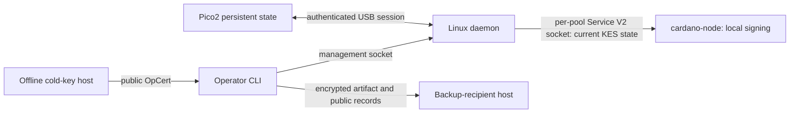

# Pico2 KES Agent

Persistent Cardano KES state on a Raspberry Pi Pico 2, with a Linux daemon and operator CLI. The goal is to retain and recover current operational KES state after **both host and device lose power**, without an ordinary KES signing-key file on the primary host or a surviving RAM-only peer.

One USB-owning daemon supports up to **64 pools**, each with one active and one staged generation and its own KES Service V2 Unix socket. Nodes receive current key material and sign locally.

**Recorded qualification:** [2026-11-01 rc9→rc11 three-pool campaign](evidence/84df698978d37256de1bdf85cec940022d32ceaa-2593f2817f21af96923ca5693f5f776a1bd1d93c63d9c8b50e25249f06cfb92b/qualification-report.md), with [public evidence and future-agent handoff](evidence/84df698978d37256de1bdf85cec940022d32ceaa-2593f2817f21af96923ca5693f5f776a1bd1d93c63d9c8b50e25249f06cfb92b/README.md). Observed inventory/deletion, three negative-boot cases with signed recoveries, device-derived signatures and state-preserving upgrade; **not full security qualification or live-forging proof**. Read the recorded final state and limitations before further device work.

## Contents

- [Purpose and security boundary](#purpose-and-security-boundary)
- [Requirements and compatibility](#requirements-and-compatibility)
- [Install and operate with p2kesup](#install-and-operate-with-p2kesup)
- [Manual RC-to-lifecycle test runbook](docs/manual-testing.md)
- [Developer build and firmware verification](#build-flash-and-install)
- [Commission and configure](#commission-and-configure)
- [Enroll and serve the first generation](#enroll-and-serve-the-first-generation)
- [Connect cardano-node](#connect-cardano-node)
- [Operations and maintenance](#operations-and-maintenance)
- [Offline restoration and failover](#offline-restoration-and-failover)
- [Troubleshooting and references](#troubleshooting-and-references)

## Purpose and security boundary

### Terms

| Term | Meaning |
| --- | --- |
| KES | Key Evolving Signatures: one verification key covers a finite sequence of secret signing states. Later states cannot derive earlier ones. |
| Period evolution | Advance an existing generation to the network's next absolute KES period; no new certificate. Period duration is network-dependent. |
| Generation rotation | Create a new KES series and obtain a new cold-signed certificate before the existing series expires. |
| Operational certificate / OpCert | Cold-key signature authorizing a KES verification key, issuance counter, and absolute start period. |
| Active / staged generation | Active is eligible for delivery; staged is the pending replacement, including a future-start certified generation. |
| Device identity | Persistent device ID and signing public key, pinned together with the application USB serial. |
| Pool incarnation | Unique enrollment lifetime; deleting and re-enrolling a pool creates a different incarnation. |
| Recipient key | Off-primary backup decryption key; only its public part is installed on the device. |
| Receipt | Durable local record of a mutation's operation ID, target, revision, request, and available result; retain it to reconcile uncertainty. |
| A2 / A4 | RP2350 silicon/boot-ROM steppings; unrelated to the Cardano KES Service V2 host protocol. A4 fixes several A2 ROM/OTP issues but retains invasive OTP-extraction limitations. |

### Why persistence?

The original [IntersectMBO KES agent](https://github.com/IntersectMBO/kes-agent) deliberately retains keys in mlocked RAM, evolves autonomously, and can refill a restarted agent from a surviving bootstrap peer, including over SSH-forwarded sockets. It already survives node-only restarts. Its [FAQ](https://github.com/IntersectMBO/kes-agent/blob/master/doc/faq.markdown) and [guide](https://github.com/IntersectMBO/kes-agent/blob/master/doc/guide.markdown) describe these availability and erasure choices.

| Dimension | Original RAM-based agent | Pico2 persistent agent |
| --- | --- | --- |
| Operational state | Agent/node RAM; optional live peers | Encrypted device storage plus daemon/node RAM |
| Node-process restart | Reconnect to agent for current state | Reconnect through per-pool socket with valid context |
| Agent / whole-host restart | Single agent loses RAM key; a running node still evolves/signs until expiry | Device retains operational state across loss of power; restart still requires identity and valid context |
| Recovery peer dependence | A surviving peer can refill the agent; simultaneous loss of all RAM copies requires operator intervention | No surviving RAM peer needed for intact-device recovery |
| Backup tradeoff | Avoid persistent initial signing-state backups; availability can use live peers | Encrypted period-zero artifacts allow offline recovery, but retained recipients/artifacts can reconstruct past states |

These are intentional design tradeoffs.



**Not an HSM or remote signer.** Current KES material reaches daemon and node RAM. An authorized service client can copy it and derive later states. A compromised primary host can steal current keys. Cold signing keys and recipient private keys stay external; the node still holds its VRF secret.

Treat socket-group membership as full trust: management-socket access grants all pool-management authority. There is no PIN or per-pool privilege separation. Trusted host time and chain context remain necessary.

Device encryption and read-verified cleanup do **not** establish resistance to physical extraction, malicious firmware, captured-flash rollback, or invasive remanence analysis. Retained period-zero backups and recipient keys can reconstruct earlier periods. Changing recipients does not revoke old ciphertext. Device erasure, pool deletion, disconnection, and daemon shutdown cannot revoke node or backup copies.

The optional `rp2350-signed-msd-v1` profile uses native ROM secp256k1 signatures, disables ordinary PICOBOOT/debug/alternate execution paths, and retains physical USB mass-storage recovery. It targets straightforward post-lock USB/SWD reads and unsigned firmware substitution, not specialist invasive extraction or fault injection. An application report is diagnosis, not independent attestation; negative boot and recovery observations are required. Locking cannot revoke a previously copied RANDID/wrapping root, flash image or operational state. Treat a pre-extracted/untrusted board as compromised and use a trusted replacement before installing operational secrets.

## Requirements and compatibility

| Execution host | Responsibility |
| --- | --- |
| Linux producer / USB host ("primary") | Runs daemon, management CLI, and producer node; owns the USB device. A relay does not need this device. |
| Offline cold-key host | Keeps cold signing key and issuance counter; signs certificates. Never copy its secret to the primary. |
| Backup-recipient host | Creates/protects the recipient private file and passphrase; performs local restoration. Never copy that private file to the primary. |

Requirements:

- Operator installation targets Debian 12 or Ubuntu 24.04 x86-64 with systemd, udev and glibc 2.36 or newer. These are targets, not a claim of completed release qualification.
- The attended bootstrap reviews missing dependencies and offers installation through the trusted OS apt channel; a functioning polkit authentication agent is needed for privileged changes. It does not install Cardano software. Source builds additionally need Git, a native C compiler/linker, rustup and the pinned tools below.
- Firmware verification and attended provisioning require Python 3, OpenSSL, GPG/GPGV and patched picotool 2.3.1 with signing/verification and libusb support. The authenticated distribution supplies the patched tool and its runtime libraries; do not replace it with stock picotool. Locked-device updates use verified UF2 through physical mass-storage BOOTSEL, not PICOBOOT.
- Pico 2 with the fitted 4-MiB flash profile checked by [firmware/src/flash.rs](firmware/src/flash.rs): JEDEC `ef4016`, SFDP `534644500a0100ff00080117800000ff`, density-minus-one `0x01ffffff`. The shared profile identifies A2/A4; A4 is expected-compatible and hardware-unverified. A2 secure-boot qualification is separate from the existing storage evidence. A3, RP2040, unknown revisions and other flash profiles are not admitted for this profile.
- A `cardano-node` release supporting the standard `--shelley-kes-agent-socket` interface and a matching `cardano-cli`. Obtain these using the [Cardano node installation guide](https://developers.cardano.org/docs/get-started/infrastructure/node/installing-cardano-node/). Check your installed node's help before cutover.
- Trusted matching Byron and Shelley genesis files, the actual Byron-to-Shelley transition epoch, an accurately maintained host UTC clock, and access to the intended USB device.
- The node's ordinary network, topology, database, VRF key, and service configuration remain necessary. Building successfully or connecting a socket does not demonstrate live forging or peer-accepted blocks.

**Clock readiness:** the daemon uses host UTC as the KES period authority, without checking kernel synchronization status or querying the node. Operators must maintain and independently monitor accurate time. An incorrect clock or genesis/transition configuration can irreversibly advance or expire a key; synchronization alone does not establish correct network configuration. The service still prohibits clock-setting calls.

## Install and operate with p2kesup

`p2kesup` is the attended, source-free operator interface. This implementation is development-unqualified; neither these instructions nor an authenticated candidate establish release or hardware acceptance. Use a qualified release when one is actually published.

For a complete ordered RC tag/build, authenticated installation, setup, lifecycle, recovery and whole-system test sequence, start with the [manual testing runbook](docs/manual-testing.md). It names the required host roles, exact commands and stop conditions; it does not claim release qualification.

### Install p2kesup

The launcher itself is trusted from the project's HTTPS-hosted default branch; this initial HTTPS trust is distinct from the pinned OpenPGP authentication of every downloaded distribution payload. If you require independent verification of the launcher before execution, use the separately signed release bootstrap and independently trusted project authority as described in the [maintainer security guide](docs/maintainer-security.md).

```sh
curl -fsSL https://raw.githubusercontent.com/AndrewWestberg/pico2-kes-agent/master/install.sh | sh
```

This selects the latest qualified stable release. To select an explicit RC for reviewed acceptance on a disposable host:

```sh
curl -fsSL https://raw.githubusercontent.com/AndrewWestberg/pico2-kes-agent/master/install.sh | sh -s -- --version v0.1.0-rc.12
```

Use `--role backup` on an isolated backup host, or `--bundle /absolute/path` for an already obtained offline distribution. Explicit candidate tags or bundles require attended disposable-host acceptance and review; they are not qualified releases. The bootstrap reviews proposed dependencies, privileges and installation changes, and installs the persistent command directly after approval, rather than requiring a menu installation. It reads interactive confirmations from `/dev/tty` even when piped and refuses noninteractive mutation. Signature, inventory, inner firmware, compatibility and applicable hardware checks remain mandatory. Offline verification cannot establish current global revocation status or the latest release.

Reopen with `p2kesup`, or `p2kesup --role backup` on the separate backup host, then perform device setup when ready. `--socket PATH` selects the primary management socket and `--bundle DIRECTORY` selects an offline bundle; standalone `p2kesup --help` and `p2kesup --version --json` need no service. Use an attended terminal at least 80×24: arrows or j/k select, Tab changes focus, Enter opens/reviews, Esc cancels, `r` refreshes, `?` opens help, and `q` quits when not applying. Labels remain meaningful with `NO_COLOR=1`.

### Upgrade the installed system

```sh
p2kesup upgrade
```

The command detects the installed primary/backup role, downloads and verifies the latest qualified stable release, and reviews the complete change. For RC testing use `p2kesup upgrade --version v0.1.0-rc.12`; for offline use, `p2kesup upgrade --bundle /absolute/path`.

On a commissioned primary, keep the pinned device connected and allow an attended maintenance window. Firmware changes guide the physical transfer; backup-host upgrades do not touch a device. The daemon is persistently inhibited during transfer and partial publication, including across reboot. Completion requires the selected host binaries, live firmware, retained identity/state and original service state—not just a successful copy.

If interrupted, retain the displayed plan and run `p2kesup upgrade --resume /absolute/original-upgrade-plan.json`. Recovery never reflashes or restores older KES state. A proven cancellation before any transfer restores the old installation; ambiguous transfers remain blocked. Do not manually unmask the service to bypass a pending upgrade.

### Workflow and recovery

- **Overview** and **Pools** distinguish fresh, stale, unavailable and partial observations from healthy or empty inventory. A local USB candidate is not an authenticated device identity. Compare the installed component tuple with actual running manager/daemon evidence; after manager update the old process remains running until **Releases → Explicitly re-exec installed manager**. Neither service status nor a socket proves node delivery or forging.
- **Setup → Install authenticated host bundle** reviews ownership, destinations, packages and proposed service changes. Existing external/manual installations are inspectable but not silently adopted; resolve collisions with their actual owner rather than overwriting them. The protected registry is `/var/lib/p2kesup/installation.json`; components and selected generation live under `/usr/lib/pico2-kes-agent/`. The manager records intent and independently checks installed and running identities. A stopped service stays stopped unless temporary validation is explicitly approved.
- For a factory/BOOTSEL-only board use **Setup → Factory-only firmware install / original record (skip compatible blank app)**, physically select the board and verify its actual mount. Transfer preserves device state and does not commission it. For an already running compatible blank application skip transfer. Review commissioning configuration, start the restricted commissioning service, then **Commission intended blank application**; stop restricted service, review/install normal configuration and pin, and start normal service. New commissioning requires fresh unambiguous compatible blank admission. A pre-existing pin, prior operation or uncertain state is not a factory board.
- **Operations** offers complete inventory/details, enrollment, generation, discard/delete, public verification-key and encrypted-artifact export, certificate and recipient installation, and original receipt inspection/reconciliation. Inputs are public; cold signing remains offline. Confirm exact identities, revisions and destinations; exports do not clobber existing files. After uncertainty retain the original receipt and use **Reconcile an original receipt**, never a new operation ID. For original `device.commission` recovery the restricted authority is selected without requiring a still-blank device or an existing pin; recover the original receipt, not a fresh commission.
- **Releases** reviews authenticated versions, offline cache, attended pinned firmware update and compatible binary fallback. Review a complete authorized tuple, not version numbers alone. Transfer is only a checkpoint: completion requires the same pin and fresh public post-update state comparisons. Keep the original host plan, firmware tool record and bundle/tool identities; use **Inspect original host plan (never replay)** and **Reconcile original firmware update** for interruption. Binary fallback never restores old config, journal or flash. An unchanged active systemd InvocationID is not proof of restart, and pending service jobs block reconciliation.
- **Service** reviews configuration/service actions and redacted diagnostics. Supply explicit public network/genesis inputs; the manager does not discover node configuration or establish forging readiness. The existing host-memory preflight remains mandatory and unchanged, including the literal `cardano-node.service` constraint in normal mode; see [host memory policies](#enforce-host-memory-policies-first). Root handoffs show exact bounded command/action summaries and scope for explicit approval; they are not arbitrary shell execution. Admission is caller-bound and expiring, and the CLI checks the expected daemon PID/UID before sending requests.
- **Device security** is optional, irreversible OTP provisioning, not an ordinary upgrade. Use the authenticated distribution and exact original manager/tool records for preview, separate prepare/enable/lock approvals, admitted pre-OTP resume or read-only permission reconciliation. Eligible blank target, attended physical checks and applicable qualification evidence are required. The bundled tool supports only the default management socket; a nondefault configured socket is refused before service stops or tool handoff. Do not retry an uncertain OTP write or substitute a record; see the detailed [security procedure](#commission-and-configure) and [maintainer guide](docs/maintainer-security.md).
- **Producer hardening** is the narrow exception to no node discovery: supply exact concrete systemd service names for the authenticated memory drop-in, review each file and explicitly approve reload/restart choices. It checks only selected units, never starts a stopped producer, and is not a runtime policy audit. On interruption reopen the original operation and digest; fresh public readback is bound to that record, and any replay of its original reload/try-restart requires explicit reapproval, without expanding scope.
- **Uninstall** removes only explicitly selected, ownership-proven components and approved managed service changes. Export needed artifacts and fence producers first. Original-record recovery uses fresh public readback tied to the original operation and digest; changed/external files block it. Config, pin, accounts, registry provenance and sources, records, journal, device storage and producer drop-ins remain. Full removal can be followed by initial Install restoring the exact prior single-bundle tuple; mixed tuples are not silently reinterpreted. Removal is not secure wipe or revocation.

### Backup host and secrets

Run `p2kesup --role backup` only on an isolated host that has not been a primary; local checks cannot prove its history. **Backup host** offers recipient creation, local restore and public-recipient transfer guidance. Active/configured primary evidence or inaccessible evidence blocks private work. Before private-path forms and again before the child, explicitly approve finite root read-only inspection of local process executables under `/proc` and role evidence; it does not read private paths or contact a daemon, device or node.

The authenticated CLI takes over the foreground terminal with inherited streams for passphrases and private work; the manager does not capture the secret or restored key. Independently verify the public device identity, pool/incarnation/generation and verification key. Restore writes plaintext KES signing material to a new protected path: protect it, fence other producers and remember the original certificate lifetime. Transfer only the public recipient record to the primary; preserve the private recipient and passphrase off-primary for old artifacts. Existing memory protection can refuse backup/restore; do not bypass it.

The remaining CLI examples are detailed operator/reference procedures, not a substitute for manager admission or authenticated release selection.

## Build, flash, and install

### Developer build

**Developer build host — from this checkout's root:** these commands do not install or qualify a release.

```bash
rustup toolchain install 1.99.1 --profile minimal
rustup target add --toolchain 1.99.1 thumbv8m.main-none-eabihf
cargo build --locked --release --bin p2kesup --bin pico2-kes-agentd --bin pico2-kes-agent-cli
cargo build --locked --release -p pico2-kes-firmware --target thumbv8m.main-none-eabihf
```

Outputs:

- `target/release/p2kesup`
- `target/release/pico2-kes-agentd`
- `target/release/pico2-kes-agent-cli`
- `target/thumbv8m.main-none-eabihf/release/pico2-kes-firmware`

All three host executables support standalone `--version` and `--version --json`
without configuration, a daemon connection or a device. JSON identifies
`schema_version`, `component`, `version`, `build_id` and `source_commit`.
Ordinary source builds report `development-unqualified`; `--release` alone
does not establish release identity or qualification. Release builders supply
`P2KES_BUILD_VERSION`, `P2KES_BUILD_ID` and `P2KES_SOURCE_COMMIT` together and
bind those values to authenticated distribution metadata.

The default source firmware build is **unsigned**. `ARM Secure` metadata does not enable signature enforcement. Locked devices require a published project-signed UF2; an unsigned local build cannot run on them. End users need only the release's **public** trust files—never a maintainer's private signing key, GitHub secret or personal GPG private key. Release production and lab procedures are documented separately in the [maintainer guide](docs/maintainer-security.md).

### Install firmware verification tools

The authenticated distribution supplies patched picotool **2.3.1**, signing/verification and USB runtime support. For developer builds use the [pinned build and native boundary check](docs/maintainer-security.md#build-the-pinned-security-tools). The patch fixes short ECDSA component conversion without weakening verification; the unchanged `2.3.1` banner alone is not proof that the patch is present.

The authenticated release includes `pico2-otp-permissions.elf`; end users do **not** build that helper or need the Pico SDK/CMake for the published-bundle provisioning path. It is unsigned preparation-only code, not an update image. Its bundle digest must verify before use; the provisioner binds it to the selected board. Never use stock `picotool otp permissions` for this profile.


### Authenticate a downloaded bundle before executing its verifier

Prefer `python3 -I tools/firmware.py verify --bundle DIR` from an already-trusted checkout. A downloaded verifier cannot establish its own trust by printing success. The checks below use only public certificates, keys and signatures; no GPG private key or passphrase is required.

For independent inspection, use the `firmware/` directory of the complete authenticated distribution, or a separately obtained intact firmware bundle. Set `BUNDLE` to that directory's absolute path, not to the outer distribution root. GitHub source archives are not firmware bundles. The manager verifies both the outer distribution and inner firmware bundle before its handoffs.

The bundle directory must contain **exactly these eleven files at its root**. Do not add logs, notes, source archives, qualification inputs or wrapping subdirectories:

```text
pico2-kes-firmware.signed.elf
pico2-kes-firmware.signed.uf2
pico2-otp-permissions.elf
firmware.py
otp-policy.json
firmware-signing-public.pem
firmware-key.json
firmware-key.json.asc
release-authority.asc
release.json
release.json.sig
```

The following optional independent verification runs trusted local Python/GPGV/OpenSSL only until it has authenticated the downloaded verifier. Run the complete Bash block; any failure means stop:

```bash
(
set -euo pipefail
umask 077
: "${BUNDLE:?Set BUNDLE to the actual absolute bundle directory}"
TRUST="$(mktemp -d)"
trap 'rm -rf -- "$TRUST"' EXIT
python3 -I - "$BUNDLE" <<'PY'
import pathlib, sys
root = pathlib.Path(sys.argv[1])
limits = {"release-authority.asc": 65536, "firmware-key.json": 65536,
          "firmware-key.json.asc": 16384, "firmware-signing-public.pem": 4096,
          "release.json": 1048576, "release.json.sig": 4096, "firmware.py": 1048576}
if not root.is_absolute() or not root.is_dir() or root.is_symlink():
    raise SystemExit("invalid bundle directory")
for name, limit in limits.items():
    path = root / name
    if path.is_symlink() or not path.is_file() or path.stat().st_size > limit:
        raise SystemExit("missing, symlinked or oversized bootstrap input: " + name)
PY
gpg --batch --no-options --dearmor --output "$TRUST/authority.gpg" \
  "$BUNDLE/release-authority.asc"
gpgv --homedir "$TRUST" --keyring "$TRUST/authority.gpg" --status-fd 1 \
  "$BUNDLE/firmware-key.json.asc" "$BUNDLE/firmware-key.json" \
  > "$TRUST/authorization.status"
python3 -I - "$BUNDLE" "$TRUST/authorization.status" <<'PY'
import hashlib, json, pathlib, sys
def require(condition):
    if not condition:
        raise SystemExit("boot-authority authentication failed")
def unique(pairs):
    result = {}
    for key, value in pairs:
        require(key not in result)
        result[key] = value
    return result
bundle, status = pathlib.Path(sys.argv[1]), pathlib.Path(sys.argv[2])
lines = status.read_text().splitlines()
valid = [line.split() for line in lines if line.startswith("[GNUPG:] VALIDSIG ")]
require(len(valid) == 1 and len(valid[0]) == 12)
require(valid[0][2] == "78C0F32094CD02A4BAFA444C684E37A210480F82")
require(valid[0][11] == "9FF957E79B5D853544805F4725491F18087931B6")
require(not any(f"[GNUPG:] {bad}" in line for line in lines
                for bad in ("REVKEYSIG", "EXPKEYSIG", "EXPSIG", "BADSIG", "ERRSIG")))
statement = json.loads((bundle / "firmware-key.json").read_bytes(), object_pairs_hook=unique)
require(set(statement) == {"schema_version", "purpose", "project", "algorithm",
                           "bootkey_slot", "bootkey_sha256", "public_pem_sha256"})
require(type(statement["schema_version"]) is int and statement["schema_version"] == 1)
require(statement["purpose"] == "pico2-kes-firmware-boot-authority-v1")
require(statement["project"] == "https://github.com/AndrewWestberg/pico2-kes-agent")
require(statement["algorithm"] == "secp256k1")
require(type(statement["bootkey_slot"]) is int and statement["bootkey_slot"] == 0)
pem = bundle / "firmware-signing-public.pem"
require(hashlib.sha256(pem.read_bytes()).hexdigest() == statement["public_pem_sha256"])
PY
openssl dgst -sha256 -verify "$BUNDLE/firmware-signing-public.pem" \
  -signature "$BUNDLE/release.json.sig" "$BUNDLE/release.json"
python3 -I - "$BUNDLE" <<'PY'
import hashlib, json, pathlib, sys
def require(condition):
    if not condition:
        raise SystemExit("verifier authentication failed")
def unique(pairs):
    result = {}
    for key, value in pairs:
        require(key not in result)
        result[key] = value
    return result
bundle = pathlib.Path(sys.argv[1])
manifest = json.loads((bundle / "release.json").read_bytes(), object_pairs_hook=unique)
require(type(manifest["schema_version"]) is int and manifest["schema_version"] == 1)
require(manifest["purpose"] == "pico2-kes-firmware-release-v1")
entries = [entry for entry in manifest["artifacts"] if entry["name"] == "firmware.py"]
require(len(entries) == 1)
data = (bundle / "firmware.py").read_bytes()
require(type(entries[0]["size_bytes"]) is int and len(data) == entries[0]["size_bytes"])
require(hashlib.sha256(data).hexdigest() == entries[0]["sha256"])
PY
python3 -I "$BUNDLE/firmware.py" verify --bundle "$BUNDLE"
)
```

Isolated Python (`-I`) prevents downloaded directories or `PYTHONPATH` from supplying shadow modules. Authentication uses explicit failures, not assertions that optimization could remove. GPGV's success alone is insufficient: the pinned fingerprint and PEM/verifier digest checks must pass before downloaded code runs. Complete verification additionally checks the ROM hash, every fixed asset and signed ELF/UF2 write/erase ranges. It contacts neither USB nor the network.

After authentication, check `release.json.tag` and `.commit` against the release/version you intended to install. Verification authenticates these signed values but does not contact GitHub or resolve a tag for you. Keep the last known-good storage-compatible bundle offline.


### Host access and USB inspection

Use **Setup → Install authenticated host bundle** for host installation and review its ownership and service changes. The application udev rule does not cover BOOTSEL; never use world-writable USB rules. Preserve the storage partition: no whole-flash erase, raw-flash clone, format or speculative rollback.

Grant the trusted operator account membership with `sudo usermod -aG pico2-kes-agent "$(id -un)"` after the group exists, then start a new login. This grants management authority, not merely per-pool access.

**Normal-operation host only:** also grant the actual node service account access. Skip this on a commissioning-only workstation:

```bash
NODE_USER=cardano-node   # replace with the actual node service account
sudo usermod -aG pico2-kes-agent "$NODE_USER"
```

Configuration lives under `/etc/pico2-kes-agent`; private daemon state under `/var/lib/pico2-kes-agent`. The zero-pin and empty-network example is not usable normal configuration.

Start a new operator login to acquire group membership. On a normal-operation host, restart the node through your controlled service procedure when ready so it acquires membership too. Membership also grants management authority; it is not restricted to signing one pool.

**Primary — diagnose application-mode USB:**

```bash
lsusb -d 1209:4b45
sudo lsusb -v -d 1209:4b45
# Set this to the CURRENT device node reported by lsusb, not a saved address.
USB_DEVICE=/dev/bus/usb/001/001
udevadm info --query=all --name="$USB_DEVICE"
stat -c '%A %U %G %n' "$USB_DEVICE"
```

The application exposes `1209:4b45` and a 16-character chip-derived serial. Read the serial from the actual intended board's `iSerial`/udev information. Do not copy another workstation's serial, pin, or a BOOTSEL identifier. The rule grants group `pico2-kes-agent` mode `0660`; addresses change after reconnects. The daemon separately authenticates the pinned identity; permissions are not identity authentication.

### Enforce host memory policies first

The installer does not install the supplied node drop-in or policy acknowledgement file. **Commissioning and OTP provisioning may run on a development workstation without Cardano installed.** Their preflight uses `--commission` and checks only the agent service, not `cardano-node.service` or `NODE_MEMORY_POLICY`. Both modes still require no active swap, masked sleep targets, agent core/swap limits, and the snapshot/backup acknowledgements below. Normal operation additionally requires the real, literally named `cardano-node.service`; a dummy unit is not a substitute.

**Normal-operation host only:** use **Producer hardening** to review and install the supplied memory drop-in for the actual `cardano-node.service`, with explicit approval of any restart. Other selected concrete service names do not change the agent preflight's literal `cardano-node.service` requirement.

**Both modes:** before proceeding, disable active swap and its reboot activation, mask `sleep.target`, `suspend.target`, `hibernate.target`, and `hybrid-sleep.target`, and disable system/service core and kernel crash dumps. The supplied agent unit already sets `LimitCORE=0`, `MemorySwapMax=0`, and a 256-MiB memlock limit. On a normal-operation host, also apply the node drop-in via a controlled node restart before allowing it to hold new keys.

Also enforce snapshot policy at the actual host/hypervisor/provider layer: disable RAM-bearing snapshots/live migration, or ensure their encryption keys and recovery access remain off-host. Copying a policy file does not enforce this. Review backup software and administrative access as part of the same boundary.

**Normal-operation host:** only after those conditions are true, create or carefully update `/etc/pico2-kes-agent/host-security.env` with the exact acknowledgements below, owned by root and group `pico2-kes-agent`, mode `0640`. Do not overwrite an existing policy without reviewing it. Then inspect:

```bash
systemctl show pico2-kes-agentd.service cardano-node.service \
  --property=LimitCORE --property=MemorySwapMax
systemctl is-enabled sleep.target suspend.target hibernate.target hybrid-sleep.target
cat /proc/swaps
sudo /usr/libexec/pico2-kes-agent-host-check
```

Exact acknowledgements in `host-security.env`:

| Literal | Operator assertion |
| --- | --- |
| `SNAPSHOT_POLICY=disabled-or-encrypted-off-host` | RAM snapshots are disabled or protected by encryption controlled off-host. |
| `NODE_MEMORY_POLICY=core-and-swap-disabled` | Normal mode only: node memory cannot enter core dumps or swap. |
| `BACKUP_PRIVATE_POLICY=off-primary` | Recipient private material is not on this host. |

For a **commissioning-only workstation**, do not assert a node policy for a nonexistent node. After actually enforcing the shared host policies, create the acknowledgement file only if one does not already exist:

```bash
if ! sudo test -e /etc/pico2-kes-agent/host-security.env; then
  printf '%s\n' \
    'SNAPSHOT_POLICY=disabled-or-encrypted-off-host' \
    'BACKUP_PRIVATE_POLICY=off-primary' \
    | sudo tee /etc/pico2-kes-agent/host-security.env >/dev/null
  sudo chown root:pico2-kes-agent /etc/pico2-kes-agent/host-security.env
  sudo chmod 0640 /etc/pico2-kes-agent/host-security.env
fi
sudo /usr/libexec/pico2-kes-agent-host-check --commission
```

Both preflight modes require no active swap, all four targets masked, and the agent unit reporting `LimitCORE=0` and `MemorySwapMax=0`. Normal mode additionally checks those limits on `cardano-node.service` and requires its policy acknowledgement. Neither mode can verify provider/snapshot promises. The commissioning override below explicitly selects `--commission` for both preflight and daemon; removing it restores the default normal-mode preflight.

Both `masked` (persistent) and `masked-runtime` (until reboot) satisfy the sleep-target checks. Runtime masks must be reapplied after reboot before provisioning; disabling swap manually also does not prevent its reboot activation.

The service keeps `ProcSubset=pid` and `ProtectProc=invisible`. Because that hides `/proc/swaps` inside its sandbox, the unit binds the live host file read-only at `/run/pico2-kes-agent/host-swaps` and directs preflight there. This is not a cached swap-status snapshot or a preflight bypass; do not remove the check or run it outside the service sandbox to work around a startup failure.

## Commission and configure

### Operator workspace and commissioning mode

**Primary — operator, not root:** use a private, owner-controlled directory for receipts, public inputs, and outputs. Never ask the CLI to publish into root-owned `/etc`.

```bash
set -euo pipefail
umask 077
OPS="$HOME/pico2-kes-ops"
install -d -m 0700 "$OPS"
USB_SERIAL=REPLACE_WITH_16_CHAR_SERIAL
```

Replace the serial before proceeding. Save the following complete **commissioning JSON template** as `$OPS/commission.json`, replacing its serial. Unknown fields are rejected; this version-1 configuration intentionally has no installed pin and no pools.

```json
{
  "version": 1,
  "device": {"usb_serial": "REPLACE_SERIAL16"},
  "socket_directory": "/run/pico2-kes-agent",
  "socket_group": "pico2-kes-agent",
  "socket_mode": "0660",
  "management_socket": "/run/pico2-kes-agent/management.sock",
  "state_directory": "/var/lib/pico2-kes-agent",
  "networks": {},
  "pools": []
}
```

Use **Setup → Review/install explicit commissioning configuration** and **Start restricted commissioning service** rather than replacing the service configuration manually. Preserve the existing normal configuration and journal; fence producers before maintenance. The selected serial must be the intended application's 16-character lowercase chip-derived serial, not a BOOTSEL identifier. The restricted commissioning service and provisioner use `/etc/pico2-kes-agent/config.json`; the provisioner has no configuration-path override. Do not run a competing USB owner.

### Optional attended OTP provisioning

This irreversible initial conversion precedes commissioning and is never an update or recovery step. It requires an eligible blank board, exact serial, authenticated distribution and tool, matching host binaries, passing host preflight and applicable hardware/tool/image qualification evidence. A2/A4 are silicon steppings, not KES Service V2 versions; A4 remains physically unverified here. Locking cannot repair extracted secrets. The application must independently report the supported flash profile and fresh blank/uncommissioned state through the sole restricted commissioning service; a BOOTSEL preview alone is not admission.

Use **Device security → Read-only security preview**, then separately review **Prepare one stage**, **Enable one stage** and **Lock one stage**. Follow the foreground tool's physical BOOTSEL, power, service and mount prompts; never script confirmations or start competing USB access. Enable and lock require the restricted commissioning observation service already running. Keep the same serial, authenticated distribution, exact tool/library identity, original manager operation and protected schema-2 tool record. The manager binds the packaged runtime using `--distribution`; stock picotool or a replacement tool is not interchangeable. The provisioner supports only the default management socket, so correct any nondefault configuration before attempting the handoff.

Stop on any error or uncertainty. Preserve the original records and observations; do not erase state, change records, replay OTP or use a new record to force progress. **Reopen original record** is read-only. **Admitted pre-OTP prepare resume** is permitted only for the original narrow pre-OTP checkpoint, with fresh blank evidence and the same inputs; **Read-only permission reconciliation** assesses the original pending permission action without a repair write or automatic advancement. A successful stage is not physical-security qualification. After successful lock, reconnect and commission as a separate action. Further physical details and qualification limits are in the [maintainer guide](docs/maintainer-security.md#attended-otp-evidence-and-uncertainty).

### Commission the blank device

As an ordinary operator use **Setup → Commission intended blank application**. Review the selected board, fresh admission, original receipt and unused public output path before confirming.

Physically trust the selected board and firmware. The record's self-signature is not independent hardware attestation. Archive the public `device.json` and original receipt separately from the machine. Nonblank, corrupt, or already-commissioned storage is not automatically reset.

If the outcome is uncertain, keep the receipt and use [reconciliation](#reconciliation) with an unused `--out` path to recover the public record; do not commission again. The exported record includes `kind`, `device_id`, `identity_public_key`, `identity_fingerprint`, `usb_serial`, protocol/storage versions, and `revision`.

### Normal configuration and trusted context

Create `$OPS/config.json` using the complete **normal-mode JSON template** below. Replace the identity, digest placeholder, network transition count, and paths with your actual values. In `device`, set `id` from the record's `.device_id`, `identity_public_key` from `.identity_public_key`, and `usb_serial` from `.usb_serial`. The zero identity below is not a live device pin.

```json
{
  "version": 1,
  "device": {
    "id": "00000000000000000000000000000000",
    "identity_public_key": "0000000000000000000000000000000000000000000000000000000000000000",
    "usb_serial": "REPLACE_SERIAL16"
  },
  "socket_directory": "/run/pico2-kes-agent",
  "socket_group": "pico2-kes-agent",
  "socket_mode": "0660",
  "management_socket": "/run/pico2-kes-agent/management.sock",
  "state_directory": "/var/lib/pico2-kes-agent",
  "networks": {
    "pool-network": {
      "byron_genesis_file": "/etc/cardano/pool-network/byron-genesis.json",
      "shelley_genesis_file": "/etc/cardano/pool-network/shelley-genesis.json",
      "byron_to_shelley_epochs": 208,
      "genesis_digest": "<SHA-256 of exact Shelley genesis bytes>",
      "max_context_age_ms": 30000
    }
  },
  "pools": []
}
```

The transition count shown is for mainnet; select the actual value for your network. Compute the SHA-256 of the exact Shelley genesis file and replace the placeholder with its hexadecimal output. This is a raw-byte SHA-256 pin, not the Cardano node genesis hash:

```bash
GENESIS=/etc/cardano/pool-network/shelley-genesis.json
sha256sum "$GENESIS"
DEVICE_RECORD="$OPS/device.json"
jq -e '{id: .device_id, identity_public_key: .identity_public_key, usb_serial: .usb_serial}' "$DEVICE_RECORD"
```

Use absolute paths visible inside the service sandbox, not `/home` or `/tmp`. Both genesis files are trusted local inputs, must be readable by the service, and are limited to 16 MiB each. They and the configuration are loaded as immutable snapshots; restart the daemon to load changes. The daemon does not need access to the node query socket. Separately, give the node access to its agent delivery socket and traversal of every parent directory using controlled group/ACL permissions; do not make sockets or directories world writable. Keep operator receipts private.

`byron_to_shelley_epochs` is required even when zero. These are documented examples, not daemon defaults:

| Network | `byron_to_shelley_epochs` |
|---|---:|
| Mainnet | 208 |
| Preprod | 4 |
| Preview | 0 |
| Guild | 2 |

Verify the actual transition and matching genesis files for your network rather than relying on magic alone. The daemon checks Byron `protocolConsts.protocolMagic` against Shelley `networkMagic` and derives binding magic, `slotsPerKESPeriod`, and `maxKESEvolutions` from Shelley genesis.

For Byron `startTime` in Unix seconds, `k`, and `slotDuration` in milliseconds, the transition slot is `B = byron_to_shelley_epochs * 10 * k` and its Unix microsecond time is `T = startTime * 1_000_000 + B * slotDuration * 1_000`. At or after `T`, the absolute slot is `B + (now_us - T) / shelley_slot_length_us` using integer division, and the absolute KES period is `absolute_slot / slotsPerKESPeriod`. Before `T`, KES context is unavailable. The origin is Byron `startTime`, not Shelley `systemStart`. This model assumes a constant Shelley slot duration through later eras; a network with a later slot-duration change requires a timing-model update.

`max_context_age_ms` sets the device lease, not a tip-age threshold. Values from 1000 through 30999 are accepted and truncated to whole seconds, producing a 1–30-second lease. The daemon samples time for each context and wakes for the next KES boundary or transition, half the encoded lease, or five seconds, whichever comes first. OS scheduling, USB work, and contention can add latency; delivery is not hard real-time.

**Migrating an existing configuration:** rename `genesis_file` to `shelley_genesis_file`, add `byron_genesis_file` and the required `byron_to_shelley_epochs`, and retain the existing Shelley digest and lease. Remove `cardano_cli`, `node_socket`, `query_timeout_ms`, `era_history`, `mainnet`, `network_magic`, `slots_per_kes_period`, and `kes_lifetime`; strict validation rejects these obsolete fields. If the existing enrollment used the same Shelley bytes and the same genesis-derived binding values, its binding is unchanged: no device reset, certificate rewrite, or re-enrollment is needed. Different bytes or binding values fail closed on mismatch. Investigate the original trusted configuration; never automatically lower durable period floors, reset the device, delete or re-enroll pools, or rewrite certificates to bypass a mismatch.

Normal `pools` may initially be empty for management-only setup. Management enrollment and the durable public journal reconstruct socket bindings; **preserve the journal**. Context polling uses the explicit `pools` bindings loaded at startup, so configure each intended delivery pool and restart before expecting readiness. Default enrollment creates `<pool-id>.sock` directly under `socket_directory`; use that returned path or choose a custom socket name. A binding has this shape (replace IDs with returned values and insert into `pools`):

```json
{
  "pool_id": "00000000000000000000000000000000000000000000000000000000",
  "incarnation_id": "00000000000000000000000000000000",
  "socket_path": "/run/pico2-kes-agent/custom-pool.sock",
  "network": "pool-network"
}
```

Registry reconstruction replays journal enrollment/deletion receipts before applying configuration. A custom socket path applies only to the matching live incarnation and network; stale configuration cannot resurrect a deleted pool or retarget a new enrollment. The daemon serves that configured path without creating an additional default `<pool-id>.sock` endpoint.

### Switch to normal mode

**Primary — administrative setup:** stop commissioning, install the reviewed normal configuration, remove **only** the dedicated runtime override, and check as the service UID. Do not use `systemctl revert`, which could erase unrelated operator overrides. Runtime/state directories must already exist and belong to that UID; systemd's runtime directory may disappear when the service stops, so create it before a manual check.

Shutdown removes only daemon-owned sockets, then explicitly releases the runtime-directory lock; a helper's inherited descriptor must not prevent a replacement daemon from starting.

```bash
sudo systemctl stop pico2-kes-agentd
sudo install -o root -g pico2-kes-agent -m 0640 "$OPS/config.json" /etc/pico2-kes-agent/config.json
sudo rm /run/systemd/system/pico2-kes-agentd.service.d/commission.conf
sudo systemctl daemon-reload
sudo install -d -o pico2-kes-agent -g pico2-kes-agent -m 0750 /run/pico2-kes-agent
sudo install -d -o pico2-kes-agent -g pico2-kes-agent -m 0700 /var/lib/pico2-kes-agent
sudo -u pico2-kes-agent /usr/bin/pico2-kes-agentd \
  --check-config --config /etc/pico2-kes-agent/config.json
sudo systemctl start pico2-kes-agentd
systemctl status pico2-kes-agentd
pico2-kes-agent-cli --json status
```

Device `ready` with no pools proves neither valid period context, key delivery, nor block production.

## Enroll and serve the first generation

### Shell and file conventions

All following primary commands run as the operator in a Bash session with `set -euo pipefail` and `umask 077`, using the private `OPS` directory above. Global `--socket` and `--json` precede command words. The default management socket is `/run/pico2-kes-agent/management.sock`; override it only with `pico2-kes-agent-cli --socket "$MANAGEMENT_SOCKET" --json ...` after defining that path.

Every mutation needs a **new, unique receipt file**; the example filenames below are for a first run only. `--operation-id` is optional; the CLI generates one. Capture successful JSON before extracting with `jq -e`; do not pipe a mutation into `jq`, hide its exit, or continue after nonzero exit. In an interactive shell, stop the sequence explicitly on any failure; do not rely solely on shell options in conditional contexts.

Refresh `.result.revision` from device `status` immediately before `recipient set` and `pool enroll`, and from `pool status --pool "$POOL"` before generation/certificate/discard/delete mutations. Concurrent operations can still cause `revision_conflict`: that is a rejection, unlike an uncertain submitted operation, which needs reconciliation with its original receipt.

File inputs and immediate parents must be owned by the invoking operator and not group/world writable. Copy transferred public files into the private workspace as that operator. Outputs are owner-only and no-clobber. A missing output after a successful mutation is not permission to repeat the mutation.

### 1. Create a backup recipient off-primary

**Backup-recipient host:** install the host CLI there, create a private directory, and retain the private file and passphrase securely.

```bash
set -euo pipefail
umask 077
BACKUP_OPS="$HOME/pico2-kes-backup"
install -d -m 0700 "$BACKUP_OPS"
RECIPIENT_KEY="$BACKUP_OPS/recipient.private"
RECIPIENT_PUBLIC="$BACKUP_OPS/recipient.public.json"
pico2-kes-agent-cli recipient create --out "$RECIPIENT_KEY" --public-out "$RECIPIENT_PUBLIC"
```

Terminal prompts handle passphrases. Recipient creation and restoration require swap disabled on the backup host and disable process dumps before the first prompt; unreadable swap status or failed memory protection stops the command. Keep swap disabled throughout secret processing. There is no argv/environment passphrase option. Transfer **only the public JSON** to the primary's `$OPS/recipient.public.json`.

### 2. Install the public recipient

**Primary:**

```bash
RECIPIENT_PUBLIC="$OPS/recipient.public.json"
DEVICE_STATUS=$(pico2-kes-agent-cli --json status)
DEVICE_REV=$(jq -er '.result.revision' <<<"$DEVICE_STATUS")
RECIPIENT_RESULT=$(pico2-kes-agent-cli --json recipient set --public-key "$RECIPIENT_PUBLIC" \
  --expected-revision "$DEVICE_REV" --receipt "$OPS/recipient-set.receipt.json")
printf '%s\n' "$RECIPIENT_RESULT"
```

### 3. Enroll the pool

Transfer the public cold verification key from the cold host to `$OPS/cold.vkey`; the cold signing key never follows it. Standard Cardano public cold-vkey envelopes are suitable. The generic public input reader does not validate arbitrary envelope type metadata; device certificate validation is the authority.

**Primary:**

```bash
NETWORK=pool-network
COLD_VKEY="$OPS/cold.vkey"
DEVICE_STATUS=$(pico2-kes-agent-cli --json status)
DEVICE_REV=$(jq -er '.result.revision' <<<"$DEVICE_STATUS")
ENROLL_RESULT=$(pico2-kes-agent-cli --json pool enroll --cold-vkey "$COLD_VKEY" --network "$NETWORK" \
  --expected-revision "$DEVICE_REV" --receipt "$OPS/enroll.receipt.json")
POOL=$(jq -er '.result.pool_id' <<<"$ENROLL_RESULT")
INCARNATION=$(jq -er '.result.incarnation_id' <<<"$ENROLL_RESULT")
pico2-kes-agent-cli --json pool status --pool "$POOL"
pico2-kes-agent-cli --json pool list --page-size 16
```

`POOL` is 56 lowercase hexadecimal characters, not Bech32 `pool1...`. Device, incarnation, and generation IDs are 32 hex characters. Save returned IDs with your records. Obtain `POOL_SOCKET` from the matching pool's returned list entry `socket_path`; follow pagination when necessary, rather than substituting the management socket.

Before key delivery, add the returned binding to the normal configuration as described [above](#normal-configuration-and-trusted-context), validate it, and restart the daemon. Enrollment alone does not add a running context poller.

### 4. Generate a staged key

**Primary:**

```bash
POOL_STATUS=$(pico2-kes-agent-cli --json pool status --pool "$POOL")
POOL_REV=$(jq -er '.result.revision' <<<"$POOL_STATUS")
GENERATE_RESULT=$(pico2-kes-agent-cli --json key generate --pool "$POOL" --incarnation "$INCARNATION" \
  --expected-revision "$POOL_REV" --receipt "$OPS/generate.receipt.json")
GENERATION=$(jq -er '.result.generation_id' <<<"$GENERATE_RESULT")
```

Generation already commits the encrypted artifact and activation intent. There is no later backup-approval gate.

### 5. Retrieve verification key and encrypted backup

**Primary:**

```bash
KES_VKEY="$OPS/first-kes.vkey"
ARTIFACT="$OPS/first-kes.backup"
pico2-kes-agent-cli key verification-key --pool "$POOL" --incarnation "$INCARNATION" \
  --generation "$GENERATION" --out "$KES_VKEY"
pico2-kes-agent-cli key export --pool "$POOL" --incarnation "$INCARNATION" \
  --generation "$GENERATION" --out "$ARTIFACT"
```

The vkey uses the `KesVerificationKey_ed25519_kes_2^6` envelope. Export is read-only ciphertext, **not a signing-key file**. Retrieve it before replacement, expiry, discard, or pool deletion retires device-side retrieval. Archive it and the [restore bundle](#offline-restoration-and-failover) off-primary before certificate installation. Read-only exports may be repeated to fresh paths.

### 6. Issue the certificate offline

Determine and verify the **absolute** start KES period from the actual network's current slot and trusted `slotsPerKESPeriod`: integer division `current_slot / slotsPerKESPeriod` gives the current absolute period. Choose the intended valid start with enough commissioning time, not a wall-clock guess or a relative evolution number. Transfer the vkey and independently checked period information to the cold host.

**Offline cold-key host:** set paths to your existing protected key/counter, choose `ERA` supported by the installed matching CLI and network, and set `START_PERIOD` to the verified absolute value before running:

```bash
set -euo pipefail
umask 077
COLD_OPS="$HOME/pool-cold"
KES_VKEY="$COLD_OPS/first-kes.vkey"
COLD_SKEY="$COLD_OPS/cold.skey"
COUNTER="$COLD_OPS/cold.counter"
OPCERT="$COLD_OPS/first.opcert"
ERA=conway             # select for your installed CLI/network
: "${START_PERIOD:?Set the independently verified absolute start period}"
cardano-cli "$ERA" node issue-op-cert --kes-verification-key-file "$KES_VKEY" \
  --cold-signing-key-file "$COLD_SKEY" --operational-certificate-issue-counter-file "$COUNTER" \
  --kes-period "$START_PERIOD" --out-file "$OPCERT"
```

Preserve the updated issuance counter. Never reset it or repeatedly issue certificates to fix a transport timeout. Transfer only the certificate back to the primary's workspace, and include it in the off-primary backup bundle.

### 7. Install the certificate

**Primary:**

```bash
OPCERT="$OPS/first.opcert"
POOL_STATUS=$(pico2-kes-agent-cli --json pool status --pool "$POOL")
POOL_REV=$(jq -er '.result.revision' <<<"$POOL_STATUS")
CERTIFICATE_RESULT=$(pico2-kes-agent-cli --json certificate install --pool "$POOL" \
  --incarnation "$INCARNATION" --generation "$GENERATION" --certificate "$OPCERT" \
  --expected-revision "$POOL_REV" --receipt "$OPS/certificate.receipt.json")
printf '%s\n' "$CERTIFICATE_RESULT"
pico2-kes-agent-cli --json pool status --pool "$POOL"
```

A valid future-start certificate is retained without key delivery, including for the first generation when context has already arrived. A currently valid eligible generation activates automatically after valid context and required cleanup. There is no activation command or backup-approval command. Inspect pool status and actual node consumption rather than treating certificate-command success as proof of forging.

## Connect cardano-node

**Primary — singleton producer example:** retain your normal config/topology/database/node-socket arguments. Set these paths for your deployment; get `POOL_SOCKET` from the matching returned `pool list` entry, not a receipt filename.

```bash
NODE_CONFIG=/etc/cardano/config.json
TOPOLOGY=/etc/cardano/topology.json
DATABASE=/var/lib/cardano-node/db
NODE_SOCKET=/run/cardano-node/node.socket
VRF_SKEY=/etc/cardano/vrf.skey
: "${POOL_SOCKET:?Set the socket_path returned for this pool}"
cardano-node run --config "$NODE_CONFIG" --topology "$TOPOLOGY" \
  --database-path "$DATABASE" --socket-path "$NODE_SOCKET" \
  --shelley-kes-agent-socket "$POOL_SOCKET" \
  --shelley-operational-certificate "$OPCERT" --shelley-vrf-key "$VRF_SKEY"
```

Replace the old `--shelley-kes-key` source; do not pass both sources. For a systemd producer, put the arguments and an accessible public startup-certificate path in its existing configuration, not the operator's protected home directory. Keep the cold key and recipient private key off this host.

Migration from a signing-key file or the original agent uses a **fresh device generation and new certificate**, not plaintext import. Keep the existing producer until the replacement is ready, then fence/stop it before enabling replacement forging. Avoid dual forging.

Ordinary evolution and generation rotation require neither node restart nor SIGHUP. Keep the node's startup certificate file current for future restarts. A change to startup configuration requires a controlled restart using your normal node-service procedure. A running node may retain already delivered state and evolve/sign independently; stopping the agent alone is not revocation.

Each pool permits two node subscriptions. Idle connections are checked for peer disconnection every 100 ms, subject to host scheduling, so closed clients release their slots without waiting for a new key publication. Healthy idle connections remain open.

### One daemon, multiple pools and node processes

One `pico2-kes-agentd` process owns the USB device. Each configured pool has its own Service V2 Unix socket and listener thread inside that daemon, not another daemon process. Node-process count is independent: singleton producers can share the daemon, or one compatible node can consume several pool sockets.

The local node checkout at `/home/westbam/haskell/cardano-node` supports version-1 bulk agent credentials. This is not a claim about an arbitrary released or PATH-installed node. Build and resolve its binary from that checkout with `cabal build exe:cardano-node` and `cabal list-bin exe:cardano-node`, preserving its configured dependency pins and local changes.

A bulk file is a JSON array. Each agent entry contains `version: 1`, `operationalCertificate` and `vrfSigningKey` as **embedded text-envelope objects**, and `kesSource: {"type":"kes-agent","socketPath":"/absolute/path/to/pool.sock"}`. Optional `blsSigningKeys` defaults to `[]`. Use each pool's actual certificate, VRF key and distinct socket; the envelope fields are not filenames. Existing legacy/file-key entries remain supported. Relative sockets resolve against the bulk file's directory, but use absolute paths in deployments. Protect the bulk file as a secret because it contains VRF private keys; never copy it into public evidence.

For bulk-only operation, retain normal config/topology/database/node-socket arguments, pass `--shelley-bulk-credentials /absolute/path/bulk.json`, and omit singleton credential arguments. The loader concatenates singleton and bulk credentials; supplying the same pool in both duplicates it. Never run both deployment configurations for the same pool during cutover.

At scheduled generation cutover, update the relevant embedded `operationalCertificate` for future restarts, preserving other pools and VRF keys. Singleton deployments instead update their startup certificate file. Keep cold signing keys and the authoritative issuance counters external in either topology; device-local counters do not replace cold-host or ledger counter discipline.

The local project's selected consensus pin is `a337d69f4946d5a1b20ecaaeae635dd47822e3d2`, not the sibling consensus checkout. It creates a separate agent client/hot key per credential, but does not include the sibling client's expected-cold-key/counter validation gate. Agent/device certificate validation and exact socket-to-pool mapping remain required. Loader tests and source support do not qualify live multi-pool forging; the three-pool device lab starts no producing nodes.

## Operations and maintenance

### Command reference

These are all implemented CLI commands; global options are `--socket PATH` and `--json`. The CLI provides top-level help, not detailed subcommand help. Mutating service commands accept optional `--operation-id` alongside the target/revision/receipt flags shown in their walkthroughs.

| Command | Complete walkthrough |
| --- | --- |
| `status` | [Routine inspection](#routine-inspection) |
| `device commission` | [Commissioning](#operator-workspace-and-commissioning-mode) |
| `device security` | Read-only public OTP/flash/debug report, available in commissioning and normal modes; no command-specific flags |
| `device inventory` | Complete read-only device pool membership in normal mode; no command-specific flags |
| `pool list`, `pool status` | [Routine inspection](#routine-inspection) |
| `pool enroll` | [Enrollment](#3-enroll-the-pool) |
| `pool delete` | [Pool removal](#pool-removal-and-re-enrollment) |
| `key generate` | [Generation](#4-generate-a-staged-key) |
| `key verification-key`, `key export` | [Public key and backup](#5-retrieve-verification-key-and-encrypted-backup) |
| `key discard` | [Staged cancellation](#staged-slot-and-cancellation) |
| `certificate install` | [Certificate installation](#7-install-the-certificate) |
| `recipient create`, `recipient set` | [Recipient creation](#1-create-a-backup-recipient-off-primary), [installation](#2-install-the-public-recipient), [rotation](#recipient-rotation) |
| `operation reconcile` | [Reconciliation](#reconciliation) |
| `restore` | [Offline restoration](#offline-restoration-and-failover) |

### Routine inspection

**Primary — operator:**

```bash
pico2-kes-agent-cli status
pico2-kes-agent-cli --json device inventory
pico2-kes-agent-cli --json pool status --pool "$POOL"
CURSOR=
while :; do
  if [[ -n "$CURSOR" ]]; then
    PAGE=$(pico2-kes-agent-cli --json pool list --page-size 16 --cursor "$CURSOR")
  else
    PAGE=$(pico2-kes-agent-cli --json pool list --page-size 16)
  fi
  jq -e '.result.pools' <<<"$PAGE"
  CURSOR=$(jq -r '.result.cursor // empty' <<<"$PAGE")
  [[ -n "$CURSOR" ]] || break
done
systemctl status pico2-kes-agentd
sudo journalctl -u pico2-kes-agentd --since '1 hour ago' --no-pager
```

Follow the returned cursor until absent/null. Inspect device identity, pool incarnation, active/staged state, validity and context, then check node logs/operational metrics for actual consumption and forging. Do not dump secret USB/socket traffic into logs or support bundles.

`device inventory` reads every occupied device slot's authenticated pool metadata in one bounded response (up to 64 pools), including pools absent from host config/journal. Its result contains `device_id`, device `revision`, and `pools` entries with `pool_id`, `incarnation_id` and pool `revision`, in storage-slot order. It does not create sockets, schedule context, change journal/flash, or require readable KES public objects. `pool list` remains the paginated host binding/socket view, not authoritative device membership.

Unsupported older firmware, disconnection, pending mutation handoff or invalid occupied metadata is an error, never an empty inventory. To establish that all pools were removed, require a successful authenticated inventory with `pools: []`; a blank host list is insufficient. Use each exact target and fresh revision for deliberate normal pool deletion, preserving receipts and reconciling uncertainty. Do not substitute a state erase.

### Evolution, rotation, and expiry

Period evolution is automatic under trustworthy context; it does not issue a new certificate. Plan generation rotation before expiry. Repeat [generation through certificate installation](#4-generate-a-staged-key) with **new output and receipt names**. Export before installing the certificate, retain the active generation until replacement validity, and update the node's startup certificate file for future restarts. There is no additional backup-readiness gate.

Replenishment reuses the retired generation's public-object region, leaving the active generation's public tree and encrypted backup intact across repeated rotations and reboot. This allocation correction prevents new overwrites; it cannot restore an object already overwritten by affected firmware. Verification covers the software NOR fault model and CLI exports, not physical flash qualification or repair of an already-damaged pool.

On expiry or outage, first restore legitimate context and inspect pool state. If the generation is expired, create/certify a replacement. Do not roll back the clock/period or expect an expired signing key to become useful again.

### Staged slot and cancellation

There is only one staged slot per pool. Before destructive cancellation, export/copy any needed artifact and public records: discard ends retrieval on the device but does not revoke external copies. Confirm the exact staged generation from fresh status; do not assume the old shell variable still names it.

**Primary — deliberate cancellation:**

```bash
: "${GENERATION:?Set the exact staged generation to discard}"
POOL_STATUS=$(pico2-kes-agent-cli --json pool status --pool "$POOL")
POOL_REV=$(jq -er '.result.revision' <<<"$POOL_STATUS")
DISCARD_RESULT=$(pico2-kes-agent-cli --json key discard --pool "$POOL" --incarnation "$INCARNATION" \
  --generation "$GENERATION" --expected-revision "$POOL_REV" --receipt "$OPS/discard.receipt.json")
printf '%s\n' "$DISCARD_RESULT"
```

Type `yes` at the interactive confirmation, or append `--yes` only for deliberate automation. A late discard can return `target_not_staged` after activation; refresh status, do not target a different generation as a retry.

### Recipient rotation

Create a new recipient on the backup host using new paths, transfer only its public JSON, and repeat [recipient installation](#2-install-the-public-recipient) with a **fresh device revision and new receipt**. It affects only future generations, not existing artifacts. Keep old private files/passphrases while their artifacts are needed. A lost recipient/passphrase cannot decrypt old ciphertext; a fresh recipient and generation can protect future backups but cannot repair that loss.

### Reconciliation

After timeout, uncertain/pending status, or a lost response, retain the original receipt, operation ID, target, revision, and digest. Do not submit a new operation merely because the result is unknown.

Reconciliation works even when the original CLI response was lost: the daemon matches the saved operation ID, action, arguments and expected revision against its journal. A completed exact retry returns the original durable result without another device mutation; a pending exact retry resumes reconciliation. Reusing the operation ID with changed inputs is rejected as `operation_conflict`.

A device missing at the initial admission check is rejected without creating a pending journal entry. Once the request is journaled, a transport failure remains uncertain. After reconnect, an unknown or Pending device receipt causes recovery to resume the saved request with its original sequence and digest; committed effects are recovered rather than repeated. New context updates wait while a mutation is Pending. Preserve the same receipt and configuration through recovery.

After an uncertain device storage or receipt-persistence failure, firmware refuses further requests until a device power-cycle reloads durable state. Reconnecting USB without restarting firmware is insufficient. Preserve the original receipt and reconcile after restart; a storage error is not proof that the mutation was rejected.

**Primary — same original receipt:**

```bash
RECEIPT="$OPS/generate.receipt.json"  # choose the original uncertain operation
pico2-kes-agent-cli operation reconcile --receipt "$RECEIPT"
```

For commissioning-output recovery only, choose the commissioning receipt and a fresh output path:

```bash
RECEIPT="$OPS/commission.receipt.json"
pico2-kes-agent-cli operation reconcile --receipt "$RECEIPT" --out "$OPS/device-recovered.json"
```

A local output failure after device success still needs reconciliation, not another mutation. Failed stdout writes or flushes return exit code `7` without undoing the operation or deleting its receipt. Read-only vkey/artifact exports can instead be repeated to fresh paths. Busy/recovering operations may require waiting for recovery before reconciling the same receipt.

### Host restart and device reconnect

Preserve pin/config/public journal and use the installed service. After restart/reconnect, check the **same** identity and each pool's readiness using [routine inspection](#routine-inspection). A running node may continue with its already received state; a reconnecting node requires fresh valid context. Disconnect is not revocation.

### Host software upgrade

Use the [one-command upgrade procedure](#upgrade-the-installed-system). Preserve `/etc/pico2-kes-agent`, `/var/lib/pico2-kes-agent`, operator receipts and public identity; make offline copies after clean shutdown, preserving permissions. Do not restore an older journal or flash image to force rollback. There is no daemon configuration hot reload; check the applied service and pool readiness separately.

### Firmware upgrade

**Normal update or application-failure recovery — not provisioning:** use **Releases → Review attended pinned firmware update** with the authenticated complete distribution; retain a last known-good compatible signed bundle offline. The verified UF2 writes/erases only firmware `[0x10000000, 0x10100000)`; preserve all state `[0x10100000, 0x10308000)`, including configuration, pool and handoff sectors. The signed ELF and unsigned permission helper are not the update file.

Before planned maintenance, retain **public** identity, recipient-policy/installation records, pool/incarnation/generation bindings, active/staged verification keys and certificates, floors and comparison outcomes. Never save current secret KES bytes or their hashes as a maintenance record. Preserve normal configuration, pin and journal. Stop/fence producers as appropriate, stop the daemon, and physically hold BOOTSEL while reconnecting the one intended board.

The attended tool verifies the actual selected BOOTSEL mount and copies the complete authenticated UF2. Never guess a mount or treat a local file copy alone as successful installation. A copy/flush error, vanished mount, interruption or missing post-check is uncertain: retain and reopen the original host and tool records through **Reconcile original firmware update**. Do not create a new operation to retry, erase state, program OTP, change the pin or recommission. Restore the service and establish fresh context only as the reviewed recovery permits.

Check that the same pinned identity and recipient configuration remain, and compare every pool/incarnation/generation, active and staged verification key and certificate binding, period floor, and usable current KES state with the pre-update observations. At the same valid period, current KES state must be retained; when context later advances normally to the staged generation's start period, that same staged generation must become usable with its original bindings. Normal evolution, activation and expiry are distinct from update-induced loss. If a key, identity, floor or binding is missing or changed, stop and preserve diagnostics; do not make the comparison pass by resetting or replacing state.

Do not move real network periods backward or freeze live context to force byte equality: an update may span legitimate evolution/activation/expiry. Establish fresh context/session after reboot and distinguish those transitions from loss. Status/security alone do not expose every retained value; retain the original public certificate and recipient records. Lab preservation tests are maintainer procedures, not a required end-user upgrade step.

Any compatible project-signed release can boot: there is no automatic irreversible firmware anti-rollback. A downgrade is supported only when its storage format and interpretation are compatible. This release retains storage version 2 and the existing wrapping-root derivation and record bindings; preserved bytes alone would not suffice if those changed. Incompatible or corrupt state must fail closed without formatting or discarding generations. Restore the last known-good compatible signed UF2 to regain access; a future format change requires a separately designed key-preserving migration.

For interruption or failure to boot, preserve the original operation and diagnose through its recovery path; never repeat OTP provisioning or assume automatic reflash. Recovery is limited by the actual supported images and qualified interruption evidence. A2 erratum E22 can hang BOOTSEL on malformed metadata: arbitrary corruption or malicious images, OTP errors, damaged hardware, and a lost signing authority are not guaranteed recoverable. ROM signature enforcement rejects execution of an unauthorized image; it does not promise that the mass-storage interface refuses to write its bytes.

### Device loss or replacement

Either perform controlled [file-based failover](#offline-restoration-and-failover) from an existing artifact, or commission a new blank device and issue fresh pool generations/certificates. Restore does not import a key into a Pico2. Do not re-pin an unexpected replacement to conceal an identity failure. Fence existing producers and treat old device/node/backup copies as still capable within their certificate validity.

### Pool removal and re-enrollment

Export required artifacts and archive public records **before** deletion. Remove/fence the node's corresponding credential source first or alongside maintenance; deletion does not stop a node that already has keys. It removes all that pool's device-side keys/artifacts, not external copies.

If only a pool's public KES objects are damaged, `pool status` can still report its authenticated pool/incarnation, revision and publication with `storage_failure` health and no active/staged details. The same deletion command works when the committed metadata of all enrolled pools authenticates unambiguously; it does not require readable objects that will be destroyed. Key delivery, export and other pool mutations remain blocked for the damaged pool. Unauthenticated or conflicting snapshots still prevent deletion: do not substitute a state erase or recommissioning.

**Primary — deliberate deletion:**

```bash
POOL_STATUS=$(pico2-kes-agent-cli --json pool status --pool "$POOL")
POOL_REV=$(jq -er '.result.revision' <<<"$POOL_STATUS")
DELETE_RESULT=$(pico2-kes-agent-cli --json pool delete --pool "$POOL" --incarnation "$INCARNATION" \
  --expected-revision "$POOL_REV" --receipt "$OPS/delete.receipt.json")
printf '%s\n' "$DELETE_RESULT"
```

Interactive confirmation requires `yes`; append `--yes` only for deliberate automation. Preserve receipts. Re-enrollment creates a new incarnation and needs fresh generations/certificates. Update the configured binding to the new incarnation and restart before expecting delivery.

### Decommission and uninstall

Intentionally export needed artifacts, stop/fence producers and deliberately delete chosen pools if required. Use **Uninstall** to review selected ownership-proven components and retain the original removal record for recovery. Configuration, state, accounts, registry provenance, records, device storage and producer drop-ins remain. This is not secure wiping or revocation; there is no supported device-wide reset/format command.

### Journal capacity or corruption

Preserve the public journal under `/var/lib/pico2-kes-agent`; it reconstructs management outcomes and pool bindings. The daemon syncs the journal's parent directory before admitting mutations and syncs each appended record before advancing the handoff. Admission has a **64-MiB bound**, with no documented compaction CLI. Do not delete/truncate it to clear an error. Stop mutations, preserve diagnostics and cleanly stopped copies, and obtain a reviewed recovery procedure.

After a journal write or sync error, further appends are blocked until the daemon restarts and validates the journal. Correct the host I/O problem first; reopening repairs only an incomplete final record and fails closed on complete corruption.

## Offline restoration and failover

Preserve a bundle containing:

- Encrypted artifact and matching recipient private file (protected off-primary).
- Independently trusted public device identity record; never infer the trusted identity from the artifact itself.
- Original exported KES verification-key envelope and matching OpCert.
- Device, pool, incarnation, and generation IDs, plus useful public receipts and certificate validity information.

**Backup-recipient host — local only:** disable swap and keep it disabled for restoration; set the IDs to the archived exact values before running. No daemon or connected device is needed.

```bash
set -euo pipefail
umask 077
BACKUP_OPS="$HOME/pico2-kes-backup"
ARTIFACT="$BACKUP_OPS/first-kes.backup"
RECIPIENT_KEY="$BACKUP_OPS/recipient.private"
DEVICE_RECORD="$BACKUP_OPS/device.json"
KES_VKEY="$BACKUP_OPS/first-kes.vkey"
OPCERT="$BACKUP_OPS/first.opcert"
RESTORED_SKEY="$BACKUP_OPS/restored-kes.skey"
DEVICE_ID=$(jq -er '.device_id' "$DEVICE_RECORD")
: "${POOL:?Set archived pool ID}"
: "${INCARNATION:?Set archived incarnation ID}"
: "${GENERATION:?Set archived generation ID}"
pico2-kes-agent-cli restore --artifact "$ARTIFACT" --recipient-key "$RECIPIENT_KEY" \
  --device-identity "$DEVICE_RECORD" --device "$DEVICE_ID" --pool "$POOL" \
  --incarnation "$INCARNATION" --generation "$GENERATION" \
  --verification-key "$KES_VKEY" --out "$RESTORED_SKEY"
```

The command prompts for the passphrase, verifies bindings/signature/recipient, and publishes a mode-0600 no-clobber conventional `KesSigningKey_ed25519_kes_2^6` file. Wrong recipient, tampering, identity mismatch, or output collision does not publish a replacement key. Keep the original public vkey envelope: restore's strict parser does not accept a raw hex file.

**Fence/stop the primary before backup forging.** There is no distributed fencing or automatic failback. Check certificate validity; restoring period zero cannot extend certificate lifetime. Plaintext now intentionally exists on the backup host, with the usual limitations of storage erasure.

**Backup producer — manual file-based node configuration:** use its ordinary config/topology/database/socket paths and matching VRF/certificate. Do not also supply an agent socket.

```bash
NODE_CONFIG=/etc/cardano/config.json
TOPOLOGY=/etc/cardano/topology.json
DATABASE=/var/lib/cardano-node/db
NODE_SOCKET=/run/cardano-node/node.socket
VRF_SKEY=/etc/cardano/vrf.skey
cardano-node run --config "$NODE_CONFIG" --topology "$TOPOLOGY" \
  --database-path "$DATABASE" --socket-path "$NODE_SOCKET" \
  --shelley-kes-key "$RESTORED_SKEY" \
  --shelley-operational-certificate "$OPCERT" --shelley-vrf-key "$VRF_SKEY"
```

For a managed service, securely stage the restored key at a service-readable location with owner-only access and use its normal controlled startup procedure, rather than weakening the backup workspace's permissions.

## Troubleshooting and references

Read-only diagnosis first. No blanket chmod, journal deletion, pin reset, reformat, artificial time markers, or default destructive retries.

| Symptom | Action |
| --- | --- |
| Missing socket / service preflight failure | Inspect `systemctl status` and journal; verify policy file, actual no-swap policy, four masked targets and both units' memory limits. |
| Permission / new membership / sandbox failure | New login and controlled node restart for group changes; inspect ownership and parent traversal. Check sandbox-visible genesis paths and management/delivery socket access separately. |
| USB renumbered / denied / BOOTSEL | Rediscover with `lsusb`/udev; expect `1209:4b45` and group mode `0660` only in application mode. Unlocked pre-lock maintenance may use attended privileged picotool; locked devices use physical BOOTSEL mass storage. |
| Wrong pin / identity failure | Stop; compare trusted original record and physical device. Do not silently re-pin. |
| Busy / recovering / uncertain receipt | Preserve original receipt and reconcile after recovery. Do not create a replacement mutation. |
| `revision_conflict` | Rejected, not success. Refresh correct device/pool status; reconsider intent before a new operation with a new receipt. |
| Staged slot occupied | Inspect staged state; finish its certificate workflow or deliberately discard the exact target after exporting required materials. |
| `target_not_staged` | Refresh state; it may have activated. Never redirect a destructive retry to another generation. |
| Period unavailable / clock / genesis / binding | Verify accurate host UTC, trusted matching genesis files, Shelley digest and actual transition epoch; check that Shelley has started and the configured binding matches the enrollment. Correct the underlying configuration and restart if needed; never roll time back, lower floors or reset/re-enroll to bypass a mismatch. |
| Expired generation | Create and certify a replacement; an expired key/restore cannot extend validity. |
| Artifact retired | Use an already archived copy; retrieval ends at replacement, expiry, discard or deletion. |
| Recipient / passphrase / binding error | Verify original bundle IDs, trusted device record, recipient and original vkey envelope; do not substitute identity from ciphertext. Lost credentials cannot decrypt old backups. |
| No-clobber / input ownership failure | Use an unused output path and operator-owned, non-group/world-writable input and immediate parent. Reconcile mutation success separately from publication. |
| Node lacks standard agent-socket option | Obtain a compatible upstream node release and matching CLI before cutover. Do not substitute undocumented credential formats. |
| Storage / entropy failure | Stop mutations; preserve diagnostics and state. Do not erase/format or force a rollback. |

### Exit codes

| Code | Meaning |
| --- | --- |
| `0` | Success |
| `2` | Invalid invocation/input |
| `3` | Permission |
| `4` | Pre-admission unavailable |
| `5` | Rejected lifecycle/identity/certificate |
| `6` | Uncertain/pending |
| `7` | Local I/O/crypto/storage |

Some device errors are coarsely mapped; not every failure has a unique fine-grained exit code. Retain diagnostics and receipts, not just the numeric code.

### Context failure evidence

Context rejections from diagnostic-capable firmware include the failing phase, first storage substage/error, and any latched entropy-health cause. For example, `CatchUp / TransactionNonce / Entropy` distinguishes nonce acquisition from `CatchUp / RecoveryScan / Flash(Io)`; neither changes quarantine or authorizes a retry. A latched entropy cause describes device state, not necessarily the cause of an unrelated rejection. Older firmware replies can omit these details. Upgrade host tools before diagnostic-capable firmware: older hosts reject the extended failure response.

The daemon reports these public rejection details on stderr (the service journal under systemd). Attended `qualification physical-context` records an owner-only, no-clobber JSONL sidecar beside its input: `<input>.context-<session>-<sequence>.jsonl`. The `--preserve-update` path records `<output>.context-<offset>-<session>-<sequence>.jsonl` beside its configured output. Each sidecar fsyncs intent before sending, then retains the complete Context payload and decoded response or transport/parse failure before returning an error. Payloads of other response kinds, especially `Current`, are never recorded. Preserve sidecars and attempt markers; an existing sidecar prevents dispatch, and a failed attempt is not automatically resumed.

Successful Context replies must match the requested target, session, sequence, and absolute floor. Preservation attempts reserve an owner-only record before device work and refuse an existing report or attempt path. Final reports are also no-clobber and retain a bounded public failure reason. Use fresh paths for a new attended attempt; never remove an uncertain attempt marker to replay it.

Preservation compares the complete public publication descriptor, pool/snapshot revision, and active relative period, as well as certificate/artifact bindings and Current held only in protected memory. Immutable hardware/security-policy observations must match; `storage_blank_at_boot` remains diagnostic because it can change across boots. Incomplete historical observations are not accepted by the current strict schema and must not be rewritten as new evidence. Installed-image identity remains an operational inference, not firmware attestation.

Diagnostics do not establish key loss or repair: a pool may be quarantined after an otherwise durable commit. Stop and inspect the recorded failure before another context, reset, or firmware transfer. Offline fault-injection and firmware compilation validate diagnostic reporting, not the board's entropy/flash health or upgrade preservation.

### Deep contracts and evidence scope

Repository-root-relative references:

- [Management CLI contract](specs/001-pico2-kes-agent/contracts/management-cli.md)
- [Backup contract](specs/001-pico2-kes-agent/contracts/backup.md)
- [Device-storage contract](specs/001-pico2-kes-agent/contracts/device-storage.md)
- [Node-service contract](specs/001-pico2-kes-agent/contracts/node-service.md)
- [Current configuration parser](src/config.rs) and [context acquisition](src/daemon/context.rs)
- [Original KES agent](https://github.com/IntersectMBO/kes-agent), [FAQ](https://github.com/IntersectMBO/kes-agent/blob/master/doc/faq.markdown), and [guide](https://github.com/IntersectMBO/kes-agent/blob/master/doc/guide.markdown)
- [Standard Cardano node installation](https://developers.cardano.org/docs/get-started/infrastructure/node/installing-cardano-node/)
- [RP2350 datasheet](https://datasheets.raspberrypi.com/rp2350/rp2350-datasheet.pdf), secure boot/OTP and A2 errata; [A4 compatibility and residual extraction limitation](https://www.raspberrypi.com/news/rp2350-a4-rp2354-and-a-new-hacking-challenge/)

Builds, configuration checks, firmware flashing, device status, and socket connection are different evidence from live network forging and peer-accepted blocks. This handbook makes no production-certification or invasive physical-security claim.

### Before leaving the producer unattended

- [ ] Physical board/firmware trusted; original device pin independently archived and verified.
- [ ] Service and host policies ready, with independently monitored accurate UTC.
- [ ] Recipient private file/passphrase secured off-primary; old recipients retained when needed.
- [ ] Current pool active with trustworthy network context and certificate validity.
- [ ] Actual node consumption checked; production-forging claims require actual network evidence.
- [ ] Rotation planned before expiry; startup certificate kept current.
- [ ] Restore bundle, public identity, receipts and cleanly stopped journal copies archived.
- [ ] Threat model accepted: no HSM, physical-extraction, rollback, external-copy revocation, or unsupported production-security guarantee.
