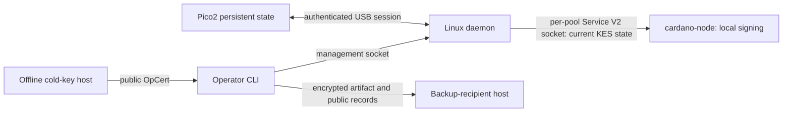

# Pico2 KES Agent

Persistent Cardano KES state on a Raspberry Pi Pico 2, with a Linux daemon and operator CLI. The goal is to retain and recover current operational KES state after **both host and device lose power**, without an ordinary KES signing-key file on the primary host or a surviving RAM-only peer.

One USB-owning daemon supports up to **64 pools**, each with one active and one staged generation and its own KES Service V2 Unix socket. Nodes receive current key material and sign locally. This README builds this project's firmware and host tools, not a custom Cardano node.

## Contents

- [Purpose and security boundary](#purpose-and-security-boundary)
- [Requirements and compatibility](#requirements-and-compatibility)
- [Build, flash, and install](#build-flash-and-install)
- [Commission and configure](#commission-and-configure)
- [Enroll and serve the first generation](#enroll-and-serve-the-first-generation)
- [Connect cardano-node](#connect-cardano-node)
- [Operations and maintenance](#operations-and-maintenance)
- [Offline restoration and failover](#offline-restoration-and-failover)
- [Troubleshooting and references](#troubleshooting-and-references)

## Purpose and security boundary

### Terms

| Term | Meaning |
| --- | --- |
| KES | Key Evolving Signatures: one verification key covers a finite sequence of secret signing states. Later states cannot derive earlier ones. |
| Period evolution | Advance an existing generation to the network's next absolute KES period; no new certificate. Period duration is network-dependent. |
| Generation rotation | Create a new KES series and obtain a new cold-signed certificate before the existing series expires. |
| Operational certificate / OpCert | Cold-key signature authorizing a KES verification key, issuance counter, and absolute start period. |
| Active / staged generation | Active is eligible for delivery; staged is the pending replacement, including a future-start certified generation. |
| Device identity | Persistent device ID and signing public key, pinned together with the application USB serial. |
| Pool incarnation | Unique enrollment lifetime; deleting and re-enrolling a pool creates a different incarnation. |
| Recipient key | Off-primary backup decryption key; only its public part is installed on the device. |
| Receipt | Durable local record of a mutation's operation ID, target, revision, request, and available result; retain it to reconcile uncertainty. |

### Why persistence?

The original [IntersectMBO KES agent](https://github.com/IntersectMBO/kes-agent) deliberately retains keys in mlocked RAM, evolves autonomously, and can refill a restarted agent from a surviving bootstrap peer, including over SSH-forwarded sockets. It already survives node-only restarts. Its [FAQ](https://github.com/IntersectMBO/kes-agent/blob/master/doc/faq.markdown) and [guide](https://github.com/IntersectMBO/kes-agent/blob/master/doc/guide.markdown) describe these availability and erasure choices.

| Dimension | Original RAM-based agent | Pico2 persistent agent |
| --- | --- | --- |
| Operational state | Agent/node RAM; optional live peers | Encrypted device storage plus daemon/node RAM |
| Node-process restart | Reconnect to agent for current state | Reconnect through per-pool socket with valid context |
| Agent / whole-host restart | Single agent loses RAM key; a running node still evolves/signs until expiry | Device retains operational state across loss of power; restart still requires identity and valid context |
| Recovery peer dependence | A surviving peer can refill the agent; simultaneous loss of all RAM copies requires operator intervention | No surviving RAM peer needed for intact-device recovery |
| Backup tradeoff | Avoid persistent initial signing-state backups; availability can use live peers | Encrypted period-zero artifacts allow offline recovery, but retained recipients/artifacts can reconstruct past states |

These are design tradeoffs, not consequences of Haskell versus Rust. Rust does not eliminate host compromise.



**Not an HSM or remote signer.** Current KES material reaches daemon and node RAM. An authorized service client can copy it and derive later states. A compromised primary host can steal current keys. Cold signing keys and recipient private keys stay external; the node still holds its VRF secret.

Treat socket-group membership as full trust: management-socket access grants all pool-management authority. There is no PIN or per-pool privilege separation. Trusted host time and chain context remain necessary.

Device encryption and read-verified cleanup do **not** establish resistance to physical extraction, malicious firmware, captured-flash rollback, or invasive remanence analysis. Retained period-zero backups and recipient keys can reconstruct earlier periods. Changing recipients does not revoke old ciphertext. Device erasure, pool deletion, disconnection, and daemon shutdown cannot revoke node or backup copies.

## Requirements and compatibility

| Execution host | Responsibility |
| --- | --- |
| Linux producer / USB host ("primary") | Runs daemon, management CLI, and producer node; owns the USB device. A relay does not need this device. |
| Offline cold-key host | Keeps cold signing key and issuance counter; signs certificates. Never copy its secret to the primary. |
| Backup-recipient host | Creates/protects the recipient private file and passphrase; performs local restoration. Never copy that private file to the primary. |

Requirements:

- Linux with systemd and udev; Git, a native C compiler/linker and normal platform build prerequisites; rustup; `jq`; `sha256sum`; USB diagnostic tools.
- Rust **1.99.1**, pinned by [rust-toolchain.toml](rust-toolchain.toml), and `thumbv8m.main-none-eabihf`.
- RP2350-capable [picotool](https://github.com/raspberrypi/picotool), for attended flashing.
- Supported Pico 2 A2 with the fitted 4-MiB flash profile checked by [firmware/src/flash.rs](firmware/src/flash.rs): JEDEC `ef4016`, with matching SFDP data. This is not support for every RP2040/RP2350 board.
- A `cardano-node` release supporting the standard `--shelley-kes-agent-socket` interface and a matching `cardano-cli`. Obtain these using the [Cardano node installation guide](https://developers.cardano.org/docs/get-started/infrastructure/node/installing-cardano-node/). Check your installed node's help before cutover.
- Trusted genesis, network parameters, and actual era/slot-length history; synchronized host clock; access to the local node's query socket and the intended USB device.
- The node's ordinary network, topology, database, VRF key, and service configuration remain necessary. Building successfully or connecting a socket does not demonstrate live forging or peer-accepted blocks.

**Readiness limitation:** the current daemon recognizes clock synchronization only when `/run/systemd/timesync/synchronized` or `/run/systemd/timesync/synchronized-clock` contains trimmed `yes`, `1`, or `true`. Generic NTP enablement or an empty marker does not satisfy this implementation. It fails closed and withholds period-dependent delivery. If the host cannot provide genuine recognized synchronization state, stop at this prerequisite; do not fabricate markers or disable the check.

## Build, flash, and install

### Build

**Build host — from this checkout's root:**

```bash
rustup toolchain install 1.99.1 --profile minimal
rustup target add --toolchain 1.99.1 thumbv8m.main-none-eabihf
cargo build --locked --release --bin pico2-kes-agentd --bin pico2-kes-agent-cli
cargo build --locked --release -p pico2-kes-firmware --target thumbv8m.main-none-eabihf
```

Outputs:

- `target/release/pico2-kes-agentd`
- `target/release/pico2-kes-agent-cli`
- `target/thumbv8m.main-none-eabihf/release/pico2-kes-firmware`

### Flash the intended board

**USB host — attended maintenance:** stop any running agent before flashing. Hold BOOTSEL while connecting the board to USB. When several boards are attached, identify/select the intended board using your picotool version's selection options, or disconnect the other boards before this command.

```bash
sudo picotool load -v -x target/thumbv8m.main-none-eabihf/release/pico2-kes-firmware -t elf
```

`-t elf` is required because Cargo's output has no extension; `-v` verifies written bytes and `-x` boots. The linker confines firmware to its own 1-MiB region. Preserve the storage partition: **no whole-flash erase, raw-flash clone, format, or speculative rollback**. Flashing is an external attended procedure, not an agent CLI command. The application udev rule does not cover BOOTSEL; use privileged picotool rather than repeated chmod or world-writable USB rules.

### Install host software and access

**Primary — from the checkout root:**

```bash
sudo deploy/install.sh
OPERATOR_USER="$(id -un)"
NODE_USER=cardano-node   # replace with the actual node service account
sudo usermod -aG pico2-kes-agent "$OPERATOR_USER"
sudo usermod -aG pico2-kes-agent "$NODE_USER"
```

The installer creates `pico2-kes-agent` user/group, installs binaries in `/usr/bin`, preflight in `/usr/libexec/pico2-kes-agent-host-check`, unit in `/usr/lib/systemd/system`, and rule in `/usr/lib/udev/rules.d`. Configuration lives under `/etc/pico2-kes-agent`; private daemon state under `/var/lib/pico2-kes-agent`. It preserves an existing `config.json` and enables, **but does not start**, the service. `DESTDIR` is staging only, not a runnable deployment. The shipped example's zero pins and empty networks are not usable normal configuration.

Start a new operator login to acquire group membership; restart the node through your normal controlled service procedure when ready so it acquires membership too. Membership also grants management authority; it is not restricted to signing one pool.

**Primary — diagnose application-mode USB:**

```bash
lsusb -d 1209:4b45
sudo lsusb -v -d 1209:4b45
# Set this to the CURRENT device node reported by lsusb, not a saved address.
USB_DEVICE=/dev/bus/usb/001/001
udevadm info --query=all --name="$USB_DEVICE"
stat -c '%A %U %G %n' "$USB_DEVICE"
```

The application exposes `1209:4b45` and a 16-character chip-derived serial. Read the serial from the actual intended board's `iSerial`/udev information. Do not copy another workstation's serial, pin, or a BOOTSEL identifier. The rule grants group `pico2-kes-agent` mode `0660`; addresses change after reconnects. The daemon separately authenticates the pinned identity; permissions are not identity authentication.

### Enforce host memory policies first

The installer does not install the supplied node drop-in or policy acknowledgement file. The unmodified preflight checks **literally `cardano-node.service`**. A differently named node unit is currently incompatible; do not bypass preflight or point the checks at an unrelated unit.

**Primary — install node limits, then enforce the real host policies:**

```bash
sudo install -d -m 0755 /etc/systemd/system/cardano-node.service.d
sudo install -m 0644 deploy/cardano-node-memory-hardening.conf \
  /etc/systemd/system/cardano-node.service.d/pico2-kes-memory.conf
sudo systemctl daemon-reload
```

Before proceeding, disable active swap and its reboot activation, mask `sleep.target`, `suspend.target`, `hibernate.target`, and `hybrid-sleep.target`, and disable system/service core and kernel crash dumps. Apply the node drop-in via a controlled node restart before allowing it to hold new keys. The supplied agent unit already sets `LimitCORE=0`, `MemorySwapMax=0`, and a 256-MiB memlock limit.

Also enforce snapshot policy at the actual host/hypervisor/provider layer: disable RAM-bearing snapshots/live migration, or ensure their encryption keys and recovery access remain off-host. Copying a policy file does not enforce this. Review backup software and administrative access as part of the same boundary.

Only after those conditions are true:

```bash
sudo install -o root -g pico2-kes-agent -m 0640 deploy/host-security.env.example \
  /etc/pico2-kes-agent/host-security.env
systemctl show pico2-kes-agentd.service cardano-node.service \
  --property=LimitCORE --property=MemorySwapMax
systemctl is-enabled sleep.target suspend.target hibernate.target hybrid-sleep.target
cat /proc/swaps
sudo /usr/libexec/pico2-kes-agent-host-check
```

Exact acknowledgements in `host-security.env`:

| Literal | Operator assertion |
| --- | --- |
| `SNAPSHOT_POLICY=disabled-or-encrypted-off-host` | RAM snapshots are disabled or protected by encryption controlled off-host. |
| `NODE_MEMORY_POLICY=core-and-swap-disabled` | Node memory cannot enter core dumps or swap. |
| `BACKUP_PRIVATE_POLICY=off-primary` | Recipient private material is not on this host. |

Preflight requires no active swap, all four targets masked, and both units reporting `LimitCORE=0` and `MemorySwapMax=0`. It cannot verify all provider/snapshot promises made by these acknowledgements.

## Commission and configure

### Operator workspace and commissioning mode

**Primary — operator, not root:** use a private, owner-controlled directory for receipts, public inputs, and outputs. Never ask the CLI to publish into root-owned `/etc`.

```bash
set -euo pipefail
umask 077
OPS="$HOME/pico2-kes-ops"
install -d -m 0700 "$OPS"
USB_SERIAL=REPLACE_WITH_16_CHAR_SERIAL
```

Replace the serial before proceeding. Save the following complete **commissioning JSON template** as `$OPS/commission.json`, replacing its serial. Unknown fields are rejected; this version-1 configuration intentionally has no installed pin and no pools.

```json
{
  "version": 1,
  "device": {"usb_serial": "REPLACE_SERIAL16"},
  "socket_directory": "/run/pico2-kes-agent",
  "socket_group": "pico2-kes-agent",
  "socket_mode": "0660",
  "management_socket": "/run/pico2-kes-agent/management.sock",
  "state_directory": "/var/lib/pico2-kes-agent",
  "networks": {},
  "pools": []
}
```

**Primary — administrative service setup:** reuse the installed unit's UID, memlock limits, runtime/state directories, and USB confinement. Stop it before changing mode.

```bash
sudo systemctl stop pico2-kes-agentd
sudo install -o root -g pico2-kes-agent -m 0640 "$OPS/commission.json" \
  /etc/pico2-kes-agent/commission.json
sudo install -d -m 0755 /run/systemd/system/pico2-kes-agentd.service.d
sudo tee /run/systemd/system/pico2-kes-agentd.service.d/commission.conf >/dev/null <<'UNIT'
[Service]
ExecStart=
ExecStart=/usr/bin/pico2-kes-agentd --commission --config /etc/pico2-kes-agent/commission.json
UNIT
sudo systemctl daemon-reload
sudo systemctl start pico2-kes-agentd
```

**Primary — operator, attended blank-device initialization:**

```bash
pico2-kes-agent-cli device commission --usb-serial "$USB_SERIAL" \
  --expected-revision 0 --receipt "$OPS/commission.receipt.json" --out "$OPS/device.json"
```

Physically trust the selected board and firmware. The record's self-signature is not independent hardware attestation. Archive the public `device.json` and original receipt separately from the machine. Nonblank, corrupt, or already-commissioned storage is not automatically reset.

If the outcome is uncertain, keep the receipt and use [reconciliation](#reconciliation) with an unused `--out` path to recover the public record; do not commission again. The exported record includes `kind`, `device_id`, `identity_public_key`, `identity_fingerprint`, `usb_serial`, protocol/storage versions, and `revision`.

### Normal configuration and trusted context

Create `$OPS/config.json` using the complete **normal-mode JSON template** below. Replace all synthetic identity, digest, network parameters, and paths. In `device`, set `id` from the record's `.device_id`, `identity_public_key` from `.identity_public_key`, and `usb_serial` from `.usb_serial`. The zero identity below is not a live device pin.

```json
{
  "version": 1,
  "device": {
    "id": "00000000000000000000000000000000",
    "identity_public_key": "0000000000000000000000000000000000000000000000000000000000000000",
    "usb_serial": "REPLACE_SERIAL16"
  },
  "socket_directory": "/run/pico2-kes-agent",
  "socket_group": "pico2-kes-agent",
  "socket_mode": "0660",
  "management_socket": "/run/pico2-kes-agent/management.sock",
  "state_directory": "/var/lib/pico2-kes-agent",
  "networks": {
    "pool-network": {
      "genesis_file": "/etc/cardano/pool-network/genesis.json",
      "genesis_digest": "0000000000000000000000000000000000000000000000000000000000000000",
      "network_magic": 42,
      "mainnet": false,
      "node_socket": "/run/cardano-node/node.socket",
      "cardano_cli": "/usr/local/bin/cardano-cli",
      "era_history": "/etc/pico2-kes-agent/pool-network-history.json",
      "slots_per_kes_period": 100,
      "kes_lifetime": 64,
      "max_context_age_ms": 30000,
      "query_timeout_ms": 5000
    }
  },
  "pools": []
}
```

The `42`/`100` values are illustrative, **not production defaults**. Use the selected network's trusted genesis for `networkMagic`, `slotsPerKESPeriod`, and `maxKESEvolutions`, and verify those values against its authoritative configuration. `mainnet=true` requires magic `764824073`. Compute the exact selected genesis file's SHA-256:

```bash
GENESIS=/etc/cardano/pool-network/genesis.json
sha256sum "$GENESIS"
DEVICE_RECORD="$OPS/device.json"
jq -e '{id: .device_id, identity_public_key: .identity_public_key, usb_serial: .usb_serial}' "$DEVICE_RECORD"
```

Use absolute paths visible inside the service sandbox, not `/home` or `/tmp`. Make public genesis/history files readable by the service. Give the daemon access to the node query socket **and traversal of each parent directory**, using the node's controlled group/ACL and, if necessary, a unit `SupplementaryGroups=` drop-in. Do not make sockets/directories world writable. This node-query access is distinct from the node's access to the agent's per-pool delivery sockets and from the operator's private receipts.

Era history is an operator-supplied JSON array of `{start_slot, start_time_us, slot_length_us}`. The first slot must be zero; times are **absolute Unix microseconds**, not offsets from Shelley genesis. Successive segments must satisfy:

`next.start_time_us = current.start_time_us + (next.start_slot - current.start_slot) * current.slot_length_us`

Obtain actual slot-length transitions from authoritative network history, including pre-Shelley history where applicable. A single-Shelley-genesis shortcut is not valid for all networks. There is no automatic history generator in this repository.

**Synthetic arithmetic example only — not mainnet or testnet history:** ten slots of two seconds end at Unix time `1700000020000000` microseconds, followed by one-second slots.

```json
[
  {"start_slot": 0, "start_time_us": 1700000000000000, "slot_length_us": 2000000},
  {"start_slot": 10, "start_time_us": 1700000020000000, "slot_length_us": 1000000}
]
```

The parser accepts 1–32 segments with positive slot lengths. `max_context_age_ms=30000` and `query_timeout_ms=5000` are example settings: maximum context age must be positive and at most 255000 ms; query timeout must be positive. A stale tip, failed query, bad genesis/history, or unrecognized synchronization state withholds fresh context/key delivery. Recheck the [clock-marker limitation](#requirements-and-compatibility) before relying on delivery; configuration validation does not test it.

Normal `pools` may initially be empty. Management enrollment and the durable public journal reconstruct bindings; **preserve the journal**. Default enrollment creates `<pool-id>.sock` directly under `socket_directory`. For migration/custom socket names, an optional explicit binding has this shape (replace IDs with returned values and insert into `pools`):

```json
{
  "pool_id": "00000000000000000000000000000000000000000000000000000000",
  "incarnation_id": "00000000000000000000000000000000",
  "socket_path": "/run/pico2-kes-agent/custom-pool.sock",
  "network": "pool-network"
}
```

### Switch to normal mode

**Primary — administrative setup:** stop commissioning, install the reviewed normal configuration, remove **only** the dedicated runtime override, and check as the service UID. Do not use `systemctl revert`, which could erase unrelated operator overrides. Runtime/state directories must already exist and belong to that UID; systemd's runtime directory may disappear when the service stops, so create it before a manual check.

```bash
sudo systemctl stop pico2-kes-agentd
sudo install -o root -g pico2-kes-agent -m 0640 "$OPS/config.json" /etc/pico2-kes-agent/config.json
sudo rm /run/systemd/system/pico2-kes-agentd.service.d/commission.conf
sudo systemctl daemon-reload
sudo install -d -o pico2-kes-agent -g pico2-kes-agent -m 0750 /run/pico2-kes-agent
sudo install -d -o pico2-kes-agent -g pico2-kes-agent -m 0700 /var/lib/pico2-kes-agent
sudo -u pico2-kes-agent /usr/bin/pico2-kes-agentd \
  --check-config --config /etc/pico2-kes-agent/config.json
sudo systemctl start pico2-kes-agentd
systemctl status pico2-kes-agentd
pico2-kes-agent-cli --json status
```

Device `ready` with no pools proves neither valid period context, key delivery, nor block production.

## Enroll and serve the first generation

### Shell and file conventions

All following primary commands run as the operator in a Bash session with `set -euo pipefail` and `umask 077`, using the private `OPS` directory above. Global `--socket` and `--json` precede command words. The default management socket is `/run/pico2-kes-agent/management.sock`; override it only with `pico2-kes-agent-cli --socket "$MANAGEMENT_SOCKET" --json ...` after defining that path.

Every mutation needs a **new, unique receipt file**; the example filenames below are for a first run only. `--operation-id` is optional; the CLI generates one. Capture successful JSON before extracting with `jq -e`; do not pipe a mutation into `jq`, hide its exit, or continue after nonzero exit. In an interactive shell, stop the sequence explicitly on any failure; do not rely solely on shell options in conditional contexts.

Refresh `.result.revision` from device `status` immediately before `recipient set` and `pool enroll`, and from `pool status --pool "$POOL"` before generation/certificate/discard/delete mutations. Concurrent operations can still cause `revision_conflict`: that is a rejection, unlike an uncertain submitted operation, which needs reconciliation with its original receipt.

File inputs and immediate parents must be owned by the invoking operator and not group/world writable. Copy transferred public files into the private workspace as that operator. Outputs are owner-only and no-clobber. A missing output after a successful mutation is not permission to repeat the mutation.

### 1. Create a backup recipient off-primary

**Backup-recipient host:** install the host CLI there, create a private directory, and retain the private file and passphrase securely.

```bash
set -euo pipefail
umask 077
BACKUP_OPS="$HOME/pico2-kes-backup"
install -d -m 0700 "$BACKUP_OPS"
RECIPIENT_KEY="$BACKUP_OPS/recipient.private"
RECIPIENT_PUBLIC="$BACKUP_OPS/recipient.public.json"
pico2-kes-agent-cli recipient create --out "$RECIPIENT_KEY" --public-out "$RECIPIENT_PUBLIC"
```

Terminal prompts handle passphrases. There is no argv/environment passphrase option. Transfer **only the public JSON** to the primary's `$OPS/recipient.public.json`.

### 2. Install the public recipient

**Primary:**

```bash
RECIPIENT_PUBLIC="$OPS/recipient.public.json"
DEVICE_STATUS=$(pico2-kes-agent-cli --json status)
DEVICE_REV=$(jq -er '.result.revision' <<<"$DEVICE_STATUS")
RECIPIENT_RESULT=$(pico2-kes-agent-cli --json recipient set --public-key "$RECIPIENT_PUBLIC" \
  --expected-revision "$DEVICE_REV" --receipt "$OPS/recipient-set.receipt.json")
printf '%s\n' "$RECIPIENT_RESULT"
```

### 3. Enroll the pool

Transfer the public cold verification key from the cold host to `$OPS/cold.vkey`; the cold signing key never follows it. Standard Cardano public cold-vkey envelopes are suitable. The generic public input reader does not validate arbitrary envelope type metadata; device certificate validation is the authority.

**Primary:**

```bash
NETWORK=pool-network
COLD_VKEY="$OPS/cold.vkey"
DEVICE_STATUS=$(pico2-kes-agent-cli --json status)
DEVICE_REV=$(jq -er '.result.revision' <<<"$DEVICE_STATUS")
ENROLL_RESULT=$(pico2-kes-agent-cli --json pool enroll --cold-vkey "$COLD_VKEY" --network "$NETWORK" \
  --expected-revision "$DEVICE_REV" --receipt "$OPS/enroll.receipt.json")
POOL=$(jq -er '.result.pool_id' <<<"$ENROLL_RESULT")
INCARNATION=$(jq -er '.result.incarnation_id' <<<"$ENROLL_RESULT")
pico2-kes-agent-cli --json pool status --pool "$POOL"
pico2-kes-agent-cli --json pool list --page-size 16
```

`POOL` is 56 lowercase hexadecimal characters, not Bech32 `pool1...`. Device, incarnation, and generation IDs are 32 hex characters. Save returned IDs with your records. Obtain `POOL_SOCKET` from the matching pool's returned list entry `socket_path`; follow pagination when necessary, rather than substituting the management socket.

### 4. Generate a staged key

**Primary:**

```bash
POOL_STATUS=$(pico2-kes-agent-cli --json pool status --pool "$POOL")
POOL_REV=$(jq -er '.result.revision' <<<"$POOL_STATUS")
GENERATE_RESULT=$(pico2-kes-agent-cli --json key generate --pool "$POOL" --incarnation "$INCARNATION" \
  --expected-revision "$POOL_REV" --receipt "$OPS/generate.receipt.json")
GENERATION=$(jq -er '.result.generation_id' <<<"$GENERATE_RESULT")
```

Generation already commits the encrypted artifact and activation intent. There is no later backup-approval gate.

### 5. Retrieve verification key and encrypted backup

**Primary:**

```bash
KES_VKEY="$OPS/first-kes.vkey"
ARTIFACT="$OPS/first-kes.backup"
pico2-kes-agent-cli key verification-key --pool "$POOL" --incarnation "$INCARNATION" \
  --generation "$GENERATION" --out "$KES_VKEY"
pico2-kes-agent-cli key export --pool "$POOL" --incarnation "$INCARNATION" \
  --generation "$GENERATION" --out "$ARTIFACT"
```

The vkey uses the `KesVerificationKey_ed25519_kes_2^6` envelope. Export is read-only ciphertext, **not a signing-key file**. Retrieve it before replacement, expiry, discard, or pool deletion retires device-side retrieval. Archive it and the [restore bundle](#offline-restoration-and-failover) off-primary before certificate installation. Read-only exports may be repeated to fresh paths.

### 6. Issue the certificate offline

Determine and verify the **absolute** start KES period from the actual network's current slot and trusted `slotsPerKESPeriod`: integer division `current_slot / slotsPerKESPeriod` gives the current absolute period. Choose the intended valid start with enough commissioning time, not a wall-clock guess or a relative evolution number. Transfer the vkey and independently checked period information to the cold host.

**Offline cold-key host:** set paths to your existing protected key/counter, choose `ERA` supported by the installed matching CLI and network, and set `START_PERIOD` to the verified absolute value before running:

```bash
set -euo pipefail
umask 077
COLD_OPS="$HOME/pool-cold"
KES_VKEY="$COLD_OPS/first-kes.vkey"
COLD_SKEY="$COLD_OPS/cold.skey"
COUNTER="$COLD_OPS/cold.counter"
OPCERT="$COLD_OPS/first.opcert"
ERA=conway             # select for your installed CLI/network
: "${START_PERIOD:?Set the independently verified absolute start period}"
cardano-cli "$ERA" node issue-op-cert --kes-verification-key-file "$KES_VKEY" \
  --cold-signing-key-file "$COLD_SKEY" --operational-certificate-issue-counter-file "$COUNTER" \
  --kes-period "$START_PERIOD" --out-file "$OPCERT"
```

Preserve the updated issuance counter. Never reset it or repeatedly issue certificates to fix a transport timeout. Transfer only the certificate back to the primary's workspace, and include it in the off-primary backup bundle.

### 7. Install the certificate

**Primary:**

```bash
OPCERT="$OPS/first.opcert"
POOL_STATUS=$(pico2-kes-agent-cli --json pool status --pool "$POOL")
POOL_REV=$(jq -er '.result.revision' <<<"$POOL_STATUS")
CERTIFICATE_RESULT=$(pico2-kes-agent-cli --json certificate install --pool "$POOL" \
  --incarnation "$INCARNATION" --generation "$GENERATION" --certificate "$OPCERT" \
  --expected-revision "$POOL_REV" --receipt "$OPS/certificate.receipt.json")
printf '%s\n' "$CERTIFICATE_RESULT"
pico2-kes-agent-cli --json pool status --pool "$POOL"
```

A valid future-start certificate waits staged. A currently valid eligible generation activates automatically after valid context and required cleanup. There is no activation command or backup-approval command. Inspect pool status and actual node consumption rather than treating certificate-command success as proof of forging.

## Connect cardano-node

**Primary — singleton producer example:** retain your normal config/topology/database/node-socket arguments. Set these paths for your deployment; get `POOL_SOCKET` from the matching returned `pool list` entry, not a receipt filename.

```bash
NODE_CONFIG=/etc/cardano/config.json
TOPOLOGY=/etc/cardano/topology.json
DATABASE=/var/lib/cardano-node/db
NODE_SOCKET=/run/cardano-node/node.socket
VRF_SKEY=/etc/cardano/vrf.skey
: "${POOL_SOCKET:?Set the socket_path returned for this pool}"
cardano-node run --config "$NODE_CONFIG" --topology "$TOPOLOGY" \
  --database-path "$DATABASE" --socket-path "$NODE_SOCKET" \
  --shelley-kes-agent-socket "$POOL_SOCKET" \
  --shelley-operational-certificate "$OPCERT" --shelley-vrf-key "$VRF_SKEY"
```

Replace the old `--shelley-kes-key` source; do not pass both sources. For a systemd producer, put the arguments and an accessible public startup-certificate path in its existing configuration, not the operator's protected home directory. Keep the cold key and recipient private key off this host.

Migration from a signing-key file or the original agent uses a **fresh device generation and new certificate**, not plaintext import. Keep the existing producer until the replacement is ready, then fence/stop it before enabling replacement forging. Avoid dual forging.

Ordinary evolution and generation rotation require neither node restart nor SIGHUP. Keep the node's startup certificate file current for future restarts. A change to startup configuration requires a controlled restart using your normal node-service procedure. A running node may retain already delivered state and evolve/sign independently; stopping the agent alone is not revocation.

## Operations and maintenance

### Command reference

These are all implemented CLI commands; global options are `--socket PATH` and `--json`. The CLI provides top-level help, not detailed subcommand help. Mutating service commands accept optional `--operation-id` alongside the target/revision/receipt flags shown in their walkthroughs.

| Command | Complete walkthrough |
| --- | --- |
| `status` | [Routine inspection](#routine-inspection) |
| `device commission` | [Commissioning](#operator-workspace-and-commissioning-mode) |
| `pool list`, `pool status` | [Routine inspection](#routine-inspection) |
| `pool enroll` | [Enrollment](#3-enroll-the-pool) |
| `pool delete` | [Pool removal](#pool-removal-and-re-enrollment) |
| `key generate` | [Generation](#4-generate-a-staged-key) |
| `key verification-key`, `key export` | [Public key and backup](#5-retrieve-verification-key-and-encrypted-backup) |
| `key discard` | [Staged cancellation](#staged-slot-and-cancellation) |
| `certificate install` | [Certificate installation](#7-install-the-certificate) |
| `recipient create`, `recipient set` | [Recipient creation](#1-create-a-backup-recipient-off-primary), [installation](#2-install-the-public-recipient), [rotation](#recipient-rotation) |
| `operation reconcile` | [Reconciliation](#reconciliation) |
| `restore` | [Offline restoration](#offline-restoration-and-failover) |

### Routine inspection

**Primary — operator:**

```bash
pico2-kes-agent-cli status
pico2-kes-agent-cli --json pool status --pool "$POOL"
CURSOR=
while :; do
  if [[ -n "$CURSOR" ]]; then
    PAGE=$(pico2-kes-agent-cli --json pool list --page-size 16 --cursor "$CURSOR")
  else
    PAGE=$(pico2-kes-agent-cli --json pool list --page-size 16)
  fi
  jq -e '.result.pools' <<<"$PAGE"
  CURSOR=$(jq -r '.result.cursor // empty' <<<"$PAGE")
  [[ -n "$CURSOR" ]] || break
done
systemctl status pico2-kes-agentd
sudo journalctl -u pico2-kes-agentd --since '1 hour ago' --no-pager
```

Follow the returned cursor until absent/null. Inspect device identity, pool incarnation, active/staged state, validity and context, then check node logs/operational metrics for actual consumption and forging. Do not dump secret USB/socket traffic into logs or support bundles.

### Evolution, rotation, and expiry

Period evolution is automatic under trustworthy context; it does not issue a new certificate. Plan generation rotation before expiry. Repeat [generation through certificate installation](#4-generate-a-staged-key) with **new output and receipt names**. Export before installing the certificate, retain the active generation until replacement validity, and update the node's startup certificate file for future restarts. There is no additional backup-readiness gate.

On expiry or outage, first restore legitimate context and inspect pool state. If the generation is expired, create/certify a replacement. Do not roll back the clock/period or expect an expired signing key to become useful again.

### Staged slot and cancellation

There is only one staged slot per pool. Before destructive cancellation, export/copy any needed artifact and public records: discard ends retrieval on the device but does not revoke external copies. Confirm the exact staged generation from fresh status; do not assume the old shell variable still names it.

**Primary — deliberate cancellation:**

```bash
: "${GENERATION:?Set the exact staged generation to discard}"
POOL_STATUS=$(pico2-kes-agent-cli --json pool status --pool "$POOL")
POOL_REV=$(jq -er '.result.revision' <<<"$POOL_STATUS")
DISCARD_RESULT=$(pico2-kes-agent-cli --json key discard --pool "$POOL" --incarnation "$INCARNATION" \
  --generation "$GENERATION" --expected-revision "$POOL_REV" --receipt "$OPS/discard.receipt.json")
printf '%s\n' "$DISCARD_RESULT"
```

Type `yes` at the interactive confirmation, or append `--yes` only for deliberate automation. A late discard can return `target_not_staged` after activation; refresh status, do not target a different generation as a retry.

### Recipient rotation

Create a new recipient on the backup host using new paths, transfer only its public JSON, and repeat [recipient installation](#2-install-the-public-recipient) with a **fresh device revision and new receipt**. It affects only future generations, not existing artifacts. Keep old private files/passphrases while their artifacts are needed. A lost recipient/passphrase cannot decrypt old ciphertext; a fresh recipient and generation can protect future backups but cannot repair that loss.

### Reconciliation

After timeout, uncertain/pending status, or a lost response, retain the original receipt, operation ID, target, revision, and digest. Do not submit a new operation merely because the result is unknown.

**Primary — same original receipt:**

```bash
RECEIPT="$OPS/generate.receipt.json"  # choose the original uncertain operation
pico2-kes-agent-cli operation reconcile --receipt "$RECEIPT"
```

For commissioning-output recovery only, choose the commissioning receipt and a fresh output path:

```bash
RECEIPT="$OPS/commission.receipt.json"
pico2-kes-agent-cli operation reconcile --receipt "$RECEIPT" --out "$OPS/device-recovered.json"
```

A local output failure after device success still needs reconciliation, not another mutation. Read-only vkey/artifact exports can instead be repeated to fresh paths. Busy/recovering operations may require waiting for recovery before reconciling the same receipt.

### Host restart and device reconnect

Preserve pin/config/public journal and use the installed service. After restart/reconnect, check the **same** identity and each pool's readiness using [routine inspection](#routine-inspection). A running node may continue with its already received state; a reconnecting node requires fresh valid context. Disconnect is not revocation.

### Host software upgrade

**Primary — maintenance window:** stop the agent, preserve `/etc/pico2-kes-agent`, `/var/lib/pico2-kes-agent`, operator receipts and public identity, then rebuild/reinstall using [the build/install instructions](#build-flash-and-install). Make offline copies after clean shutdown; preserve ownership and permissions. Do not restore an older journal/flash image to force rollback.

There is no daemon configuration hot reload. Check configuration as the service UID with existing owned runtime/state directories, restart through systemd, then verify identity and pool readiness. The installer preserves an existing config; it does not merge new settings or install the optional hardening files automatically.

### Firmware upgrade

Stop the agent; make public records/state backups after clean shutdown. Enter BOOTSEL physically and use the verified ELF-only [flash procedure](#flash-the-intended-board), preserving state. Start normally and compare identity, revision, and pool state with the pre-maintenance records. There is no automatic migration or downgrade guarantee. Unsupported/corrupt state fails closed: stop, preserve diagnostics, and obtain a reviewed recovery procedure rather than erasing it.

### Device loss or replacement

Either perform controlled [file-based failover](#offline-restoration-and-failover) from an existing artifact, or commission a new blank device and issue fresh pool generations/certificates. Restore does not import a key into a Pico2. Do not re-pin an unexpected replacement to conceal an identity failure. Fence existing producers and treat old device/node/backup copies as still capable within their certificate validity.

### Pool removal and re-enrollment

Export required artifacts and archive public records **before** deletion. Remove/fence the node's corresponding credential source first or alongside maintenance; deletion does not stop a node that already has keys. It removes all that pool's device-side keys/artifacts, not external copies.

**Primary — deliberate deletion:**

```bash
POOL_STATUS=$(pico2-kes-agent-cli --json pool status --pool "$POOL")
POOL_REV=$(jq -er '.result.revision' <<<"$POOL_STATUS")
DELETE_RESULT=$(pico2-kes-agent-cli --json pool delete --pool "$POOL" --incarnation "$INCARNATION" \
  --expected-revision "$POOL_REV" --receipt "$OPS/delete.receipt.json")
printf '%s\n' "$DELETE_RESULT"
```

Interactive confirmation requires `yes`; append `--yes` only for deliberate automation. Preserve receipts. Re-enrollment creates a new incarnation and needs fresh generations/certificates. Review any explicit configuration binding so an obsolete incarnation is not retained.

### Decommission and uninstall

Intentionally export needed artifacts, stop/fence producers, and deliberately delete chosen pools if required. Then, **primary, checkout root**:

```bash
sudo deploy/uninstall.sh
```

Uninstall preserves configuration, state, service account/group, and device storage. It is not secure device wiping. There is no supported device-wide reset/format command.

### Journal capacity or corruption

Preserve the public journal under `/var/lib/pico2-kes-agent`; it reconstructs management outcomes and pool bindings. Admission has a **64-MiB bound**, with no documented compaction CLI. Do not delete/truncate it to clear an error. Stop mutations, preserve diagnostics and cleanly stopped copies, and obtain a reviewed recovery procedure.

## Offline restoration and failover

Preserve a bundle containing:

- Encrypted artifact and matching recipient private file (protected off-primary).
- Independently trusted public device identity record; never infer the trusted identity from the artifact itself.
- Original exported KES verification-key envelope and matching OpCert.
- Device, pool, incarnation, and generation IDs, plus useful public receipts and certificate validity information.

**Backup-recipient host — local only:** set the IDs to the archived exact values before running. No daemon or connected device is needed.

```bash
set -euo pipefail
umask 077
BACKUP_OPS="$HOME/pico2-kes-backup"
ARTIFACT="$BACKUP_OPS/first-kes.backup"
RECIPIENT_KEY="$BACKUP_OPS/recipient.private"
DEVICE_RECORD="$BACKUP_OPS/device.json"
KES_VKEY="$BACKUP_OPS/first-kes.vkey"
OPCERT="$BACKUP_OPS/first.opcert"
RESTORED_SKEY="$BACKUP_OPS/restored-kes.skey"
DEVICE_ID=$(jq -er '.device_id' "$DEVICE_RECORD")
: "${POOL:?Set archived pool ID}"
: "${INCARNATION:?Set archived incarnation ID}"
: "${GENERATION:?Set archived generation ID}"
pico2-kes-agent-cli restore --artifact "$ARTIFACT" --recipient-key "$RECIPIENT_KEY" \
  --device-identity "$DEVICE_RECORD" --device "$DEVICE_ID" --pool "$POOL" \
  --incarnation "$INCARNATION" --generation "$GENERATION" \
  --verification-key "$KES_VKEY" --out "$RESTORED_SKEY"
```

The command prompts for the passphrase, verifies bindings/signature/recipient, and publishes a mode-0600 no-clobber conventional `KesSigningKey_ed25519_kes_2^6` file. Wrong recipient, tampering, identity mismatch, or output collision does not publish a replacement key. Keep the original public vkey envelope: restore's strict parser does not accept a raw hex file.

**Fence/stop the primary before backup forging.** There is no distributed fencing or automatic failback. Check certificate validity; restoring period zero cannot extend certificate lifetime. Plaintext now intentionally exists on the backup host, with the usual limitations of storage erasure.

**Backup producer — manual file-based node configuration:** use its ordinary config/topology/database/socket paths and matching VRF/certificate. Do not also supply an agent socket.

```bash
NODE_CONFIG=/etc/cardano/config.json
TOPOLOGY=/etc/cardano/topology.json
DATABASE=/var/lib/cardano-node/db
NODE_SOCKET=/run/cardano-node/node.socket
VRF_SKEY=/etc/cardano/vrf.skey
cardano-node run --config "$NODE_CONFIG" --topology "$TOPOLOGY" \
  --database-path "$DATABASE" --socket-path "$NODE_SOCKET" \
  --shelley-kes-key "$RESTORED_SKEY" \
  --shelley-operational-certificate "$OPCERT" --shelley-vrf-key "$VRF_SKEY"
```

For a managed service, securely stage the restored key at a service-readable location with owner-only access and use its normal controlled startup procedure, rather than weakening the backup workspace's permissions.

## Troubleshooting and references

Read-only diagnosis first. No blanket chmod, journal deletion, pin reset, reformat, artificial time markers, or default destructive retries.

| Symptom | Action |
| --- | --- |
| Missing socket / service preflight failure | Inspect `systemctl status` and journal; verify policy file, actual no-swap policy, four masked targets and both units' memory limits. |
| Permission / new membership / sandbox / node query failure | New login and controlled node restart for group changes; inspect ownership and parent traversal. Check sandbox-visible absolute paths and daemon node-query access separately from management/delivery sockets. |
| USB renumbered / denied / BOOTSEL | Rediscover with `lsusb`/udev; expect `1209:4b45` and group mode `0660` only in application mode. BOOTSEL uses attended privileged picotool. |
| Wrong pin / identity failure | Stop; compare trusted original record and physical device. Do not silently re-pin. |
| Busy / recovering / uncertain receipt | Preserve original receipt and reconcile after recovery. Do not create a replacement mutation. |
| `revision_conflict` | Rejected, not success. Refresh correct device/pool status; reconsider intent before a new operation with a new receipt. |
| Staged slot occupied | Inspect staged state; finish its certificate workflow or deliberately discard the exact target after exporting required materials. |
| `target_not_staged` | Refresh state; it may have activated. Never redirect a destructive retry to another generation. |
| Period unavailable / clock / genesis / history / stale tip | Verify genuine recognized sync-marker content, trusted digest/history and synchronized node tip. Correct context; never roll time back or create markers. |
| Expired generation | Create and certify a replacement; an expired key/restore cannot extend validity. |
| Artifact retired | Use an already archived copy; retrieval ends at replacement, expiry, discard or deletion. |
| Recipient / passphrase / binding error | Verify original bundle IDs, trusted device record, recipient and original vkey envelope; do not substitute identity from ciphertext. Lost credentials cannot decrypt old backups. |
| No-clobber / input ownership failure | Use an unused output path and operator-owned, non-group/world-writable input and immediate parent. Reconcile mutation success separately from publication. |
| Node lacks standard agent-socket option | Obtain a compatible upstream node release and matching CLI before cutover. Do not substitute undocumented credential formats. |
| Storage / entropy failure | Stop mutations; preserve diagnostics and state. Do not erase/format or force a rollback. |

### Exit codes

| Code | Meaning |
| --- | --- |
| `0` | Success |
| `2` | Invalid invocation/input |
| `3` | Permission |
| `4` | Pre-admission unavailable |
| `5` | Rejected lifecycle/identity/certificate |
| `6` | Uncertain/pending |
| `7` | Local I/O/crypto/storage |

Some device errors are coarsely mapped; not every failure has a unique fine-grained exit code. Retain diagnostics and receipts, not just the numeric code.

### Deep contracts and evidence scope

Repository-root-relative references:

- [Management CLI contract](specs/001-pico2-kes-agent/contracts/management-cli.md)
- [Backup contract](specs/001-pico2-kes-agent/contracts/backup.md)
- [Device-storage contract](specs/001-pico2-kes-agent/contracts/device-storage.md)
- [Node-service contract](specs/001-pico2-kes-agent/contracts/node-service.md)
- [Current configuration parser](src/config.rs) and [context acquisition](src/daemon/context.rs)
- [Original KES agent](https://github.com/IntersectMBO/kes-agent), [FAQ](https://github.com/IntersectMBO/kes-agent/blob/master/doc/faq.markdown), and [guide](https://github.com/IntersectMBO/kes-agent/blob/master/doc/guide.markdown)
- [Standard Cardano node installation](https://developers.cardano.org/docs/get-started/infrastructure/node/installing-cardano-node/)

Builds, configuration checks, firmware flashing, device status, and socket connection are different evidence from live network forging and peer-accepted blocks. This handbook makes no production-certification or invasive physical-security claim.

### Before leaving the producer unattended

- [ ] Physical board/firmware trusted; original device pin independently archived and verified.
- [ ] Service and host policies ready, with genuine recognized clock synchronization.
- [ ] Recipient private file/passphrase secured off-primary; old recipients retained when needed.
- [ ] Current pool active with trustworthy network context and certificate validity.
- [ ] Actual node consumption checked; production-forging claims require actual network evidence.
- [ ] Rotation planned before expiry; startup certificate kept current.
- [ ] Restore bundle, public identity, receipts and cleanly stopped journal copies archived.
- [ ] Threat model accepted: no HSM, physical-extraction, rollback, external-copy revocation, or unsupported production-security guarantee.
