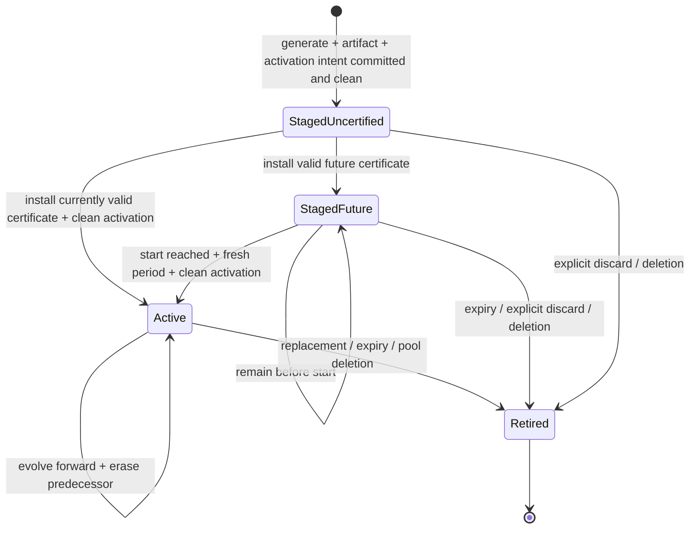
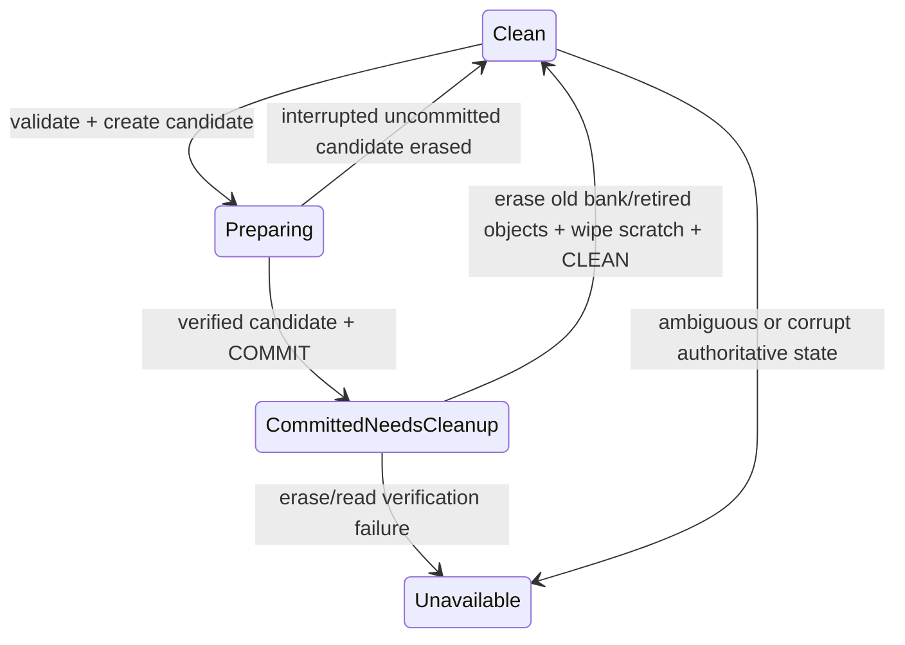

# Data model and lifecycle invariants

## Identity and representation

Version 1 uses unsigned checked integers, byte arrays with fixed lengths, and bounded collections. Device, incarnation, generation and operation IDs are 16 bytes; pool ID is the 28-byte Blake2b-224 hash of its 32-byte cold verification key, exactly as in the adopted forge artifact. Identifiers exposed as JSON use lowercase fixed-width hexadecimal, never filesystem paths. Storage-slot number is never a pool identity. Network identity binds the genesis digest and protocol parameters, not merely network magic.

All secret fields live only in device secret banks or protected transient memory. The only intentional key0 persistence is recipient-encrypted ciphertext. The daemon may persist public configuration, operation requests/receipts and encrypted artifacts, but never plaintext KES state, seed, or recipient private key.

| Entity | Fields and relationships | Validation / persistence |
|---|---|---|
| Device | Stable device ID; Ed25519 identity keypair; storage-encryption key; format version; silicon/flash qualification identity; global revision; next management sequence; optional shared recipient policy; commissioning ID/digest/public result | Explicit attended commissioning creates identity/storage keys on-device only from wholly verified blank state. Sequence 0 binds commissioning; managed commands then start at 1. Two authenticated banks; valid initial COMMIT recovers the same identity, nonblank ambiguous initial state fails closed without reset. Recipient must be set before generation. |
| RecipientPolicy | Public X25519 key (32 bytes), SHA-256 fingerprint, monotonically increasing policy revision | Exactly one current policy across all pools. Reject invalid/low-order keys through the chosen crypto implementation. Changes affect future generations only. |
| Pool | 28-byte Cardano/artifact pool ID; cold verification key; incarnation ID; fixed slot 0–63; network binding; revision; optional absolute period floor; highest accepted certificate issuance counter; current Publication; optional active/staged references; health | Reject duplicate cold identities, duplicate pool IDs, unsupported network context and a 65th slot. Re-enrollment uses a fresh incarnation; stale requests cannot target reused slots. Period floor survives expiry/rotation while enrolled and is removed on verified pool deletion. |
| Generation | Random generation ID; pool-local monotonic generation number; creation operation ID; 32-byte KES vkey; 608-byte canonical current state; relative period; role; optional certificate; public-object digest; artifact digest; recipient snapshot; auto-activation flag | At most one active and one staged per pool. All generations originate on-device. Uncertified remains period zero. Generation success requires immutable backup commit. No implicit staged overwrite. |
| PublicObject | Generation identity, 4,064-byte public tree, immutable <=2,048-byte artifact, integrity digest | One 8-KiB region per retained generation. Certificate belongs in the mutable authenticated pool snapshot, not in an immutable object needing rewrite after certification. No operational secrets in this region. |
| Certificate | Cold key, KES vkey, issuance counter, absolute start period, signature, canonical encoded certificate | Verify exact Cardano signed representation, cold identity, generation vkey, non-regressive issuance, configured lifetime and primitive limits. Exact reinstallation is idempotent. Changed data with same/lower accepted counter is rejected. Persist highest counter after generation retirement. |
| PeriodContext | Target pool/incarnation; network/genesis binding; slots-per-KES-period; network lifetime L; current absolute period; synchronized publication-time sample; host observation and monotonic freshness; context sequence; session identity | Require 1 <= L <= 64. Host derives current period from trusted time and local node era/genesis context. Device durably raises that incarnation's period floor before success, rejects lower values and refreshes equal-period leases without writes. Freshness resets on reconnect/reboot. No persistent device-wide network history. |
| Mutation | Device ID (absent only before commissioning); monotonic management sequence; random operation ID; action; target identities; expected revision; canonical request digest; pending/committed/rejected result | Sequence 0 binds commissioning to the selected serial; later commands bind the pinned device. One management mutation dispatched globally at a time. Persist intent before effects; reject changed digest/stale targets. Journal exact device arguments, including derived enrollment timestamp floor, separately from the original CLI request digest. |
| DeviceReceipt | Sequence, operation ID, digest, target, terminal outcome, resulting revision/generation/artifact digest; commissioning public record or terminal deletion descriptor/high-water when applicable | Retain until daemon fsyncs the public result and acknowledges it; no next managed mutation before handoff. First-identity result also remains in configuration for exact reconciliation. Automatic evolution/current delivery do not wait for receipt acknowledgment. Deletion cannot erase its only recoverable ordering result. |
| Retirement | Target generation/incarnation, reason, committed pool revision, artifact removal and secret cleanup status | Reason is replacement, expiry, discard or pool deletion. Terminal; never resurrect or recreate from an old retry. Generation numbers and revisions never wrap. |
| PoolSubscription | Bound socket path/pool identity; negotiated node-service version; last delivered public revision/time; bounded output buffer | No stream-level pool selector. Immutable binding for connection lifetime; one bundle describes one generation, certificate and period. Outage is not deletion. |
| Publication | Pool/incarnation; publication revision; kind none/key/drop; key generation/period/certificate binding when present; u64 timestamp/high-water | Device assigns once and commits atomically with the visible state, exposes only after CLEAN, and returns exact bytes/time for retries. Metadata-only revisions retain it. Deletion transfers the terminal descriptor/high-water into the durable public receipt; same-pool re-enrollment seeds ordering from that receipt, never from reused slot contents. |
| EnrollmentRecord | Version; device ID/public identity key/fingerprint; USB serial; protocol/storage versions; initial device revision; commissioning operation ID/digest | Public no-clobber host file from the explicit attended ceremony. A fresh self-signature proves possession; physical trusted connection/firmware is the initial trust basis. Normal startup validates its configured pin and never acquires a replacement automatically. |

Exact identity widths and binary map field definitions are normative in the adopted source codec and [backup contract](contracts/backup.md); the new device/management wire uses those same widths, not an independent reinterpretation.

## Generation transitions

A started certified staged generation is evolved before evaluation/delivery; if already expired, erase it rather than activate it. A usable active generation stays available while the staged generation lacks certification or its start has not arrived. Activation atomically changes the role references, retires the prior active generation, removes its artifact and erases obsolete operational state before acknowledgment/publication. No backup-host readiness or explicit activate command exists.

At absolute period P and certificate start S: before S, do not release; otherwise relative period r = P-S using checked subtraction. If r >= L, retire. If r < stored relative period, reject regressive context. Otherwise evolve forward to r, clean obsolete state, and deliver only after rechecking context freshness. The primitive's 64 periods and device's 64 pool slots are unrelated limits.

The operator resolved I1 as minimal nonsecret live-pool metadata: a period floor is per incarnation, not an archive of past key states or a network-wide retained history. Pools sharing a network accept the common host observation independently. A quarantined pool is not an authority for a healthy pool's floor. Deleting the last pool for a network leaves no network-period record; re-enrollment starts with fresh validated context, never restored old KES state. Public retry receipts and publication-order continuity remain required; see [period floors](contracts/device-storage.md#pool-incarnation-period-floors).

## Persistent transaction state

A valid durable successor commit always outranks its predecessor, even without CLEAN. Recovery must finish cleanup, never fall back to an older committed secret. A torn candidate with no valid commit is erased before the old state can be served. A valid newer commit with a corrupt body is ambiguity, not permission to restore the old state. Per-pool failures quarantine that pool; invalid shared configuration quarantines the device.

## Retry and discard ordering

The daemon is the sole USB owner. It writes and fsyncs a public request intent before dispatch and writes/fsyncs the device's terminal receipt before replying or acknowledging receipt retention. Crash recovery reconciles that outstanding sequence before admitting a new management mutation. The device retains only the outstanding receipt plus current generation identities; the daemon keeps an append-only public receipt journal across normal power loss. A 64-MiB journal admission bound refuses new management mutations before exhaustion rather than silently deleting retry history; automatic evolution, expiry and current delivery do not depend on spare journal space. Physical host-storage loss is not ordinary power-loss recovery: report unavailable reconciliation rather than guess or replay.

A request retry uses identical operation ID, target, sequence and digest. It returns the recorded result; if its artifact has retired, return the original generation identity plus `artifact_retired`, never regenerate. Reusing an ID with changed arguments fails. This durable nonsecret host journal avoids an unbounded flash history and avoids pretending a pruned receipt proves historical success.

Discard and automatic activation serialize at the pool commit boundary. Discard requires the exact staged generation ID and expected pool revision. If activation commits first, discard fails `target_not_staged`; if discard commits first, activation has no candidate. Repeated completed discard returns its receipt, even after a new staged generation occupies the slot. Pool deletion removes operational/public objects but not public daemon receipts. Deletion and slot reuse change incarnation; old identities cannot address the new pool.

## Health and failure states

Public health discriminates `disconnected`, `recovering`, `ready`, `not_yet_valid`, `expired`, `delayed_evolution`, `storage_failure`, `entropy_failure`, and `period_unavailable`. Include affected pool/generation, public revision and actionable reason; never include key bytes. A new entropy failure prevents generation without revoking an otherwise valid existing key. Temporary connectivity loss preserves node-held keys. Explicit retirement without a replacement can produce a protocol-supported deletion; replacement delivers the new complete bundle rather than a transient cross-generation mixture.
