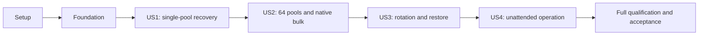

# Tasks: Persistent Pico2 Multi-Pool KES Agent

**Input**: Design documents from `specs/001-pico2-kes-agent/`: `plan.md`, `spec.md`, `research.md`, `data-model.md`, `quickstart.md`, and all five `contracts/*.md` documents; governance from `.specify/memory/constitution.md`.

**Prerequisites**: Follow the resolved plan and contracts, including the corrected native baseline. Planned paths below are implementation destinations, not claims that those files already exist. This task list does not authorize production-key experiments, irreversible provisioning, or a hardware upgrade.

**Tests**: Included because the specification explicitly requires independent story tests, fault injection, physical qualification, independent decoding, and accepted primary-producer blocks. Write behavioral regressions before their implementations and observe meaningful failures; do not replace them with source-text, wiring, or mock-echo assertions. Actual public-interface smoke runs remain required in addition to tests.

**Organization**: Setup, shared foundation, four story increments in specification order (US1–US3 P1, US4 P2), then complete-product qualification. Each story has a standalone acceptance scenario against completed prerequisites; shared dependencies are explicit, not concealed as independent greenfield delivery.

## Format: `[ID] [P?] [Story] Description`

- Every actionable task has an unchecked checkbox, sequential ID, concrete file paths, and a story label only within a story phase.
- `[P]` identifies a task eligible for a documented parallel wave after its prerequisites; it never permits concurrent edits to a shared file or bypasses phase gates.
- Tests, models, services, endpoints, and integration are ordered within each story. Within a phase, run unmarked tasks in order unless a narrower dependency is explicitly stated.
- Constraint quotations reproduce the model where unchanged; expanded commissioning, context and publication fields follow the refined `data-model.md` and normative contracts, not an older quoted subset.

## Path Conventions

- Repository-relative Rust paths follow `plan.md`: root host package, `crates/kes-core/`, `crates/kes-protocol/`, `firmware/`, `third-party/kes-summed-ed25519/`, `qualification/`, `tests/`, `fuzz/`, `benches/`, and `deploy/`.
- Native paths below are absolute in `/home/westbam/haskell/cardano-node/` and `/home/westbam/haskell/ouroboros-consensus/`. Newly named native test/decoder modules must be registered in the discovered native manifests and test runners, using those repositories' conventions.
- `evidence/<candidate>/<gate>/report.json` denotes a runtime output path: replace `<candidate>` with the recorded revision plus dirty-source digest and `<gate>` with the stated gate. Never commit secret fixtures, traffic, seeds, key0 references, or recipient credentials.
- Every report records candidate/source pins, gate-definition hash and approval, tool versions, environment, counts, exclusions, oracle, and verdict. Missing hardware/tooling/approval is blocked, never a fabricated pass.

## Blocking Pre-Implementation Approval

Before executing T001–T100, obtain and record maintainer approval of `contracts/quality-gates.md`, including applicable scopes, sensor mappings, thresholds, exclusions, execution budgets, and evidence requirements. The approval record must identify the approver, date, and approved document revision or content digest.

Documentation review and read-only prerequisite discovery may precede approval. Implementation, build-configuration changes, and qualification-tool code may not.

Approval of the definition does not activate a gate or constitute a passing reading. Activation requires implemented checks, nonempty workloads, and demonstrated defect/regression sensitivity. Missing approval blocks execution.

The maintainer explicitly approved the synchronized verification-contract definition, recorded with its verified digest in `contracts/quality-gates.md`. The definition-approval prerequisite for T001–T100 is satisfied; the referenced storage bytes are unchanged. T005 must bind its manifest to this approval, not the historical U1/U2/I1 record. All other prerequisites remain. No task is complete and no gate reading is asserted.

C1 defines reload as post-initialization SIGHUP, not a new provider protocol. Its synchronized obligations and deadlines in [SIGHUP reload qualification](contracts/quality-gates.md#sighup-reload-qualification) are approved but unmeasured. The dated approval record supersedes the frozen definition's proposal-time status wording, not its required scenarios or bounds; approval is not evidence of safe live reload.

## Phase 1: Setup (Shared Infrastructure)

**Purpose**: Establish the approved toolchain, source inventory, and workspace without importing predecessor product scope.

- [ ] T001 Retain package `pico2-kes-agent` and edition 2024 while creating workspace manifests in `Cargo.toml`, `crates/kes-core/Cargo.toml`, `crates/kes-protocol/Cargo.toml`, `firmware/Cargo.toml`, and `qualification/Cargo.toml`; select host default members, explicit `pico2-kes-agentd`/`pico2-kes-agent-cli` binaries, `pico2-kes-firmware`, and no_std core/protocol boundaries without Linux dependencies in firmware.
- [ ] T002 Pin Rust 1.99.1 and production target support in `rust-toolchain.toml`, `.cargo/config.toml`, `firmware/memory.x`, and `firmware/build.rs`; reserve the single 1-MiB image and state-partition offsets from `contracts/device-storage.md`, and install `thumbv8m.main-none-eabihf` without making the isolated fuzz nightly the production toolchain.
- [ ] T003 Record reviewed direct/transitive dependencies and licenses in `Cargo.toml`, member manifests, `Cargo.lock`, and `deny.toml`, using exact R3/R4/R7/R9/R10 pins from `specs/001-pico2-kes-agent/research.md`; retain only required reviewed no_std manifest patches, audit maintenance/security, and do not import predecessor runtime or custom cryptographic primitives.
- [ ] T004 [P] Capture corrected node/consensus source inventory, dirty-source digests, GHC/Cabal versions and resolved dependency plans in `qualification/native-sources.json`; verify the research node/consensus pins and agent/crypto archive SHA-256 values, preserve supported baseline semantics, and explicitly exclude reintroduction of removed cardano-kes-forge integration. Record a compatibility matrix for legacy triples, singleton file, singleton agent, existing versioned forms, and any external-signing forms. Include the existing SIGHUP initialization boundary, configured-path reuse, malformed/missing-file outcomes and current bulk-agent rejection. Record the inspected receiver-cancellation hazard separately from the isolated probe and any actual native reproduction. This inventory records the corrected baseline; it does not authorize removing supported functionality or imply that a binary's reported revision proves its dirty-source identity.
- [ ] T005 [P] Translate the explicitly approved synchronized `specs/001-pico2-kes-agent/contracts/quality-gates.md` definition into `qualification/gates.json`, preserving G1–G10/P0/P1 budgets, thresholds, sensor mappings, limitations, and gaps; verify the approved gate-definition and unchanged referenced storage-contract digests and bind the manifest to the current verification-contract approval. Include the synchronized C1 G2 native regression and G9 actual reload/accepted-block scenarios and deadlines by reference to `contracts/quality-gates.md#sighup-reload-qualification`, not as a future synchronization task. Reconsult full MCP entries when sensor applicability or tooling changes. Manifest creation is not gate activation or a passing reading.
- [ ] T006 [P] Install/version-check the pinned quality tools through `qualification/tools.toml` and `qualification/src/tools.rs`, including proptest, Criterion, mutants, llvm-cov, fuzz/nightly, audit, deny, native oracles and hardware tools; report unsupported or missing tools explicitly rather than declaring gates active.
- [ ] T007 Record the actual accepted A2 silicon, fitted flash JEDEC/SFDP geometry, page/erase constraints, guaranteed minimum sector endurance with datasheet source and qualified voltage/temperature conditions, documented prior-wear upper bound, entropy qualification procedure, power controller, and legitimate development USB identity in `qualification/hardware.json`; verify the planned 4-MiB/4,096-byte-sector/256-byte-page layout is supportable before enrollment, without flashing or irreversible operations as a side effect of discovery. Missing rating, operating-condition or wear-history evidence leaves endurance qualification inconclusive.

**Checkpoint**: Source/tool/part identities and gate approval are recorded. Unavailable hardware may leave execution blocked but cannot be replaced by a simulated fit claim.

## Phase 2: Foundational (Blocking Prerequisites)

**Purpose**: Implement bounded representations, transport boundaries, protected memory, and real verification infrastructure shared by all stories.

- [ ] T008 Implement checked identity and bounded-value types in `crates/kes-core/src/identity.rs` and `crates/kes-core/src/lib.rs`: "Version 1 uses unsigned checked integers, byte arrays with fixed lengths, and bounded collections."; "Device, incarnation, generation and operation IDs are 16 bytes; pool ID is the 28-byte Blake2b-224 hash of its 32-byte cold verification key, exactly as in the adopted forge artifact."; "Identifiers exposed as JSON use lowercase fixed-width hexadecimal, never filesystem paths."; "Storage-slot number is never a pool identity."; "Network identity binds the genesis digest and protocol parameters, not merely network magic."
- [ ] T009 Implement mutation/receipt types in `crates/kes-core/src/operation.rs` per `data-model.md`: commissioning sequence 0/serial binding, pinned device identities thereafter, monotonic sequence, operation ID, action, targets, expected revision and separate CLI/device request digests. Journal the exact derived USB arguments before effects; reject changed digests/stale targets. Retain commissioning public results and terminal deletion publication descriptors as specified; no next managed mutation before durable receipt handoff, while automatic evolution/current delivery remain independent.
- [ ] T010 [P] Implement the complete bounded USB v1 request/response codec in `crates/kes-protocol/src/usb.rs` and parser regressions in `crates/kes-protocol/tests/usb.rs`: `PKA1`, BE fields, canonical CBOR, CRC32C, 4,096-byte preallocation bound, kinds 1–10, exact identities and strict reconnect framing per `contracts/device-storage.md`; include commissioning sequence 0, pool/incarnation context plus publication-time sample, stored publication descriptors, deletion receipt and enrollment timestamp floor. Distinguish ephemeral request numbers from durable operation IDs.
- [ ] T011 [P] Implement the management v1 codec and stable error/outcome types in `crates/kes-protocol/src/management.rs` with behavioral decoding tests in `crates/kes-protocol/tests/management.rs`: 16,384-byte length limit, duplicate/unknown/trailing-field rejection, strict integer/hex widths, exclusive result/error branches, all documented actions and no operational-secret response per `contracts/management-cli.md`.
- [ ] T012 [P] Implement bounded flash/clock/entropy interfaces and a deterministic faultable storage adapter in `crates/kes-core/src/platform.rs` and `crates/kes-core/tests/support/flash.rs`; expose every program/erase/marker boundary and fitted-part page restrictions, model torn writes/erase/read failures, and prevent the adapter from being mistaken for physical qualification.
- [ ] T013 [P] Implement host locked/zeroizing secret buffers, nondumpable setup, and atomic no-clobber public file/receipt utilities in `src/memory.rs`, `src/files.rs`, and `src/lib.rs`; fail readiness if required memory protection fails, wipe all error/disconnect paths, and prohibit secrets in Debug/log/diagnostic representations.
- [ ] T014 Implement the actual fixture parser, prerequisite checks and sanitized evidence recorder in `qualification/src/fixture.rs` and `qualification/src/evidence.rs`, and the foundation qualification in `qualification/src/foundation.rs` dispatched by `qualification/src/main.rs` as `cargo run --locked -p qualification -- foundation`. Exercise actual T010/T011 bounded decoders with malformed and oversized input, the actual T013 protection initializer in a subprocess with deterministic OS memory-lock denial, and the actual fixture parser rejecting locally generated invalid public input before side effects. Require the exact quickstart device/source/network/power/recipient/oracle bindings for applicable fixture-driven scopes, refuse production credentials/networks and missing prerequisites, and invoke real tools directly with bounded output/timeouts rather than shell interpolation or successful no-op commands. Foundation itself requires no fixture, hardware, daemon, or T042 binaries.
- [ ] T015 Build pinned independent Cardano/Haskell oracle adapters in `qualification/native/Main.hs` and `qualification/src/oracle.rs`, using research's unmodified `cardano-cli 11.4.0.0` and pinned agent/crypto sources; expose Sum6KES generation/evolution/signature/state, op-certificate, direct service-byte, and conventional-envelope decoding comparisons using disposable protected inputs and public-only result hashes. Wire `native-regression --fixture` through `qualification/src/main.rs` to invoke registered actual native cases and report their command/source identity and outcomes; T047/T055 add the receiver/finalizer cases, whose scope remains pending until then, never a passing empty run.
- [ ] T016 Configure executable gate dispatch and report validity checks in `qualification/src/gates.rs`, `qualification/src/main.rs`, `qualification/gates.json`, and `.github/workflows/quality.yml`; dispatch T014's `cargo run --locked -p qualification -- foundation` and wire host/firmware/native checks and later hardware subcommands with explicit required-scope tracking, stale/empty/inconclusive rejection, and no passing reading for an unimplemented scenario. Foundation reports missing execution or incorrect outcomes as nonzero, not a full G2 or firmware pass.
- [ ] T017 Configure five bounded fuzz entrypoints and sanitized seed corpora in `fuzz/Cargo.toml`, `fuzz/fuzz_targets/usb.rs`, `fuzz/fuzz_targets/node_service.rs`, `fuzz/fuzz_targets/management.rs`, `fuzz/fuzz_targets/certificate.rs`, and `fuzz/fuzz_targets/artifact.rs`; use actual available parsers, register remaining story parsers when implemented, and keep those scopes pending until nonempty semantic execution exists.
- [ ] T018 Implement reusable deterministic action generation and exhaustive state exploration in `crates/kes-core/tests/support/actions.rs` and `crates/kes-core/tests/support/explorer.rs` for G3's 64-pool sequences and finite 2-pool/3-period model; include retries, torn writes/erases and both activation/discard orderings, with counters and exhaustion reported as inconclusive.
- [ ] T019 Configure Criterion measurement and comparison infrastructure in `benches/lifecycle.rs`, `benches/host.rs`, `qualification/src/benchmarks.rs`, `qualification/src/main.rs`, `crates/kes-core/Cargo.toml`, and root `Cargo.toml`. Register the `kes-core` target `lifecycle` with path `../../benches/lifecycle.rs` and the `pico2-kes-agent` target `host` with path `benches/host.rs`, both `harness = false`; keep host-only dependencies out of no_std core. Dispatch `cargo run --locked -p qualification -- benchmarks --baseline "$BASELINE_REV"` to run both targets for approved baseline and candidate, with three separately retained runs, 100 samples, 5-second warmup, 10-second measurement, fixed environment and per-workload 95% ratio-CI <=1.05 pass, >1.05 fail, crossing inconclusive, within the combined 30-minute budget without skipping workloads. Direct `cargo bench --locked -p kes-core --bench lifecycle -- --save-baseline "$RUN_LABEL"` and `cargo bench --locked -p pico2-kes-agent --bench host -- --save-baseline "$RUN_LABEL"` are measurements, not aggregate passes. Add real workloads as stories land and forbid a skeleton baseline or invented benchmark sensor ID.
- [ ] T020 Execute `cargo run --locked -p qualification -- foundation` after T010/T011/T013/T014/T016, exercising actual bounded transport rejection, deterministic protected-memory failure and locally generated invalid public fixture rejection without T042 binaries, hardware, daemon or external fixture. Run foundational host/no_std checks and record structured nonsecret outcomes in `evidence/<candidate>/foundation/report.json` within the G2 30-minute host budget; missing execution or incorrect outcomes return nonzero. Keep story/hardware scopes pending and activate only gates with demonstrated nonempty measurements; this is not a full G2 or firmware pass.

**Checkpoint**: Foundation complete before story implementation. Infrastructure has exercised behavior, not placeholder success; product readings remain pending until their real workloads exist.

## Phase 3: User Story 1 — Recover pool keys after complete power loss (Priority: P1)

**Goal**: Commission one pool, generate/certify it through the daemon/CLI, deliver its current key, then recover the same lineage after complete host/device power loss with catch-up and verified cleanup.

**Independent Test**: With disposable credentials, deliver relative period 5, remove host/device power, restore at period 8 with fresh context, and independently sign/verify with unchanged generation, vkey and certificate. Exercise expired state, stale/regressive context, torn commits, failed erasure and isolated/shared corruption; no earlier or unclean key may be served.

### Tests for User Story 1

- [ ] T021 [P] [US1] Add persistent transaction and recovery regressions in `crates/kes-core/tests/recovery.rs`, covering every PREPARE/COMMIT/CLEAN cut, abandoned candidate removal, valid newer commit with corrupt body, divergent revisions, orphan objects, directory intent recovery, expired outage, isolated quarantine and shared-state failure. Include blank/partial/committed first commissioning, unchanged identity after committed retry, no reinitialize on corruption, per-incarnation floor commits and atomic publication timestamp/state recovery; assert no acknowledged/released rollback or delivery before cleanup.
- [ ] T022 [P] [US1] Add independent all-period KES, certificate and generation-artifact tests in `crates/kes-core/tests/crypto_compatibility.rs`, using T015's oracle for periods 0–63, 31→32, first invalid period, lifetime below 64, wrong cold/hot identity, signatures/counters, failed entropy and immutable key0 artifact bindings; no committed plaintext fixture.
- [ ] T023 [P] [US1] Add public-interface single-pool/retry/time-context and V2 contract tests in `tests/single_pool.rs` and `tests/node_service.rs`; cover attended daemon commissioning, pin-record publication/reconciliation, fragmented streams, four-byte confirmations, generation/certificate handoff, lost replies and reconnect freshness. Assert exact device-owned timestamp/bundle reuse across commit/reply/confirmation cuts, no new publication on metadata-only commits, monotonic later publications, overflow rejection, no timeout-as-rejection and no Drop on temporary unavailability.

### Implementation for User Story 1

- [ ] T024 [US1] Implement Device/Pool/Publication and enrollment-record models in `crates/kes-core/src/device.rs` and `crates/kes-core/src/pool.rs` per `data-model.md`: blank-only explicit on-device commissioning, initial result binding, optional recipient, authenticated configuration, pool/cold/incarnation/slot/network identities, revision, optional period floor, certificate counter and device-owned publication descriptor. Reject duplicates, unsupported network context and enrollment 65; re-enrollment creates a new incarnation without old slot secrets or period floor.
- [ ] T025 [US1] Implement Generation/PublicObject models in `crates/kes-core/src/generation.rs` and `crates/kes-core/src/public_object.rs`: "Random generation ID; pool-local monotonic generation number; creation operation ID; 32-byte KES vkey; 608-byte canonical current state; relative period; role; optional certificate; public-object digest; artifact digest; recipient snapshot; auto-activation flag"; enforce "At most one active and one staged per pool. All generations originate on-device. Uncertified remains period zero. Generation success requires immutable backup commit. No implicit staged overwrite." and "Generation identity, 4,064-byte public tree, immutable <=2,048-byte artifact, integrity digest" with "One 8-KiB region per retained generation. Certificate belongs in the mutable authenticated pool snapshot, not in an immutable object needing rewrite after certification. No operational secrets in this region."
- [ ] T026 [US1] Implement Certificate model, canonical encoding and verification in `crates/kes-core/src/certificate.rs`: fields "Cold key, KES vkey, issuance counter, absolute start period, signature, canonical encoded certificate"; enforce "Verify exact Cardano signed representation, cold identity, generation vkey, non-regressive issuance, configured lifetime and primitive limits. Exact reinstallation is idempotent. Changed data with same/lower accepted counter is rejected. Persist highest counter after generation retirement."
- [ ] T027 [US1] Implement PeriodContext model and checked period decisions in `crates/kes-core/src/period.rs`: exact pool/incarnation/network target, slots-per-KES-period, lifetime 1–64, absolute period, synchronized publication-time sample, freshness/session/sequence. Commit a raised per-incarnation period floor before context success, reject lower periods, refresh equal-period leases without writes and reset freshness on reconnect/reboot. Retain floors through expiry/rotation/discard, remove them on pool deletion, and require fresh context on re-enrollment without a network-history registry or inherited slot floor. Use checked P-S and recheck freshness before delivery.
- [ ] T028 [US1] Integrate the minimal provenance/license-preserving no_std Sum6KES 0.2.1 adaptation in `third-party/kes-summed-ed25519/Cargo.toml`, `third-party/kes-summed-ed25519/src/lib.rs`, and `crates/kes-core/src/kes.rs`; maintain canonical 608-byte states, 4,064-byte public tree, 32-byte root/seed, 448-byte signature and one shared workspace, verify T022 independently, and expose no production device block-signing/import API.
- [ ] T029 [US1] Implement RecipientPolicy and immutable KESBKP01 production in `crates/kes-core/src/recipient.rs` and `crates/kes-core/src/backup.rs`: "Public X25519 key (32 bytes), SHA-256 fingerprint, monotonically increasing policy revision"; "Exactly one current policy across all pools. Reject invalid/low-order keys through the chosen crypto implementation. Changes affect future generations only."; preserve all 16 fields, 13-field header/15-field unsigned map, exact forge domains, RFC 9180 suite, trusted-device Ed25519 origin signature, 624-byte ciphertext and <=2,048-byte artifact from `contracts/backup.md`.
- [ ] T030 [US1] Implement authenticated two-bank transactions and directory intents in `crates/kes-core/src/storage.rs` and `crates/kes-core/src/recovery.rs`; use HKDF-separated XChaCha20-Poly1305 keys/fresh 24-byte nonces, independently authenticated COMMIT/CLEAN pages, exact slot geometry, maximum-size proofs, candidate/public-object verification, erase/read-verified predecessor and scratch cleanup, tombstones, and fail-closed successor precedence per `contracts/device-storage.md`.
- [ ] T031 [US1] Implement A2 Embassy startup, health-checked entropy, qualified raw-flash operations and explicit attended identity enrollment in `firmware/src/main.rs`, `firmware/src/entropy.rs`, and `firmware/src/flash.rs`; read-verify the entire allocated state region before blank admission, bind the first identity to commissioning sequence 0/operation digest, recover valid COMMIT and reject nonblank partial/ambiguous initial state without reset. Use SRAM flash routines with XIP/cache/core/interrupt handling, preserve state during attended installation, and require no fuse programming.
- [ ] T032 [US1] Implement the real USB interface and kinds 1–10 dispatch in `firmware/src/usb.rs` and `firmware/src/service.rs`; implement commissioning/blank hello without invented identity, signed committed hello, exact-target context floors, device-owned publication descriptors in status/current and terminal deletion receipts. Enforce sequence/digest/revision and receipt retention; no operational key before normal pin validation and valid context/CLEAN, no secret-bearing logs.
- [ ] T033 [US1] Implement initial generation/certification/activation, forward evolution, expiry and recovery gating in `crates/kes-core/src/lifecycle.rs`; atomically commit artifact plus activation intent at generation (download is read-only), keep uncertified state at zero, reject staged overwrite, erase temporary seeds/obsolete states before release, require no backup approval, and never silently replace expired keys. Commit device-owned publication descriptors/timestamps with visible key/Drop transitions, retaining them on metadata-only updates and rejecting overflow.
- [ ] T034 [US1] Implement public append-only intent/receipt journal and restart reconciliation in `src/daemon/journal.rs`; fsync CLI intent and exact derived device request before dispatch, and terminal result before reply/receipt acknowledgment. Preserve commissioning results, retired-generation outcomes and completed deletion timestamp floors keyed by device/pool identity. Validate checksums/torn tails, fail on acknowledged-history corruption, enforce the 64-MiB admission bound without blocking autonomous evolution/expiry/current delivery, and never invent recovery after physical host-storage loss.
- [ ] T035 [US1] Implement sole-owner nusb transport and reconnect identity verification in `src/daemon/usb.rs`; normal mode validates the configured ID and nonce-bound Ed25519 pin before keys. Only explicit commissioning mode can acquire the initial public pin through the attended contract. Allow one USB request in flight, distinguish pre-admission failure from uncertain mutations, and reconcile the outstanding sequence including commissioning before admitting another mutation.
- [ ] T036 [US1] Implement per-network era-aware context acquisition in `src/daemon/context.rs`, invoking the configured unmodified `cardano-cli` directly with bounded output/timeouts every 5 seconds; validate exact genesis/network binding, synchronized trusted time, no future/stale tip and 30-second freshness. Fan observations and publication-time samples to exact pool/incarnation targets; enforce independent durable floors, new sessions after reconnect and no guessed period fallback.
- [ ] T037 [US1] Implement strict public daemon configuration and runtime-directory/socket ownership in `src/config.rs` and `src/daemon/sockets.rs`; support side-effect-free normal/commissioning `--check-config`, explicit `--commission` with selected serial/empty pools/management-only action allowlist, and normal startup requiring the installed device pin. Preserve network and immutable pool bindings, identical mode 0660/group/traversal policy, directory locking, live-endpoint conflict detection and removal only of owned stale endpoints.
- [ ] T038 [US1] Implement pinned V2 direct stream bytes in `crates/kes-protocol/src/node_service.rs`; use the exact version offer/choice/initialization, fixed key/certificate fields, u64 POSIX microseconds and u32 receive results from `contracts/node-service.md`, no extra framing or selector, bounded partial I/O and unsupported-only negotiation rejection; compare actual Haskell codec output.
- [ ] T039 [US1] Implement PoolSubscription/publication in `src/daemon/node_service.rs`: immutable pool/incarnation binding, V2 version, last delivered publication revision/time and bounded buffer. Forward the device's committed timestamp and matching bundle verbatim; never assign a host-side competing timestamp. One send then confirmation, 2-KiB buffers/5-second waits, coalescing and reconnect reuse; unavailable is not Drop.
- [ ] T040 [US1] Implement management dispatch for commissioning/status/list/enroll/shared-recipient setup/generate/vkey/artifact/certificate/reconcile in `src/daemon/management.rs`; enforce the commissioning-mode allowlist, sequence-0 identity receipt and no operational secrets on management. Derive enrollment timestamp floors from intact completed deletion receipts, not client overrides. Preserve common authority and reconstruct the public socket registry atomically from durable receipts.
- [ ] T041 [US1] Implement initial management CLI commands and exit/result contract in `src/cli/mod.rs`, `src/cli/client.rs`, and `src/cli/receipt.rs`; fsync a no-clobber public receipt before mutation, atomically update outcomes and print exact reconciliation advice. Implement `device commission --out` and commissioning `operation reconcile --out` public record publication without repeating initialization on I/O failure. Export public envelopes/immutable ciphertext without clobber, disclose retirement, and never use direct USB or handle backup private keys on primary.
- [ ] T042 [US1] Wire runnable daemon and CLI in `src/bin/pico2-kes-agentd.rs`, `src/bin/pico2-kes-agent-cli.rs`, and `src/daemon/mod.rs`, then remove obsolete `src/main.rs`; provide explicit attended commissioning-to-pinned-normal startup and external cold-certificate handoff. Exercise side-effect-free config paths now; perform physical commissioning only after T043's size/part checks in T044. Add no activate/import/signing compatibility command.
- [ ] T043 [US1] Measure firmware link size, maximum encoded snapshots/configuration/objects, stack/runtime high-water, flash stalls and entropy/erase behavior through `qualification/src/hardware.rs`; record image <=1 MiB, planned 128-KiB owned RAM budgets plus framework overhead, >=32-KiB spare SRAM and state-preserving attended installation in `evidence/<candidate>/hardware/report.json` before enrollment acceptance. Measure worst-case per-physical-sector erase costs and implement the checked service-life projection from `contracts/device-storage.md#endurance-acceptance-policy`, using the five-year/1,827-day horizon, selected monthly maintenance counts, network-derived transitions and 2× margin. Include prior wear, shared-sector hot spots, interrupted erases, cleanup/retries and background writes; report the limiting sector and unknown inputs. Treat this as preliminary implemented-scope evidence, with later lifecycle costs pending until T093.
- [ ] T044 [US1] Implement and execute one-pool `smoke` and persistent-boundary campaigns in `qualification/src/smoke.rs` and `qualification/src/power_loss.rs`; prove blank-device commissioning/pin installation and first-write/lost-reply outcomes, device-owned publication replay at commit/cleanup/reply/confirmation cuts, physical host/device period-5→8 recovery, independent valid signing with unchanged lineage/certificate, expiry/context/entropy/erasure/corruption failures and no primary plaintext outputs. Retain sanitized `evidence/<candidate>/US1/report.json`; host models are not physical evidence.
- [ ] T045 [US1] Run applicable G1–G8/G10 and benchmark measurements for the implemented single-pool scope, demonstrate relevant seeded-defect sensitivity before trusting readings, and update `specs/001-pico2-kes-agent/quickstart.md` with the exercised commissioning/recovery commands and `evidence/<candidate>/US1/gates.json`; explicitly leave bulk, full rotation, installed-operator and full-product gates pending.

**Checkpoint**: Independently usable single-pool recovery increment. No 64-pool, complete rotation, or full product acceptance claim follows from this checkpoint.

## Phase 4: User Story 2 — Operate 64 pools through one device (Priority: P1)

**Goal**: Route 64 correct current-key subscriptions through one daemon/device, support mixed native bulk sources, enforce common authority, and preserve healthy-pool operation during isolated failures.

**Independent Test**: Configure 64 independently certified pools in the actual bulk node, verify every pool's key/certificate/signing before and after reconnect and post-initialization SIGHUP, reject enrollment 65 with zero mutation, and exercise mixed file/agent plus singleton compatibility. Verify file-key catch-up without file rewriting, fresh agent delivery, cancellation-safe repeated reloads, and isolated agent outage/recovery without restarting the node process. Rotation continuity and deletion/re-enrollment slot-reuse acceptance remain pending until US3. US2 retains full-capacity allocation, routing, reconnect, isolation, and timing requirements; it does not claim these later lifecycle scenarios have passed.

### Tests for User Story 2

- [ ] T046 [P] [US2] Add 64-slot/common-authority and scheduling regressions in `tests/multi_pool.rs`, covering correct socket binding, duplicate/unknown/incarnation mismatch, denied clients, authorized management across all pools, 65th enrollment, stalled peers, queue bounds and isolated corrupt pools without cross-pool substitution.
- [ ] T047 [P] [US2] Add strict native bulk/source-selection, reload and receive-validation regressions in `/home/westbam/haskell/cardano-node/cardano-node/test/Test/Cardano/Node/BulkCredentials.hs` and `qualification/native/Main.hs`, registering native targets and their invocation through T015's `cargo run --locked -p qualification -- native-regression --fixture "$FIXTURE"`; use T004's compatibility matrix for legacy triples, versioned files/agents, singleton inputs, duplicate JSON/socket/cold identity, malformed envelopes, unsupported sources, wrong certificate, outage isolation and no fallback. Cover the actual SIGHUP loader path, early-init not-effective behavior, valid changed credential contents, baseline malformed/missing-file outcomes, slot-driven file-key catch-up without file rewriting, future/expired keys and agent reconnection. Before T054's fix, reproduce cancellation swallowed by the actual receiver/finalizer during service I/O; retain a failing-before/passing-after regression for cancellation in service I/O and reconnect delay, no retry after cancellation and completed cleanup under the approved SIGHUP qualification bounds. An isolated exception-loop probe alone is not the native regression.
- [ ] T048 [P] [US2] Add full-occupancy and allocation invariants in `crates/kes-core/tests/capacity.rs`, proving 64 active plus 64 staged snapshots/objects fit at maximum field sizes, rejecting overflow and enrollment 65 without mutation, and preserving distinct pool/incarnation and per-pool network bindings. Deletion followed by re-enrollment and slot-reuse behavior is exercised in US3 by T062/T066/T075/T077.

### Implementation for User Story 2

- [ ] T049 [US2] Complete the 64-slot directory and cooperative device work scheduling in `crates/kes-core/src/directory.rs` and `firmware/src/scheduler.rs`; reserve two generation slots per pool, retain only compact descriptors/one KES workspace, yield bounded generation/evolution steps, expose dirty revisions, and preserve healthy pools under isolated failure with explicit shared-failure handling.
- [ ] T050 [US2] Implement fair host scheduling in `src/daemon/scheduler.rs`, bounding one pending read and one latest publication per pool, one dispatched management mutation, 16 management connections/queued requests and two subscriptions per pool; alternate context/current/lifecycle work, coalesce obsolete notifications and prevent management saturation or slow subscribers from starving healthy pools.
- [ ] T051 [US2] Complete dynamic 64-pool registry and identical socket policy in `src/daemon/registry.rs`, integrating `src/daemon/sockets.rs` and `src/daemon/management.rs`; persist stable `<pool-id>.sock` bindings after enrollment reconciliation, reject conflicting mappings, never retarget live subscriptions after re-enrollment, and expose public paginated lists with page size <=16.
- [ ] T052 [US2] Create the strict versioned file/agent bulk decoder in `/home/westbam/haskell/cardano-node/cardano-node/src/Cardano/Node/Protocol/Shelley/Credentials.hs`; implement the exact `Bulk = [LegacyTriple | VersionedEntry, ...]` grammar from `contracts/node-service.md`, reject duplicate keys before Aeson normalization, resolve relative sockets against the bulk file directory, normalize absolute sockets, and produce entry/path-specific errors for invalid or duplicate selections.
- [ ] T053 [US2] Integrate file/agent source types, singleton/bulk loading and independent credential construction in `/home/westbam/haskell/cardano-node/cardano-node/src/Cardano/Node/Protocol/Shelley.hs`, `/home/westbam/haskell/cardano-node/cardano-node/src/Cardano/Node/Types.hs`, `/home/westbam/haskell/cardano-node/cardano-node/src/Cardano/Node/Parsers.hs`, and `/home/westbam/haskell/cardano-node/cardano-node/src/Cardano/Node/Orphans.hs`; preserve the existing `updateBlockForging` SIGHUP path in `/home/westbam/haskell/cardano-node/cardano-node/src/Cardano/Node/Run.hs` so startup and reload use the same source decoding and configured paths. Inspect LSP references before exported changes; preserve baseline diagnostics and malformed/missing-file behavior, not a new transactional reload policy. Never serialize an agent as file credentials, require a connected agent during static loading, evolve keys in the signal handler, or rewrite file-backed keys during catch-up.
- [ ] T054 [US2] Thread expected cold identity/network context and validate each received bundle before hot-key replacement in `/home/westbam/haskell/ouroboros-consensus/ouroboros-consensus-protocol/src/ouroboros-consensus-protocol/Ouroboros/Consensus/Protocol/Praos/AgentClient.hs`, `/home/westbam/haskell/ouroboros-consensus/ouroboros-consensus-protocol/src/ouroboros-consensus-protocol/Ouroboros/Consensus/Protocol/Praos/Common.hs`, and `/home/westbam/haskell/ouroboros-consensus/ouroboros-consensus-protocol/src/ouroboros-consensus-protocol/Ouroboros/Consensus/Protocol/Ledger/HotKey.hs`; inspect LSP references and migrate singleton/bulk consumers, check derived hot vkey/cold signature/counter/period/lifetime, and permit legitimate certificate/vkey rotation. Using T047's native reproduction, fix receiver cancellation so both the dedicated AsyncCancelled handler and broad SomeException handling propagate asynchronous termination rather than reconnecting; retain retries for genuine recoverable service errors. Verify awaited finalization closes receiver resources and cleans its key, without detached threads or a key-transfer cache. Preserve ordinary-disconnect local signing and explicit-drop behavior; replacement hot keys require fresh agent delivery.
- [ ] T055 [US2] Complete the exported-reference migration and native failure-isolation regressions in `/home/westbam/haskell/cardano-node/cardano-node/test/Test/Cardano/Node/BulkCredentials.hs` and `qualification/native/Main.hs`; use T004's compatibility matrix to verify every supported baseline form and explicit unsupported-source rejection. Prove wrong-socket/wrong-pool rejection, SIGHUP file-key catch-up, fresh replacement-agent delivery, ordinary-disconnect key retention versus explicit reload with an unavailable agent, and healthy file/agent operation while that agent is absent then returns. Verify repeated reloads complete old-receiver cancellation/cleanup without accumulation or retrying cancellation; do not restore absent external-signing paths or hold bootstrap hot-key equality forever.
- [ ] T056 [US2] Register new native modules/tests, pin agent 1.3.0.0/crypto 1.1.0.0 and the integrated consensus revision in `/home/westbam/haskell/cardano-node/cardano-node/cardano-node.cabal` and `/home/westbam/haskell/cardano-node/cabal.project`, following actual Cabal source conventions; capture all affected native manifest changes and resolved plans in `qualification/native-sources.json` and run native build/tests with no stale callers.
- [ ] T057 [US2] Implement real `load` qualification in `qualification/src/load.rs`, creating 64 independently certified active pools and resident staged generations, verifying every delivered pool/certificate/signature, rejected slot 65 and common authorization, measuring each request <=10 s and full recovery <=60 s under malformed/stalled traffic and recording per-request—not percentile-only—results.
- [ ] T058 [US2] Implement controlled native-node qualification in `qualification/src/node.rs`, supplying predeclared leadership opportunities within the unchanged G9 budget and an independent validating peer, exercising all 64 V2 sockets, separate mixed-source and singleton cases, and retaining accepted-block hashes before/after evolution, actual SIGHUP credential reload and complete power recovery. For each valid topology complete ten sequential post-initialization reloads without crediting signal coalescing, alternating I/O and reconnect-delay cancellation cases where applicable; include unchanged and changed valid contents and separately exercise early-init not-effective behavior. Record unchanged node PID, old receiver/socket termination and counts, no accumulation, current-period file signing with unchanged key-file bytes, fresh correctly bound agent delivery, baseline invalid/missing-file outcomes and healthy-pool operation during isolated agent outage/recovery. Apply the approved deadlines and inconclusive missing-leadership rule in `contracts/quality-gates.md#sighup-reload-qualification`; protocol notifications or merely sending a signal are not completion evidence. No backup producer is required.
- [ ] T059 [US2] Execute real 64-pool/load/native scenarios from `specs/001-pico2-kes-agent/quickstart.md`, including reconnect, repeated SIGHUP, different network contexts and all simultaneous active/staged allocations; record actual RAM/flash occupancy, verified keys, source-selection failures, latency and accepted-block evidence in `evidence/<candidate>/US2/report.json`. Include T058's native cancellation, file-key catch-up and isolated agent outage/recovery observations; fail on hung cleanup or receiver leaks rather than accepting a successful signal command. Rotation continuity and deletion/re-enrollment slot-reuse acceptance remain pending until US3. Retain full-capacity allocation, routing, reconnect, isolation, and timing requirements; do not claim these later lifecycle scenarios have passed.
- [ ] T060 [US2] Run applicable G1–G9/P1 and current benchmark gates, update the native integration instructions in `specs/001-pico2-kes-agent/contracts/node-service.md` and `specs/001-pico2-kes-agent/quickstart.md` with exercised SIGHUP commands, initialization/failure semantics and the explicit-reload outage caveat, and record revision-matched results in `evidence/<candidate>/US2/gates.json`. Missing reload/cancellation evidence, unsupported hardware capacity or missed deadlines block acceptance rather than reduce pool count, infer protocol-only compatibility or add an A4 requirement.

**Checkpoint**: Full-capacity routing, native source selection and SIGHUP reload work, with file-key catch-up, fresh agent delivery and cancellation-safe old-worker cleanup verified. Rotation continuity and deletion/re-enrollment slot-reuse acceptance remain pending until US3. US2 retains full-capacity allocation, routing, reconnect, isolation, and timing requirements; it does not claim these later lifecycle scenarios have passed. No isolated agent failure may hang reload, trigger file fallback or cause wrong-pool delivery.

## Phase 5: User Story 3 — Rotate keys without interrupting unrelated pools (Priority: P1)

**Goal**: Prepare replacements alongside usable active generations, activate automatically after export commitment/certification/timing/cleanup, reconcile retries, safely discard exact staged generations, and prove offline initial-key restoration fidelity.

**Independent Test**: With 64 operating pools and backup host offline, rotate one through lost replies and restart. Observe exactly one replacement without node restart, unchanged other 63 lineages, no early delivery and no superseded key resurrection. Separately restore on the recipient host with no daemon/device/producer and compare exact generation-time key0 bytes through an independent conventional decoder.

### Tests for User Story 3

- [ ] T061 [P] [US3] Add retry/rotation/retention contract tests in `tests/rotation.rs`, covering lost generation/export/certificate replies, byte-identical retrieval across evolution/reboot, future/absent/invalid/regressive certificates, offline backup, retired-artifact retries, recipient-policy changes, restart after durable activation and all 64 certified active/staged catch-ups.
- [ ] T062 [P] [US3] Add lifecycle race regressions in `crates/kes-core/tests/discard.rs`, exercising occupied staged rejection, both discard/activation commit orderings, exact generation/expected revision, repeated completed discard after later staging, deletion/re-enrollment incarnations, expiry before activation and unchanged active key/artifacts on rejected commands. Verify that reusing a deleted pool's storage slot creates a fresh incarnation, exposes no prior pool secret or artifact, rejects stale mutation retries, and never retargets an existing subscription to the new incarnation.
- [ ] T063 [P] [US3] Add restore contract tests in `tests/restore.rs`, using independent disposable vectors for every authenticated-field mutation, wrong recipient/device/pool/incarnation/generation/vkey, truncation, invalid KES state, output collision/symlink, mode 0600 and interrupted publication; failures must publish zero usable destination keys and never connect to daemon/USB.

### Implementation for User Story 3

- [ ] T064 [US3] Complete active/staged evolution and replacement activation in `crates/kes-core/src/lifecycle.rs` and `crates/kes-core/src/generation.rs`; evolve every started certified generation before eligibility evaluation, expire unusable staged generations, preserve a valid active generation while waiting, atomically change references/retire old state, and never wait for artifact download, archive/decryption/backup notification or separate approval.
- [ ] T065 [US3] Implement terminal retirement and artifact removal in `crates/kes-core/src/retirement.rs`: fields "Target generation/incarnation, reason, committed pool revision, artifact removal and secret cleanup status"; enforce "Reason is replacement, expiry, discard or pool deletion. Terminal; never resurrect or recreate from an old retry. Generation numbers and revisions never wrap."; remove only the targeted generation's objects, preserve certificate issuance history/public receipts, and return original identities plus `artifact_retired` on old retries without revoking external copies.
- [ ] T066 [US3] Implement generation-bound staged discard and pool deletion in `crates/kes-core/src/discard.rs` and `crates/kes-core/src/directory.rs`; serialize against automatic activation, require exact staged ID/revision, reject `target_not_staged` after activation and preserve active state. On deletion, commit the terminal Drop/high-water into the retained public receipt before freeing its sole pool record, then verified cleanup removes that incarnation's period floor. Reconcile without touching later replacements; re-enrollment seeds publication ordering from same-pool receipts, not network-period or slot history.
- [ ] T067 [US3] Complete recipient-policy replacement in `crates/kes-core/src/recipient.rs` and `firmware/src/service.rs`; accept only a validated shared public recipient under normal socket authority, persist monotonic policy revision with clean configuration commit, snapshot it only into future generations and preserve all retained artifact bytes/recipient bindings without a download override or plaintext bypass.
- [ ] T068 [US3] Extend storage/reconciliation integration in `crates/kes-core/src/storage.rs` and `src/daemon/journal.rs` for activation/discard/delete races and interrupted retirement; preserve authoritative commits, durable result handoff, no-wrap counters, retained original operation results after retirement, and independent automatic lifecycle progress while receipt acknowledgment or journal admission is blocked.
- [ ] T069 [US3] Integrate bounded simultaneous active/staged catch-up and automatic activation in `firmware/src/scheduler.rs`; qualify 64 active/64 staged boundary work, leave uncertified states at zero, keep healthy current delivery progressing while generating a replacement and expose only complete clean revisions.
- [ ] T070 [US3] Integrate rotation notifications and exact mutation outcomes in `src/daemon/node_service.rs` and `src/daemon/management.rs`; push a new complete bundle directly without intermediate Drop or node restart, preserve its durable timestamp, and expose `staged_occupied`, `target_not_staged`, retired retrieval and policy/delete results without hidden retries.
- [ ] T071 [US3] Complete discard/delete/recipient-change and retained-artifact CLI flows in `src/cli/mod.rs` and `src/cli/receipt.rs`; name exact targets, warn that device retrieval is lost and external copies survive, require interactive confirmation or `--yes`, retain original receipts for reconciliation, and never make automatic retirement wait for acknowledgment.
- [ ] T072 [US3] Implement backup-host local recipient creation/unlocking in `src/backup/recipient.rs`, reusing reviewed forge Argon2id/AEAD recipient-file format and resource limits; take passphrases only interactively from a terminal, protect/zeroize buffers, publish restricted no-clobber files and send only the public key through `recipient set`.
- [ ] T073 [US3] Implement offline restoration and CLI routing in `src/backup/recover.rs`, `src/backup/mod.rs`, and `src/cli/mod.rs`; require all trusted identity/vkey bindings, verify origin/suite/canonical artifact/recipient before decrypting exactly 608 period-zero bytes, derive/compare the root key, publish `KesSigningKey_ed25519_kes_2^6` with `590260` prefix atomically/no-clobber/mode 0600 and file+directory fsync, clean unpublished temporary files, and never open USB/socket or invoke a producer.
- [ ] T074 [US3] Implement and run real `interop` artifact/restore qualification in `qualification/src/interop.rs` with a test-only protected generation-time reference in `firmware/src/qualification.rs`; compare each qualification generation across pools byte-for-byte with original key0 and an independent conventional decoder, destroy references afterward, prove rejection publishes no key, and ensure production firmware has no plaintext initial-export interface or retained key0 copy.
- [ ] T075 [US3] Complete/run `crates/kes-core/tests/lifecycle_properties.rs` and `crates/kes-core/tests/lifecycle_model.rs`, comparing implementation with exhaustive model traces: >=10,000 sequences of 1–256 actions over 64 pools and all reachable 2-pool/3-period states including torn writes/erases, retries, slot reuse, retention and discard/activation races. Include two same-network pools with independent floors, quarantine isolation, last-pool deletion/re-enrollment, publication identity stability and deletion receipt timestamp continuity. Retain seeds, shrinking and state/transition counts without secret data.
- [ ] T076 [US3] Connect and exercise all five actual decoders and semantic invariants in `fuzz/fuzz_targets/usb.rs`, `fuzz/fuzz_targets/node_service.rs`, `fuzz/fuzz_targets/management.rs`, `fuzz/fuzz_targets/certificate.rs`, and `fuzz/fuzz_targets/artifact.rs`; include bounded allocation, canonical rejection and identity/state checks, verify nonempty execution/corpora and sanitize any minimized reproducer.
- [ ] T077 [US3] Extend and execute `qualification/src/smoke.rs`, `qualification/src/power_loss.rs`, and `qualification/src/node.rs` for offline-backup automatic rotation, lost-reply/restart boundaries, all retirement paths before/after download, recipient change, exact discard races and accepted primary blocks after rotation; prove no node restart, unchanged other 63 lineages and no duplicate/superseded generation in `evidence/<candidate>/US3/report.json`. After T066–T071, exercise deletion and re-enrollment through the real daemon/CLI, including interrupted deletion cleanup, reuse of the freed slot, stale-operation reconciliation, and old-subscription isolation. Verify that no previous pool secret or artifact is delivered and that unrelated pools remain usable; record the results in the US3 report.
- [ ] T078 [US3] Run applicable G1–G9/P0/P1 gates and update `specs/001-pico2-kes-agent/contracts/backup.md` plus `specs/001-pico2-kes-agent/quickstart.md` with exercised restoration/rotation/retirement behavior and `evidence/<candidate>/US3/gates.json`; state backup producer execution is not required and recoverable key0 artifacts preclude a full-system forward-security claim.

**Checkpoint**: Rotation and local restoration satisfy their own scenarios using US1/US2 prerequisites; neither backup-host availability nor successful restoration gates activation.

## Phase 6: User Story 4 — Run and diagnose the service unattended (Priority: P2)

**Goal**: Install the real service/utility, recover unattended after restart/reconnect, provide actionable nonsecret status, and complete all operator commands under the common socket policy.

**Independent Test**: Install and enable systemd/udev packaging, use the CLI for the full lifecycle and local restoration, restart/reconnect while a node signs, inspect identical socket permissions and primary persistence, and distinguish denied/unavailable/rejected/uncertain outcomes without direct-device fallback.

### Tests for User Story 4

- [ ] T079 [P] [US4] Add service-lifecycle tests in `tests/service_lifecycle.rs` for restart/USB reconnect, pinned-device mismatch, owned-stale versus live foreign endpoints, safe shutdown, fresh context, resubscription and node-held key preservation without false Drop.
- [ ] T080 [P] [US4] Add executable CLI outcome/confirmation tests in `tests/operator_cli.rs`, covering every command from `contracts/management-cli.md`, exit codes 0/2/3/4/5/6/7, no-clobber receipts, denied connections, lost reply/reconcile, exact discard/delete warnings, stdout JSON versus stderr diagnostics and local-only restore.
- [ ] T081 [P] [US4] Add security/resource-boundary tests in `tests/host_security.rs` for required locked-memory startup failure, bounded malformed/idle traffic, public-only durable journal/log/error outputs and zeroization paths; exercise deliberate disposable secret markers without committing secret fixtures or treating tests as proof of host snapshot policy.

### Implementation for User Story 4

- [ ] T082 [US4] Complete unattended daemon startup/shutdown and reconnect state transitions in `src/daemon/mod.rs`, `src/daemon/usb.rs`, and `src/daemon/sockets.rs`; reacquire only the intended device, reconcile pending results, refresh period sessions, preserve safe endpoint ownership and allow node-local signing during service/USB loss without PIN or manual key reconstruction.
- [ ] T083 [US4] Implement complete public health/status diagnostics in `src/daemon/status.rs` and `src/cli/status.rs`, exposing exactly `disconnected`, `recovering`, `ready`, `not_yet_valid`, `expired`, `delayed_evolution`, `storage_failure`, `entropy_failure`, and `period_unavailable` with affected identity/revision/actionable reason, no key bytes and no revocation of an existing valid key solely because new entropy failed.
- [ ] T084 [US4] Complete deadline/resource enforcement in `src/daemon/scheduler.rs`, `src/daemon/management.rs`, and `src/daemon/node_service.rs`; enforce 5-second incomplete-frame/read/write/handshake/confirmation idle limits and all queue/connection bounds, reject saturation before admission as `busy`, retain uncertain outcomes after admission and isolate slow/malformed clients without overstating protection from authorized destructive commands.
- [ ] T085 [US4] Complete and audit operator parsing/output behavior in `src/cli/mod.rs`, `src/cli/client.rs`, and `src/cli/status.rs` against the full management table and quickstart, including all status/enrollment/generation/export/certificate/discard/recipient/delete/reconcile/local commands, exact exit classes, stable public JSON, required paths/identities and no USB/activation/plaintext-import escape hatch.
- [ ] T086 [US4] Implement `deploy/pico2-kes-agentd.service`, `deploy/70-pico2-kes-agent.rules`, and `deploy/config.example.json` with dedicated account, common sockets, RuntimeDirectory/state ownership, UMask 0007, LimitCORE 0, sufficient LimitMEMLOCK, NoNewPrivileges, restricted writable paths and restart-on-failure; restrict USB to the daemon using legitimate VID/PID without `PrivateDevices` settings that break access.
- [ ] T087 [US4] Implement an explicit install/uninstall packaging path in `deploy/install.sh` and `deploy/uninstall.sh` for both release binaries, account/group, unit, udev rule and public configuration; validate inputs, preserve existing configuration/state on reinstall/uninstall, never erase enrolled device storage, and make required privileged/manual steps explicit.
- [ ] T088 [US4] Implement actual installed-operator qualification in `qualification/src/operator.rs`, driving systemd/CLI/device and permission-denied clients, collecting actual manual steps and all command outcomes, inspecting logs/journal/persistent outputs, and checking node/daemon memory, swap/hibernation/snapshot deployment policy rather than claiming daemon-only memory protection is sufficient.
- [ ] T089 [US4] Finish operator/deployment documentation in `specs/001-pico2-kes-agent/quickstart.md` and `specs/001-pico2-kes-agent/contracts/management-cli.md`, covering installation, external certification handoff, 64-pool bindings, receipts/reconciliation, recipient custody, retention warnings, honest A2 erasure limits, failure diagnostics, node-memory protections and absence of producer fencing.
- [ ] T090 [US4] Execute the installed end-to-end operator exercise through `qualification/src/operator.rs` and retain `evidence/<candidate>/US4/report.json`: lifecycle commands, cold handoff, restart/reconnect during actual node operation, live socket conflict/wrong device, slow-client pressure, denied/unavailable/rejected/uncertain exits, no plaintext primary persistence and offline restore with daemon/device/producer absent.
- [ ] T091 [US4] Run all applicable implemented-scope G1–G10/P0/P1 checks with real installed-service G10 readings, validate the exact quickstart commands and record remaining complete-campaign prerequisites in `evidence/<candidate>/US4/gates.json`; do not treat documentation review, simulated systemd or missing manual steps as operator completion.

**Checkpoint**: All four story increments are implemented and independently exercised against their prerequisites. Full product acceptance still requires the final same-candidate campaigns below.

## Phase 7: Polish & Cross-Cutting Concerns

**Purpose**: Complete full-scale physical qualification and same-candidate quality/security evidence; remove obsolete implementation weight, not acceptance requirements.

- [ ] T092 Extend and execute the full G8/SC-002/SC-009 campaign in `qualification/src/power_loss.rs`, covering every software persistent cut point plus >=1,000 randomized physical host/device interruptions across generation, certification, evolution, activation, discard, deletion and cleanup; use 64 active/63 staged before generation and 64/64 before evolution, record intentional occupancy changes, verify every obsolete secret-bearing region and retain `evidence/<candidate>/G8/report.json` without resetting replay history. Record conservative per-sector campaign wear against the physical part identity for T093's remaining-life calculation; do not reuse a pre-campaign wear baseline.
- [ ] T093 Run `qualification/src/load.rs` for 1,000 full-capacity rounds with reconnect, full-boundary catch-up, background replacement generation and malformed/stalled clients; require every verified request <=10 seconds and all valid pools recovered <=60 seconds after all stated prerequisites, with actual SRAM/flash and per-sector erase measurements in `evidence/<candidate>/P1/report.json`, not percentile or simulated substitutes. Complete T043's endurance projection for every implemented path using the authoritative five-year/monthly-churn workload in `contracts/device-storage.md#endurance-acceptance-policy`; include T092 and all other wear already consumed on this physical part, the load run itself, and justified network/era transition counts. Require `2 * (prior wear + projected service erases) <= guaranteed rating` for every sector; report all inputs, checked arithmetic and the limiting-sector margin. Missing/unbounded inputs are inconclusive; any later campaign requires recalculation before T100 acceptance.
- [ ] T094 Run complete real differential/native/operator campaigns through `qualification/src/interop.rs`, `qualification/src/node.rs`, and `qualification/src/operator.rs`, retaining `evidence/<candidate>/G7/report.json`, `evidence/<candidate>/G9/report.json`, and `evidence/<candidate>/G10/report.json`; require independent key0 decoding and rejection cases, actual accepted blocks before/after evolution/SIGHUP reload/rotation/power recovery with observed leadership, full mixed/singleton compatibility and no backup producer acceptance gate. Repeat T058's unchanged-process reload, file-key catch-up, receiver teardown/leak and isolated agent outage/recovery scenarios on this exact candidate; the isolated cancellation probe and older US2 results cannot substitute.
- [ ] T095 Execute all gate sensitivity probes using `qualification/src/gates.rs` and isolated disposable candidate copies: stale context, wrong-pool substitution, skipped erasure, duplicate retry generation, active-target discard, bypassed artifact authentication/output collision, parser over-allocation and controlled latency regression; ensure model/coverage probes expose invalid/unexecuted paths. Exercise the endurance evaluator with exact-bound acceptance, one over-budget hot sector despite a passing average, and missing rating/history/network inputs requiring an inconclusive result. Remove seeded defects and retain public detection evidence in `evidence/<candidate>/activation/report.json` before trusting candidate readings.
- [ ] T096 Complete representative real workloads in `benches/lifecycle.rs` for core generation, evolution/catch-up, certificate and artifact verification and in `benches/host.rs` for framing and real public journal fsync/reconcile; retain registrations in `crates/kes-core/Cargo.toml` and root `Cargo.toml` and the aggregate runner in `qualification/src/benchmarks.rs`. Approve the first correct baseline and run `cargo run --locked -p qualification -- benchmarks --baseline "$BASELINE_REV"` for both targets and both revisions with three separately retained runs; retain raw samples, environment and baseline revision in `evidence/<candidate>/P0/report.json`, with any inconclusive workload blocking acceptance. The direct `cargo bench --locked -p kes-core --bench lifecycle -- --save-baseline "$RUN_LABEL"` and `cargo bench --locked -p pico2-kes-agent --bench host -- --save-baseline "$RUN_LABEL"` commands are measurements only, not aggregate passes.
- [ ] T097 Execute final G1–G6 and approved remaining sensor scopes through `qualification/src/gates.rs`: host/no_std/firmware/native builds and lint/tests, properties/exhaustive model, mutation with zero unexplained critical survivors and >=90% remaining-module detection, >=90% relevant-crate line coverage/no changed-line regression, and all five fuzz targets at 24 hours each before release; retain nonempty counts, reviewed exclusions and public artifacts under `evidence/<candidate>/` without weakening thresholds after failure.
- [ ] T098 Reconcile implemented interfaces, measured limits and exact commands across `specs/001-pico2-kes-agent/plan.md`, `specs/001-pico2-kes-agent/quickstart.md`, and `specs/001-pico2-kes-agent/contracts/`; distinguish targets from measurements, document any approved compatibility migration, remove obsolete scaffolds/temporary probes and ensure firmware, daemon, CLI and native callers match the recorded candidate.
- [ ] T099 Perform independent trust-boundary and maintainability review of `crates/kes-core/src/`, `crates/kes-protocol/src/`, `firmware/src/`, `src/`, and `deploy/`, recording findings in `evidence/<candidate>/security/report.json`; review unsafe invariants, dependency maintenance, physical-claim exclusions, parser/secret handling, common-authority semantics, USB sole ownership, node memory and backup custody, fix actionable findings and invalidate/rerun affected readings after code changes.
- [ ] T100 Aggregate all FR-001–FR-021, SC-001–SC-009 and G1–G10/P0/P1 evidence for the same revision/source digests using `qualification/src/gates.rs` into `evidence/<candidate>/acceptance/report.json`; reject missing/stale/empty/failed/inconclusive readings or outstanding review findings, and report actual results plus exclusions without declaring product acceptance from host tests, prior candidates, scaffolds or incomplete hardware/node work.

U1/U2/I1 proof obligations are part of the existing tasks, not optional follow-ups: T030 includes first-identity commits, period floors and publication descriptors; T043/T093 prove maximum encodings and include their extra physical writes in endurance; T062/T068/T070/T077 cover deletion receipt handoff and same-pool timestamp continuity without retained period history; T080/T082/T085–T090 exercise commissioning mode and pin installation, while the normal systemd unit never enables that mode; T092/T095 include the refined fault boundaries and seeded regression cases from `quickstart.md`.

C1 proof obligations are also mandatory: the synchronized contract is explicitly approved, not future synchronization work; T004 inventories native SIGHUP and failure semantics and T005 translates the approved definition. T047 reproduces the actual receiver/finalizer cancellation failure before T054 fixes it, including blocked I/O and reconnect delay; T053 preserves the existing signal/loader path; T055 verifies file/agent lifecycle distinctions; T058–T060 and T094 exercise actual reload and accepted blocks under `contracts/quality-gates.md#sighup-reload-qualification`. Preserve all existing task IDs and parallel-wave ownership; T047 owns its native test/oracle changes until that wave is integrated, and T054/T055 execute afterward.

## Dependencies & Execution Order

### Phase Dependencies

1. After the blocking pre-implementation approval is recorded, Setup T001–T007 establishes the approved source/tool/part baseline.
2. Foundation T008–T020 blocks every story; codec/platform/memory work can fan out only after shared types are ready.
3. US1 T021–T045 supplies durable storage, initial lifecycle, daemon/CLI and one-pool service.
4. US2 T046–T060 extends US1 to capacity and native bulk integration.
5. US3 T061–T078 builds on US1 lifecycle and US2's 64-pool/native surface for its complete acceptance criterion. Its core race/restore tests can be authored earlier against the agreed contracts, but the story cannot finish without US2. US3 owns deletion/re-enrollment slot-reuse acceptance through T062/T066/T075/T077; US2 completion does not depend on that acceptance.
6. US4 T079–T091 packages and validates the complete US1–US3 surface. Service tests/packaging may be prepared earlier; full operator completion depends on all required lifecycle commands and restore.
7. Final T092–T100 requires all stories. Shared physical-device campaigns run serially on one fixture; separate approved devices/fixtures are needed for concurrency. Any code fix invalidates affected candidate readings.

### User Story Completion Graph

These are genuine completion dependencies, not a claim that all implementation files must be edited serially. Independent acceptance means a named scenario and oracle for each increment using completed prerequisites; it does not erase the specification's cross-story 64-pool rotation requirements.

### Within Each Story

- Start with the marked behavioral/contract test wave; register new test targets before running them and observe the relevant failing behavior, not a missing-tool failure.
- Models precede lifecycle services, services precede dispatch/CLI, and complete public paths precede physical/native acceptance.
- Use the contract's schema and exact target identities throughout; no duplicate conventions, deprecated aliases or hidden fallback APIs.
- Run native LSP references before exported API changes and migrate every affected caller together.
- Complete an exercised checkpoint before claiming the increment ready. Required unavailable measurements block that claim.

### Parallel Opportunities

| Wave | Prerequisites | Independent tasks | Integration constraint |
|---|---|---|---|
| Setup research/configuration | Recorded pre-implementation approval and T001–T003 | T004 native inventory; T005 approved-definition translation; T006 tool inventory | Separate files; finish all before foundational evidence |
| Foundation boundaries | T008–T009 | T010 USB; T011 management; T012 fault platform; T013 host protection | Shared exports/manifests owned by integration owner; combine before T014–T020 |
| US1 test design | Foundation | T021 recovery; T022 independent crypto; T023 executable/service behavior | Separate test files; implementation follows |
| US2 test design | US1 | T046 host capacity; T047 native grammar; T048 storage occupancy | Native suite registration serialized by native integration owner |
| US3 test design | US2 | T061 rotation; T062 discard races; T063 offline restore | Separate files; do not concurrently edit shared lifecycle implementation |
| US4 test design | US3 | T079 service; T080 CLI outcomes; T081 host security | Separate files; production integration follows |

Only these proven disjoint waves carry `[P]`. In particular, firmware storage/lifecycle edits, host receipt/dispatch edits, native caller migration, and campaigns sharing one physical device are not automatically parallel.

## Parallel Example: User Story 1

After T020, assign T021 (`crates/kes-core/tests/recovery.rs`), T022 (`crates/kes-core/tests/crypto_compatibility.rs`) and T023 (`tests/single_pool.rs`, `tests/node_service.rs`) to separate workers. Freeze identity/codec/oracle contracts first; one owner integrates test registration and then proceeds with T024–T045.

## Parallel Example: User Story 2

After T045, assign T046 (`tests/multi_pool.rs`), T047 (`/home/westbam/haskell/cardano-node/cardano-node/test/Test/Cardano/Node/BulkCredentials.hs`) and T048 (`crates/kes-core/tests/capacity.rs`) independently. Keep Cabal manifest edits with the native integration owner; run combined native/device scenarios only after T049–T058.

## Parallel Example: User Story 3

After T060, assign T061 (`tests/rotation.rs`), T062 (`crates/kes-core/tests/discard.rs`) and T063 (`tests/restore.rs`) independently. They share contract inputs but no edited files; lifecycle, journal and CLI mutations remain ordered through T064–T073 before qualification.

## Parallel Example: User Story 4

After T078, assign T079 (`tests/service_lifecycle.rs`), T080 (`tests/operator_cli.rs`) and T081 (`tests/host_security.rs`) independently. Keep the installed disposable systemd/device fixture exclusive during T088–T091 so service restarts cannot invalidate another worker's measurements.

## Requirement-to-Task Coverage

| Requirements | Owning tasks and observable proof |
|---|---|
| FR-001 minimal current-key provider | T028, T032–T033, T038–T044; local node signing, no per-block device request |
| FR-002 capacity | T024–T025, T043, T048–T050, T057, T059, T093; 64 active +64 staged and unchanged rejected slot 65 |
| FR-003 common pool routing | T037, T039–T040, T046, T051, T057; exact immutable socket binding/common authority |
| FR-004 native compatibility | T004–T005, T047, T052–T060, T094; mixed/legacy/singleton, SIGHUP file-key catch-up, cancellation-safe agent replacement, baseline failure semantics, no fallback |
| FR-005–FR-006 durability/erasure | T021, T030–T035, T043–T044, T068, T092; authoritative COMMIT, CLEAN before release, real cuts |
| FR-007 period/expiry | T027, T033, T036, T044, T064, T069, T075; fresh network-specific forward-only state |
| FR-008 generation/certification | T022, T025–T026, T028–T033, T061, T064; entropy and exact binding/counter validation |
| FR-009 retry/rotation | T009, T034–T035, T041, T061–T070, T077; stable original outcome and automatic publication |
| FR-010 immutable initial artifact | T022, T025, T029, T033, T061, T074; immutable ciphertext and original key0 fidelity |
| FR-011 conventional restore | T063, T072–T074, T090, T094; independent decoder, private local-only mode 0600 output |
| FR-012 retention | T025, T041, T061, T065–T071, T077; removal on all retirement paths without external revocation |
| FR-013 service lifecycle | T035, T037, T039, T079, T082, T086–T090; pinned reconnect and no false Drop/takeover |
| FR-014 secret handling | T013, T031, T034, T072–T074, T081, T086, T088–T090, T099; device/host/custody boundaries |
| FR-015 bounded failure/status | T049–T050, T079, T081–T084, T090, T093; healthy-pool deadlines and public reasons |
| FR-016 full socket authority | T037, T040, T046, T051, T067, T086, T090; no extra management credential |
| FR-017 recipient custody | T029, T061, T067, T072–T074, T089–T090; future-only public policy and private key off-primary |
| FR-018 export-triggered activation | T029, T033, T061, T064, T069–T070, T077; commit artifact+intent before success, no download gate |
| FR-019 A2/honest claims | T007, T031, T043, T092–T094, T098–T100; actual fitted storage and explicit exclusions |
| FR-020 complete utility | T041–T042, T071–T074, T080, T085–T091; installed operator command/exit matrix |
| FR-021 exact staged discard | T062, T066, T068, T071, T075, T077, T092; commit-order races and safe retries |
| SC-001, SC-003, SC-004 | T057, T059, T093; capacity plus every-pool 10/60-second outcomes |
| SC-002, SC-009 | T044, T081, T088, T092, T099; physical cuts, cleanup and primary persistence |
| SC-005 | T061–T071, T077, T094; offline-backup rotation with unchanged other 63 pools |
| SC-006 | T063, T074, T094; exact original key0 and independent standard-envelope decoding |
| SC-007 | T058–T059, T077, T094; peer-accepted primary blocks with actual leadership across SIGHUP reload, evolution, rotation and recovery; mixed-source reload and agent outage/return |
| SC-008 | T080, T085–T091, T094; documented installed operator completion/manual steps |
| Edge case: deletion followed by slot reuse | T062, T066, T075, T077, T092; cleanup before reuse, fresh incarnation, stale-request rejection, and no residual secret delivery |
| Constitution quality gate | T004–T006, T014–T020, story gate tasks, T095–T100; approved, sensitive, nonempty same-candidate readings |

## Implementation Strategy

### MVP First (User Story 1)

1. Complete Setup and Foundation, retaining all full-capacity representation/storage constraints from day one.
2. Complete US1 and independently exercise actual single-pool recovery through daemon/CLI/device and the pinned client/oracle.
3. Treat this as the first working delivery increment only. The specification makes 64 pools and multi-pool rotation mandatory, so an MVP demonstration is not full product acceptance or permission to ship a reduced-capacity substitute.

### Incremental Delivery

1. US1: durable generation, certification, current delivery and power recovery.
2. US2: complete 64-pool capacity, isolation and native bulk/file/agent interoperability.
3. US3: fully qualified replacement/discard/retirement/retry behavior and offline restore fidelity.
4. US4: installed unattended service, complete operator path and deployment security boundary.
5. Final phase: all SC criteria and approved gates pass on the same actual candidate, including physical campaigns and accepted primary blocks.

Each increment runs its own scenario and all applicable implemented-scope gates. Unimplemented scopes remain explicitly pending, never excluded to manufacture a passing full-product report.

### Parallel Team Strategy

Use the six documented disjoint waves, with one integration owner for shared exports/manifests and each shared implementation file. Native preparation and independent oracle work can proceed without hardware; final physical acceptance cannot. Do not run power interruption concurrently with another campaign on the same device, or restore removed native integration to fabricate compatibility coverage.

## Notes

- 100 tasks total: Setup 7, Foundation 13, US1 25, US2 15, US3 18, US4 13, Final 9. Nineteen tasks are marked `[P]` across six disjoint waves.
- Generation commits the encrypted artifact and automatic intent; `key export` retrieves immutable bytes and is not a second encryption or activation approval.
- No task adds cloud upload, remote firmware update, arbitrary signing, imported KES secrets, producer fencing, per-pool credentials, a stronger administrator role, mandatory irreversible provisioning, or an A4 upgrade.
- Physical/host-storage destruction, captured-flash rollback, malicious firmware, invasive extraction/remanence and retained external copies remain outside the accepted ordinary-power-loss/qualified-operational-erasure guarantee.
- Passing documentation structure is evidence about this task plan only. No implementation, runtime, hardware or accepted-block result is asserted by task generation.
