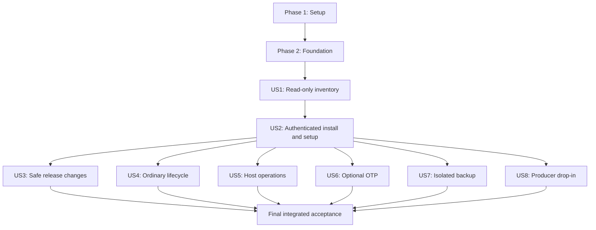

# Tasks: Pico2 KES Agent Management TUI

**Input**: Design documents from `/specs/002-manage-kes-agent/`.
**Prerequisites**: [plan.md](plan.md), [spec.md](spec.md), [research.md](research.md), [data-model.md](data-model.md), [manager contract](contracts/manager.md), [observations contract](contracts/observations.md), [distribution contract](contracts/distribution.md), [quality contract](contracts/quality.md), [quickstart.md](quickstart.md), and [constitution](../../.specify/memory/constitution.md).
**Organization**: Setup, shared foundation, eight user-story phases in specification priority order, then cross-cutting acceptance. Extend the existing Rust workspace and existing authorities; do not implement a second lifecycle, backup, OTP, or device-owner service.
**Delivery contract**: Build and deliver the full feature together end to end. All eight stories and all 70 tasks are required; no story subset is a release or a stopping point. Phases, priorities, independent tests and checkpoints organize internal implementation and verification only. Completion requires the integrated packaged product and all required end-to-end acceptance evidence.
**Tests**: The specification explicitly requests existing affected regressions, small checks for new critical logic, actual end-user acceptance, and the bounded constitutional performance gate using existing tooling. Write the targeted failing checks before their implementation; execute the integrated developer commands once after integration. Do not add a dedicated manager suite, coverage target/report, property/mutation/fuzz campaign, rendering snapshots, new benchmark executable, or producer-policy audit. Operator scenarios and the bounded Q1/Q3 comparison/calibration are executable checks, not instructions to automate eleven suites.

## Format: `[ID] [P?] [Story] Description`

- Every implementation task is an unchecked checklist item with a sequential ID and concrete file paths.
- `[P]` means a disjoint-file task can run in its explicitly identified wave after prerequisites; it does not remove dependencies or authorize simultaneous edits of shared routing files.
- `[US1]`–`[US8]` map directly to the specification's stories. Setup, foundation, and final tasks have no story label.
- Paths are repository-relative unless they name installed destinations. Proposed `src/manager/` files and root `install.sh` are new; other named integration surfaces already exist unless explicitly described as new.
- Acceptance reports use `evidence/p2kesup/<candidate>/Qn.md`, where `<candidate>` is the full candidate commit plus dirty-source digest when applicable. This is a concrete output naming rule, not permission to fabricate an evidence result. Record build/tool/environment/device identities, exact scenario, expected/observed outcomes, timing, failures, and public receipts; never secret contents.

## Phase 1: Setup (Shared Infrastructure)

**Purpose**: Adopt the existing design and operator-led quality scope without introducing another framework or changing the constitution.

- [X] T001 Confirm SO-002b/SO-002c/SO-006e applicability and approve the gate definition in `specs/002-manage-kes-agent/contracts/quality.md` before implementation, recording baseline-selection procedure, measurement tools/environment, thresholds, finite budgets and evidence naming in `specs/002-manage-kes-agent/quickstart.md`. Freeze a separately identified comparable baseline before candidate evaluation; if no manager baseline yet exists, use the prescribed initial comparable implementation rather than zero or the candidate itself. Approve the bounded behavioral calibration's known defect, invariant, exact check/scenario, runner versions, expected failure and reuse criteria before evaluation; T067 must demonstrate applicable defect detection before behavioral readings are trusted, separately from T068's performance sensitivity. Retain missing signing, compatible bundles, hardware, baseline/calibration, and five-operator prerequisites as blockers, not passing readings.
- [X] T002 Add exact Ratatui 0.30.2 with default features disabled and only its Crossterm backend, and Crossterm 0.29.0 dependencies in `Cargo.toml`, per the maintainer-approved dependency revision and backend alignment; resolve `Cargo.lock` against `rust-toolchain.toml` Rust 1.99.1/edition 2024; review maintenance, licenses, advisories, and target compatibility before adoption, reuse installed serde/rustix/standard threads, and add no async runtime.

---

## Phase 2: Foundational (Blocking Prerequisites)

**Purpose**: Shared public identity, persistence, receipt, and terminal primitives needed by all workflows.
**Gate**: Complete T001–T007 before user-story implementation. This foundation does not authorize installation or a privileged action before US2 authenticates and validates it.

- [X] T003 Implement shared host build identity in new `build.rs` and `src/build_info.rs`, export it through `src/lib.rs`, and add config/device-independent `--version` and `--version --json` to `src/bin/pico2-kes-agent-cli.rs` and `src/bin/pico2-kes-agentd.rs`; emit the exact schema-1 component/version/build_id/source_commit contract and mark development builds unqualified rather than inferring a release from the Cargo version; extend `tests/operator_cli.rs` with a small executable behavior check.
- [X] T004 [P] Define public manager model types in `src/manager/model.rs` for installation/component/source observations, composite pool/generation identities, release selection, maintenance and artifact references using the fields in `specs/002-manage-kes-agent/data-model.md`; preserve the observation enum "fresh/stale/unavailable/unsupported/unknown", device-mode enum "application/bootloader/absent/ambiguous", schema-1 new records, and the rule "Unknown schemas are read-only diagnostics and block mutation." Reuse existing IDs/config/receipt types rather than copying their validation.
- [X] T005 Implement bounded protected public records in `src/manager/records.rs` using `src/files.rs`: maintenance authority is "Public durable intent before mutation; no rewriting prior confirmed evidence to force success; privileged side revalidates plan"; enforce "maximum 1 MiB each, maximum 64 MiB retained per record store" and "At capacity, block new mutation with explicit export/archive guidance; never silently delete unresolved records." Use `/var/lib/p2kesup/` mode 0755, root-owned operator-group-readable records mode 0640 in a 0750 subdirectory, and backup-local protected XDG state; user XDG cache/state has "owner-only directories (0700) and files (0600)". Reuse exclusive creation, bounded reads, ownership checks, atomic replace, file/parent fsync and safe ancestry; include small inline checks for no-clobber, capacity refusal and unknown-schema mutation refusal, without changing existing receipt/OTP limits.
- [X] T006 [P] Implement existing-CLI operation orchestration in `src/manager/lifecycle.rs` using `src/cli/client.rs` and `src/cli/receipt.rs`: "Existing CLI receipt/journal authority; no second manager mutation ID; retain before submit and on uncertain exit"; pass exact targets/revisions and structured argv, let the CLI create the protected receipt before submission, retain its reference before launching, handle exit classes 0/2/3/4/5/6/7, and recover a created receipt even if the child produces no final JSON. Add a small behavioral check for interrupted submission retaining the original operation instead of creating a replacement.
- [X] T007 [P] Implement terminal ownership and foreground handoff in `src/manager/terminal.rs` using Crossterm/Ratatui: restore raw mode/alternate screen/cursor/echo on normal exit, errors, panic hook under `panic = abort`, and before inherited-stdio children; resume safely afterward, suspend observation during handoffs, never capture/tee secret or OTP interaction, and never pass passphrases through argv/environment. Keep this a terminal helper, not a workflow engine; exercise exit and child-failure restoration in a real terminal once US1 is runnable.

**Checkpoint**: Public records and existing receipt identities survive interruption; terminal handoff has one owner; no new mutation protocol or secret persistence exists.

---

## Phase 3: User Story 1 — Discover and monitor the actual installation (Priority: P1)

**Goal**: Read-only, unprivileged inventory that distinguishes installed/running/selected state and shows every device/configured/effective pool identity with truthful freshness.
**Independent Test**: Open the actual manager against absent, partial, healthy, mixed-version, disconnected and denied installations; compare independent public commands and host evidence. With 64 pools/128 generations, overview is available within 5 seconds, all responsive pools within 10 seconds, and loss visible within 10 seconds. No viewing action mutates state. Early developer-build checks are internal feedback only; final acceptance exercises this behavior in the complete packaged feature.

### Targeted checks before implementation

- [X] T008 [P] [US1] Extend existing inline fixtures/checks in `crates/kes-protocol/src/management.rs` and `crates/kes-protocol/src/usb.rs` for the three new read actions and kinds 13/14: canonical keys/types/widths, missing/duplicate/extra keys, null paired certificate fields, invalid page sizes, maximum-sized valid responses, 16,384-byte management/4,096-byte USB bounds, and rejection rather than truncation; preserve kinds 1–12 and mutation encodings.
- [X] T009 [P] [US1] Extend `tests/service_lifecycle.rs`, `tests/single_pool.rs`, and `tests/support/mod.rs` with the affected public observation/fake-device cases: complete membership versus failure, device-only pools, snapshot revision conflict, old-firmware capability refusal without repeated poisoning, and identity mismatch never downgraded to unsupported; assert public results rather than UI wording.

### Implementation

- [X] T010 [US1] Add schema-1 `host.observe`, `device.info`, and `pool.observe` management forms and CLI-compatible data in `crates/kes-protocol/src/management.rs`, and canonical allocation-free `FirmwareInfo` kind 13/`PoolObservation` kind 14 codecs in `crates/kes-protocol/src/usb.rs` exactly as `specs/002-manage-kes-agent/contracts/observations.md` defines; bound release/security strings to 64 UTF-8 bytes, build ID to 32 bytes, source commit to 40/64 ASCII hex bytes, bitmap to u64, and paired certificate start/lifetime to both-present or both-absent. Reads do not acquire mutation receipts or alter existing wire/storage formats.
- [X] T011 [P] [US1] Expose public generation/certificate/publication metadata from `crates/kes-core/src/generation.rs`, `crates/kes-core/src/lifecycle.rs`, and `crates/kes-core/src/device.rs` for exact pool/incarnation targets; retain "Existing lifecycle data; checked arithmetic; missing certificate or context yields explicit unknown fields" and avoid allocations, secret release, persistent-layout changes or lifecycle transitions caused by observation. Check exported-symbol references before changing existing APIs.
- [X] T012 [US1] Wire observation dispatch in `firmware/src/service.rs` and `firmware/src/usb.rs` and manifest-bound firmware version/build metadata in `firmware/build.rs` and `firmware/src/main.rs`; retain "Application identity bound to daemon session; physical bootloader association requires attendance; security report is not attestation", nullable device ID only for explicitly blank commissioning, existing error envelopes and pool-scoped failures; verify both new maximum responses fit the unchanged USB bound.
- [X] T013 [US1] Implement daemon observation/snapshot assembly in `src/daemon/management.rs`, `src/daemon/registry.rs`, `src/daemon/usb.rs`, `src/daemon/runtime.rs`, and `src/daemon/context.rs`: "Config and reconstructed journal registry remain distinct from device membership; full paging required before absence claims"; page 1–16 bindings within frame budget, bind snapshot ID to config/journal position, compute registry once per snapshot, reject changed pages with `revision_conflict`, and query unbound device pools with unavailable context. Derive expiry/relative/remaining by checked arithmetic and suppress untrusted time estimates; probe extensions at most once per authenticated connection, reconnect/reauthenticate boundedly where needed, and never mask pin failure or starve healthy node-service delivery.
- [X] T014 [US1] Add structured `host observe`, `device info`, and `pool observe` dispatch/rendering in `src/cli/mod.rs` and `src/cli/status.rs` using the shared bounded client, including cursor/snapshot/page-size and exact pool/incarnation inputs; preserve existing action/exit/receipt semantics and document the additive commands in `specs/001-pico2-kes-agent/contracts/management-cli.md`.
- [X] T015 [P] [US1] Implement read-only host/component discovery in `src/manager/observe.rs`: "Local observations plus authenticated installation registry; unknown ownership is external, never silently adopted" and "Keep installed/running/selected separate; do not execute untrusted binaries for discovery". Inspect support status, PATH candidates, systemd ExecStart/MainPID, permitted `/proc/<PID>/exe`, own executable, config access and ownership independently; inaccessible is unknown, not absent, and normal inspection needs no blanket root or node probe.
- [X] T016 [US1] Extend `src/manager/observe.rs` with bounded device/config/effective snapshot joins and refresh: membership is "≤64 pool/incarnation/revision entries" with "Existing authenticated inventory, duplicate rejection; unavailable is never an empty complete snapshot"; pool identity is "Exact composite identity; unmatched pools remain visible and queryable; no automatic repair"; observations obey "Retain last success on failure; null is not zero/empty/healthy; not all observations are simultaneous". Enforce "Observation memory is bounded to 64 device entries, 64 configured and 64 effective host identities, and 128 device generation slots, plus bounded pages." Also enforce "A full join can display up to 192 distinct source identities; never truncate unmatched bindings to the device's 64-pool capacity." Enforce "Generation details remain bounded by 64 device pools." Use monotonic age, an 8-second partial-result scan deadline, refresh every 2 seconds, one management request and one coalesced queued refresh; discard/restart conflicting snapshots only within the deadline and label unresolved scans incomplete. Add small boundary checks for unmatched joins and clock-independent staleness, including deterministic `manager::observe::tests::stale_after_observation_failure` for the failed-observation transition and preserved last-success evidence; T067 reuses this check for behavioral calibration.
- [X] T017 [US1] Implement the actual Overview/Pools/details UI in `src/manager/ui.rs`, register `src/manager/mod.rs` through `src/lib.rs`, and add `src/bin/p2kesup.rs` plus its `Cargo.toml` binary entry. Implement the entrypoint/exit classes and keyboard commands from `specs/002-manage-kes-agent/contracts/manager.md`, no-color labels, escaped untrusted controls, 100-ms maximum input polling, resize-preserved selection and an 80×24 minimum with safe quit; show generation/certificate/context/period/readiness reasons and observation ages, not a global healthy badge. Nonterminal invocation refuses interactive mutation; help/version work without a daemon.
- [X] T018 [US1] Update affected exhaustive consumers in `fuzz/fuzz_targets/management.rs`, `fuzz/fuzz_targets/usb.rs`, `qualification/src/fixture.rs`, and `qualification/src/load.rs`, and any discovered existing fake-device adapters, for the new read variants; synchronize `specs/002-manage-kes-agent/contracts/observations.md` with implemented bytes and keep node-service, storage, backup and mutation contracts unchanged. This is existing-consumer maintenance, not a new fuzz/load framework.
- [ ] T019 [US1] Exercise inventory portions of Q1, all Q3, and navigation/restoration portions of Q10 from `specs/002-manage-kes-agent/quickstart.md` through the actual `p2kesup` executable, recording `evidence/p2kesup/<candidate>/Q3.md`; include 64 active/64 staged slots, last/unmatched identities, incomplete pagination, missing context, mixed/unsupported builds, disconnect/permission loss, healthy-pool delivery isolation, no-network navigation, keyboard/no-color/resize/nonterminal behavior and elapsed times. Mark unavailable physical evidence blocked rather than substituting a host model.

**Checkpoint**: Read-only monitoring is verified for integration with the remaining workflows, not for separate delivery. Continue through all remaining stories; installation and downloaded-code execution must use US2's authenticated paths.

---

## Phase 4: User Story 2 — Install and set up a usable system (Priority: P1)

**Goal**: Authenticated source-free installation and resumable commissioning on the two selected x86-64 platforms, preserving existing operator state.
**Independent Test**: Run the HTTPS-hosted `curl | sh` bootstrap, admit a signed compatible RC explicitly by `--version TAG` on disposable Debian 12 and Ubuntu 24.04 without source tools, install/reopen, then complete first-install/commissioning on a factory BOOTSEL-only board and commissioning on an already-running compatible blank application with OTP declined. Payloads retain pinned authority verification. Rerun on an existing installation and exercise prerequisite decline/failure, external ownership, invalid inputs and interruption. No destructive reset, automatic re-pin or node discovery occurs.

### Targeted checks before implementation

- [X] T020 [P] [US2] Extend `tools/tests/test_publish_release.py` and affected verifier cases in `tools/tests/test_firmware.py` to reject missing/altered outer assets, wrong authority/purpose, unknown qualification status, incomplete publication and extra inner-bundle files; retain no-overwrite publication and verify promotion keeps tested payload/source identities. Add first-install preview/no-write, ambiguous-target refusal, firmware/state range exclusion and interrupted-record checks before T028. Use isolated public/disposable test authorities, never production signing material or weakened production pins.

### Implementation

- [X] T021 [P] [US2] Implement strict authenticated distribution admission in `src/manager/release.rs` per `specs/002-manage-kes-agent/contracts/distribution.md`: exact authenticated bytes; unknown schema/compatibility blocks installation; cache age is not authenticity. Use trusted OS signature tools and pinned primary/signer fingerprints, reject duplicate/unknown manifest keys, require exact authorized compatible digest tuples and readable schemas/profiles, and reverify inner firmware with the authenticated existing verifier. Normal discovery offers qualified releases only; candidates require explicit `--version TAG` or local `--bundle` and reviewed disposable-host acceptance with trust/state/hardware checks intact. Enforce manifest ≤1 MiB, ≤256 artifacts, path ≤240 bytes, artifact ≤256 MiB, total/cache admission ≤1 GiB and free-space checks; reject traversal, links/devices, control bytes, duplicates, undeclared entries and oversized expansion. Retain behavioral rejection checks.
- [X] T022 [P] [US2] Extend `tools/publish_release.py` to assemble/authenticate schema-1 `distribution.json`, `distribution.json.asc` and `install.sh.asc`, binding manager/daemon/CLI, deployment files, trusted firmware tool, patched picotool 2.3.1/runtime dependencies/license notices and unchanged inner `firmware/` bundle. Populate exact OS/prerequisite lists, authorized compatible tuples and signed candidate status; implement evidence-bound metadata-only promotion to qualified status without rebuilding/changing tested payloads or source. Preserve authority separation, round-trip verification and historical no-overwrite publication. Signing remains blocked without separately authorized project OpenPGP capability.
- [ ] T023 [US2] Extend `.github/workflows/release.yml` to build host binaries on Debian 12/glibc ≥2.36 with immutable commit/build IDs, include `p2kesup` and authenticated tool/deployment assets, and retain firmware/native checks and signing isolation. Stage signed compatible candidate bundles for explicit local acceptance on both target OS images; promotion must reuse identical tested payloads and run the implemented T022 metadata-only path after T070 evidence approval, not edit workflow/source after testing. No target/tuple is advertised qualified before evidence passes; no end-user Git/Rust/CMake/ARM/Cardano toolchain is introduced.
- [X] T024 [P] [US2] Implement finite internal `host-apply --plan FILE` and immutable installation in `src/manager/host.rs`: enumerate only install/config/service/hardening/uninstall actions, require digest-bound displayed approval, one maintenance lock and privileged revalidation of platform/ownership/hashes/compatibility/ancestry after protected staging; never run user-selected program paths/command strings as root. Installation registry obeys "Root-owned mode 0644 public metadata; no-clobber initial creation, atomic durable update; paths confined to approved roots". Stage/fsync `/usr/lib/pico2-kes-agent/components/<component>/<digest>/` and `generations/<id>/`, atomically select `current`, create stable `/usr/bin` links, and record service/config/udev changes as separate checkpoints; include a small behavioral check that cache substitution/external ownership blocks writes.
- [X] T025 [US2] Cut `deploy/install.sh`, `deploy/pico2-kes-agentd.service`, and `deploy/uninstall.sh` over to authenticated bundle/ownership-aware installed paths rather than assuming `target/release`; reuse `deploy/70-pico2-kes-agent.rules`, `deploy/pico2-kes-agent-host-check`, existing account/group and hardening, preserve `/etc/pico2-kes-agent`, `/var/lib/pico2-kes-agent`, pin, journal and receipts, and do not loosen daemon-directory/receipt permissions or replace operator configuration on reruns. Retain the existing `cardano-node.service` preflight constraint without adding node probes or changing host-wide policy.
- [X] T026 [US2] Implement pipe-safe `install.sh [--version TAG | --bundle DIRECTORY] [--role primary|backup] [--help]`: reject unsupported hosts before mutation; explicitly trust the initial HTTPS-hosted launcher while independently verifying downloaded payloads against pinned signatures; acquire prerequisites through reviewed trusted apt operations and download assets automatically. Read confirmations from `/dev/tty`, reject absent attendance, and directly install the persistent command through the protected authenticated manager. Candidate selection remains explicit. No skip-verification/force/unattended mode, source-build fallback or primary service installation for a backup-only role; explain the persistent reopen command.
- [X] T027 [US2] Implement explicit public setup/configuration inputs in `src/manager/setup.rs` through existing `src/config.rs` validators: "Validate with current config/core parsers; no node lookups, guessed network defaults or silent conflict resolution". Retain entered/file provenance and digests, review pin/network/genesis/access/host-policy changes, validate a sibling candidate as the service identity before replacement, and enforce "Configuration edits validate in a sibling candidate before replacing the working file; a failed check leaves working bytes/mode/owner unchanged." Show unavailable prerequisites and unchanged existing normal-mode preflight obligations; never silently alter host-wide security policy.
- [X] T028 [US2] Implement authenticated foreground `first-install --bundle DIR --record FILE [--apply]` in `tools/firmware.py` and its Setup handoff in `src/manager/setup.rs` before commissioning. Reuse verification/board/mount/UF2 helpers, require one attended unambiguous BOOTSEL target without inventing an application serial/pin, retain original intent/transfer/flush checkpoints, write only `[0x10000000,0x10100000)` and preserve `[0x10100000,0x10308000)` without erase/OTP. Through the sole restricted commissioning daemon, require the selected compatible application and blank admission; unknown/nonblank/mismatched state blocks commissioning. An existing compatible blank application skips transfer. Reopening reconciles original first-install evidence without automatic reflash or new-work retry. Then use T006's CLI/receipt path for separately approved commissioning, no-clobber public enrollment, reviewed pin/config installation, restricted-mode shutdown and independently observed normal readiness; refuse an unexpected commissioned identity.
- [X] T029 [US2] Connect Setup and installation review/apply screens in `src/manager/ui.rs` and privileged dispatch in `src/bin/p2kesup.rs` to T021–T028, reconstruct completed setup from actual files/service/device/receipts after cancellation or restart, and retain the approved plan/checkpoints rather than replaying a setup script. Confirmations expire on changed targets; installation role and observed state must remain explicit.
- [ ] T030 [US2] Execute Q1/Q2 and commissioning portions of Q4 from `specs/002-manage-kes-agent/quickstart.md` on both supported disposable hosts with the signed compatible candidate, recording `evidence/p2kesup/<candidate>/Q1.md` and `evidence/p2kesup/<candidate>/Q2.md`. Prove explicit candidate admission without final qualification, rejection outside that path, source-free reopening, prerequisites/unsupported-host/external-collision refusal and retained state. Exercise factory first-install and existing-blank-application paths with OTP declined, interrupted transfer/reopen, ambiguous target and nonblank/wrong/unknown post-state refusals before commissioning. Package all T028 changes into the recorded candidate first; missing signing/device prerequisites block completion.

**Checkpoint**: Source-free primary and backup-role installation works; commissioning is deliberate, resumable and identity-preserving. Continue integrating all remaining workflows before delivery; optional OTP means optional operator use, not optional implementation.

---

## Phase 5: User Story 3 — Select, install, upgrade, and downgrade releases safely (Priority: P1)

**Goal**: Explicit compatible component selection with authenticated host/firmware changes, truthful uncertainty and no state rollback.
**Independent Test**: On a commissioned disposable system, perform compatible host/firmware upgrade and downgrade and manager-only update; reject tampered/unknown/incompatible inputs; interrupt staging/switch/transfer; reopen offline and reconcile actual state, preserving legitimate forward lifecycle transitions.

### Targeted checks before implementation

- [X] T031 [P] [US3] Add small inline behavioral checks in `src/manager/maintenance.rs` for accepted forward evolution/staged-to-active transitions versus unexplained generation disappearance, lowered period floors and concurrent unauthorized membership changes; assert failed/uncertain outcomes rather than normalization, including unavailable evidence and arithmetic boundaries.
- [X] T032 [P] [US3] Extend `tools/tests/test_firmware.py` for normal update preview/no-write, image/state range exclusion, ambiguous/wrong destination refusal and failed transfer/flush checkpoints; retain current firmware authentication and OTP tests, and do not treat simulated transfer as physical preservation evidence.

### Implementation

- [X] T033 [US3] Implement bounded authenticated release discovery and Releases selection. `p2kesup upgrade` selects the latest qualified stable publication; explicit `--version TAG` admits reviewed RC testing and `--bundle` retains offline use. Infer installed role, review the complete signed tuple, and coordinate host/firmware transition without manufacturing mixed-version authorization. Retain advanced component selection only within explicit signed tuples. Restrict GitHub origins/redirects, escape controls, separate stable/prerelease from candidate/qualified status, label cache source/age, reverify at use and preserve receipts during cache removal. Local monitoring remains independent of release networking.
- [X] T034 [US3] Extend `src/manager/host.rs` with upgrade/downgrade/self-update transactions using T024 installation primitives: durably retain intent and prior service state, validate candidate config as service user, switch the immutable tuple only after checks, reload separately changed assets, restore only approved service state and independently check installed/running builds. Stopped services remain stopped absent explicit temporary validation approval; retain the old manager inode/tuple until validation and offer explicit re-exec without forcing daemon/firmware changes. Never roll back config, journals, periods or flash snapshots.
- [X] T035 [US3] Implement foreground `update --bundle DIR --serial SERIAL --record FILE [--apply]` in `tools/firmware.py`, reusing T028's first-install verification/board/mount/UF2 transfer helpers without reusing its unpinned admission. Preview is read-only; apply requires direct attended confirmation and qualified hardware/tool/image evidence. Validate destination/space, copy/flush verified UF2 and persist public transfer checkpoints; write only `[0x10000000,0x10100000)` and exclude `[0x10100000,0x10308000)`. No OTP/erase command or guessed volume-label target; T037's existing-pin/pre-state/post-state checks remain mandatory.
- [X] T036 [US3] Implement forward public-state comparison in `src/manager/maintenance.rs`: "Pool/incarnation identity must remain constant unless a separately recorded authorized mutation explains a change." Permit certificate/context-proven staged→active and expiry, require independently reconciled authorization for deletion/discard, enforce "Period floors do not decrease." and "Unexpected concurrent changes yield uncertainty, not automatic normalization." Check recipient/publication/journal continuity and refuse to treat missing data alone as expiry.
- [X] T037 [US3] Connect firmware review/handoff/post-check orchestration in `src/manager/maintenance.rs` and `src/manager/ui.rs`: acquire complete pre-state and exact compatible device/build selection, approve daemon stop, invoke T035 via the restored foreground terminal, reconnect only through the daemon and require same pin/selected live build/storage plus T036 retained state before completion. Explicit temporary daemon validation may return an originally stopped service to stopped; missing context/reconnect remains incomplete or uncertain, never successful copy-as-update.
- [X] T038 [US3] Implement reopening and recovery views in `src/manager/maintenance.rs` and `src/manager/ui.rs` over original `src/manager/records.rs` checkpoints using states planned/approved/staged-authenticated/intent-durable/service-quiesced/activated/post-check/completed and cancelled/failed-known/uncertain; reobserve actual pointer/files/service/device before proposing only explicitly compatible binary fallback or attended recovery. Retain last confirmed evidence after interruption; no auto-reflash/reset/re-pin/recommission/OTP, snapshot rollback or new operation identity to hide uncertainty.
- [ ] T039 [US3] Execute Q5/Q6 from `specs/002-manage-kes-agent/quickstart.md` and record `evidence/p2kesup/<candidate>/Q5.md` and `evidence/p2kesup/<candidate>/Q6.md`: genuine compatible upgrades/downgrades, self-update/re-exec, offline verification, tamper/unknown-schema/unreadable-current-state rejection, staging/switch/restart interruptions, wrong/ambiguous board, interrupted transfer/flush/reboot, stopped-service handling and retained state across evolution/activation/expiry. Use qualified disposable physical hardware for firmware results; do not substitute test doubles or old state restoration.

**Checkpoint**: Every supported version change finishes with independent checks or retains an actionable failed/uncertain record. Unknown compatibility is blocked.

---

## Phase 6: User Story 4 — Perform day-to-day pool and KES management (Priority: P2)

**Goal**: Complete existing ordinary lifecycle actions through reviewed exact-target workflows and original receipts, without accepting private keys on the primary.
**Independent Test**: Exercise every ordinary FR-016 action on disposable identities, including 65th enrollment rejection, cancellation, stale-target rejection and terminate/reopen/reconcile, and confirm unrelated pools and active state survive.

### Targeted checks before implementation

- [X] T040 [P] [US4] Extend affected `tests/operator_cli.rs` and `tests/management_recovery.rs` behaviors for manager-facing structured results and original-receipt discovery after lost subprocess output; retain existing lifecycle rejection coverage and verify no new-ID retry, wrong-target application or output overwrite. Do not add assertions about copied menu text or invocation wiring.

### Implementation

- [X] T041 [US4] Implement enrollment and exact pool/incarnation/revision deletion in `src/manager/lifecycle.rs` using validated supplied inputs and existing CLI actions; preview authoritative device/capacity/binding facts, revalidate immediately before submit, preserve 65th-pool rejection without eviction and require irreversible/fencing confirmation for deletion. Review new incarnation/binding without node lookup or automatic repair.
- [X] T042 [US4] Add staged generation creation/discard in `src/manager/lifecycle.rs` using existing `key generate`/`key discard`, showing exact generation/revision, occupied-stage/expired/context blockers and consequences; preserve active-generation safety, activation-race rejection and cancellation without mutation, with durable original receipts rather than manager-generated operation IDs.
- [X] T043 [US4] Add public verification-key and encrypted-artifact exports in `src/manager/lifecycle.rs` using explicit operator destinations and existing commands; enforce "Public inputs or encrypted outputs on primary; no-clobber output; plaintext restore only in backup-host child", retain public device/pool/incarnation/generation/recipient/path/digest metadata, and preserve export's durable activation-intent semantics without an archival/restore approval gate.
- [X] T044 [US4] Add matching public certificate installation and public recipient installation/rotation in `src/manager/lifecycle.rs`; explain off-primary cold signing, validate public bindings through existing commands, retain results and automatic activation rules, and explain future-only recipient effect plus old-artifact dependence on original private keys. Never request cold/private-recipient material or plaintext current KES keys.
- [X] T045 [US4] Connect lifecycle review screens and Operations/receipts in `src/manager/ui.rs` to `src/manager/lifecycle.rs`, including list/detail, prerequisite reasons, expired confirmations on target/revision change, existing exit outcomes and reopen/reconcile of the original receipt. Serialize local mutations and supersede queued refreshes without pretending an admitted operation was cancelled; distinguish success/rejected/pending/uncertain and require a new review after authoritative revision changes.
- [ ] T046 [US4] Execute remaining Q4 lifecycle paths from `specs/002-manage-kes-agent/quickstart.md` and record `evidence/p2kesup/<candidate>/Q4.md`: every enrollment/delete/generate/discard/export/certificate/recipient/reconcile action, occupied stage, stale revision, invalid context, wrong certificate, no-clobber destinations, cancellation, 64/65 capacity and terminate-after-submit recovery. Include observable activation/evolution and preserved unrelated state; keep cold signing off-primary and record no secrets.

**Checkpoint**: Ordinary management is complete without changing mutation, authorization, receipt, custody or activation contracts. OTP and backup-private operations remain separate stories.

---

## Phase 7: User Story 5 — Operate, diagnose, and remove host components (Priority: P2)

**Goal**: Reviewed service/configuration operations, useful public diagnostics and ownership-proven uninstall that preserves operator/device data.
**Independent Test**: Start/stop/restart and inject configuration/start failures; inspect distinct service/device/pool state; cancel then perform uninstall and independently verify all designated retained paths, identities, permissions and device state.

### Targeted checks before implementation

- [X] T047 [P] [US5] Extend affected `tests/host_security.rs` and `tests/service_lifecycle.rs` with behavioral checks for rejected candidate config preserving working bytes/mode/owner, modified/external owned-path collision refusal and unchanged host-memory/preflight protections; use existing fixtures and do not add a manager-specific suite.

### Implementation

- [X] T048 [P] [US5] Add finite approved agent start/stop/restart actions to `src/manager/host.rs`, showing privileges, prerequisites and disruption before apply, persisting actual command/checkpoint outcomes and observing service state afterward; failed start is not healthy, service uptime is not pool delivery/forging evidence, and no general node service action is exposed.
- [X] T049 [P] [US5] Extend `src/manager/setup.rs` for existing-installation configuration review/edit/validation using T027 sibling-candidate semantics, service-identity validation, exact approved diff and explicit restart requirement; preserve working bytes/ownership/permissions on invalid/missing/conflicting input and leave unrelated settings and host-wide policy unchanged.
- [X] T050 [P] [US5] Add bounded public diagnostic presentation/export in `src/manager/observe.rs`: "UI logs are a bounded public ring, not raw subprocess/socket traffic." Retain useful identities/source times/public failure reasons and escape terminal controls; enforce "No daemon, manager or primary cache stores raw current KES traffic, cold keys, recipient private keys, passphrases or restored plaintext keys." Do not infer node connections, consumption or forging, and do not label application security reports independent attestation.
- [X] T051 [US5] Complete selected ownership-proven uninstall in `src/manager/host.rs` and `deploy/uninstall.sh`: review removal paths/hash changes, stop only the approved managed service, refuse silent external/modified-file deletion, and preserve/list config, public journal, lifecycle/maintenance/OTP records, identity/pin, service user/group, all device storage and producer drop-ins. Support manager self-removal without destroying its retained evidence; never restart producers or claim secure wiping/revocation.
- [ ] T052 [US5] Wire Service/configuration/diagnostics/Uninstall views in `src/manager/ui.rs`, then execute Q9 from `specs/002-manage-kes-agent/quickstart.md` and record `evidence/p2kesup/<candidate>/Q9.md`; exercise permission and failed-command paths, config validation failure, distinct health indicators, diagnostics secret review, cancel/confirm removal, external/modified files and retained data. Do not perform node integration checks.

**Checkpoint**: Operations report actual outcomes; uninstall removes managed host components only and leaves retained data explicitly listed.

---

## Phase 8: User Story 6 — Provision optional device security deliberately (Priority: P2)

**Goal**: Expose the existing optional, separately qualified attended OTP procedure without duplicating or weakening its state machine.
**Independent Test**: On an eligible qualified sacrificial device, preview/apply prepare→enable→lock with original records/readbacks; cancel between stages and exercise admitted refusal/interruption cases. Simulation does not prove physical OTP safety.

### Implementation and existing-procedure acceptance

- [X] T053 [US6] Implement optional Device security admission and read-only preview in `src/manager/provisioning.rs` through authenticated `python3 -I firmware.py` verify/inspect/provision commands; require blank intended supported hardware, matching serial/tool/bundle and qualification evidence, show irreversibility/security limits and refuse nonblank/unsupported/mismatched inputs without erase. Normal setup never auto-selects OTP and supported unlocked use remains allowed.
- [X] T054 [US6] Implement one-stage foreground prepare/enable/lock handoff in `src/manager/provisioning.rs` using `src/manager/terminal.rs`; require exact-target confirmation per applying stage, inherit direct tool/physical prompts and readbacks, coordinate existing daemon-mediated observations without another USB owner, and retain the original protected record before advancing. Never feed confirmation, request a signing private key or begin the next stage after cancellation.
- [X] T055 [US6] Implement original-record reopen/admitted recovery display in `src/manager/provisioning.rs` and connect Device security in `src/manager/ui.rs`: "Existing firmware tool owns semantics and persistence; manager retains path/reference, never rewrites record" and "A pending uncertain write blocks advancement/replay." Offer only the existing admitted pre-OTP `--resume` or read-only `reconcile-prepare` procedure, never arbitrary record edits/reset/erase/retry; final completion states observed limits and offers commissioning separately.
- [ ] T056 [US6] Execute Q7 from `specs/002-manage-kes-agent/quickstart.md` and record `evidence/p2kesup/<candidate>/Q7.md` on the qualified sacrificial target, including cancellation, wrong/nonblank/unsupported/evidence-mismatched refusal, protected per-stage evidence and qualification-controlled interruption; retain uncertainty and verify foreground terminal recovery. Missing qualification blocks applying and acceptance rather than motivating a new mock suite.

**Checkpoint**: OTP remains optional and physically attended; original tool records govern all advancement and recovery.

---

## Phase 9: User Story 7 — Manage backup-recipient and restoration work off-primary (Priority: P2)

**Goal**: Device-free isolated-host recipient creation/restoration with private custody confined to the existing foreground CLI.
**Independent Test**: On an isolated backup host, create recipient material and restore valid disposable evidence; wrong recipient/passphrase, tamper, missing/mismatched identity, active swap or output collision publishes no key. A configured/active or unverifiable primary role refuses before reading private paths.

### Targeted check before implementation

- [X] T057 [US7] Add small inline role-admission behavioral checks in `src/manager/backup.rs` for active/configured primary, inaccessible evidence and binaries-only isolated-host cases; assert denial precedes private-path access/passphrase interaction and never contacts a daemon/device. Retain existing custody/output checks in `tests/backup_restore.rs` rather than duplicating a backup framework.

### Implementation

- [X] T058 [US7] Implement backup-role admission in `src/manager/backup.rs` using local registry/service/runtime/socket/config/state evidence only: "Backup role admission precedes private-path reads and passphrase prompts; contradictory primary evidence or unverifiable role blocks." Binaries alone do not imply primary; inaccessible evidence is not absence, no override bypass exists, and explain that local checks cannot prove historical separation. Do not open management/device/node connections in backup mode.
- [X] T059 [US7] Connect the Backup host screen in `src/manager/ui.rs` to `src/manager/backup.rs` and the existing foreground `recipient create`/`restore` CLI forms with exact independent identity/pool/incarnation/generation/verification inputs; inherit secure memory/passphrase interaction and no-clobber owner-only outputs without capturing secrets, retain public outcome/path metadata only, offer explicit public-recipient transfer and explain plaintext custody/original certificate validity/no revocation/fencing. Never import restored keys to a device, touch a node or accept these private workflows in primary mode.
- [ ] T060 [US7] Execute Q8 from `specs/002-manage-kes-agent/quickstart.md` and record `evidence/p2kesup/<candidate>/Q8.md` on the isolated host without daemon/device: validate recipient output protection, restored conventional format/identity with the existing independent procedure, every wrong/tampered/missing/memory/collision rejection and primary-role refusal before secrets. Inspect no secret bytes in UI/logs and retain terminal restoration evidence without recording the passphrase session.

**Checkpoint**: Backup workflows work locally without daemon/device access and without weakening existing custody, output or memory policy.

---

## Phase 10: User Story 8 — Memory-harden local block-producer services (Priority: P2)

**Goal**: Install the supplied drop-in for operator-named services and report reload/approved-restart results; no new policy or runtime audit.
**Independent Test**: Observe the installed file and requested `systemctl` outcomes for an operator-selected concrete service, including deferred restart, stopped service and command failure; unrelated files remain untouched and uninstall retains the drop-in. No dedicated suite/multi-producer setup is required.

### Implementation and minimal acceptance

- [X] T061 [US8] Implement concrete unit-name validation in `src/manager/producer.rs` before paths/argv: accept escaped systemd names and concrete `.service` instances within the systemd length limit; reject traversal/slashes/control bytes, leading option syntax, empty template instances and other unit types; bound a reviewed batch to 64 units. Use argument vectors, not shell interpolation, and include a small inline acceptance/rejection boundary check rather than a producer test suite.
- [X] T062 [US8] Implement approved producer drop-in installation in `src/manager/producer.rs` through the existing privileged action boundary in `src/manager/host.rs`, using unchanged authenticated `deploy/cardano-node-memory-hardening.conf` at `/etc/systemd/system/<unit>.d/pico2-kes-memory.conf`; safely publish atomically, reuse the same destination, require review of different existing contents and preserve unrelated files. Run `systemctl daemon-reload`, query only selected running state, offer explicitly approved restart only for running units, explain deferred effect and retain exact file/command/partial-failure results and drop-in ownership for uninstall retention; no policy audit or agent-preflight change.
- [ ] T063 [US8] Connect the Producer hardening screen in `src/manager/ui.rs`, execute Q11 from `specs/002-manage-kes-agent/quickstart.md` and record `evidence/p2kesup/<candidate>/Q11.md`: actual install/reload, approved restart/defer, no start of stopped units, failed file/command reporting and preservation of unrelated files. Verify US5 lists/retains these files without producer restart; do not add node discovery, node connections, a multi-producer fixture or runtime hardening verification.

**Checkpoint**: The sole node-related exception consists of the supplied file and explicitly permitted systemd commands.

---

## Phase 11: Polish & Cross-Cutting Concerns

**Purpose**: Synchronize operator/security/contracts and obtain actual revision-linked evidence before accepting the complete feature. These tasks do not expand the agreed quality program.

- [X] T064 [P] Update `README.md` and `docs/maintainer-security.md` for independently verified bootstrap/reopen, qualified platforms/prerequisites, external ownership, full workflows, installed-versus-running evidence, original-receipt/maintenance recovery, offline trust limits, unchanged host preflight, backup custody, optional OTP limits, producer exception and uninstall retention; remove obsolete source-build-only end-user installation instructions without deleting developer build guidance.
- [X] T065 [P] Synchronize implemented public contracts and runnable acceptance instructions in `specs/001-pico2-kes-agent/contracts/management-cli.md`, `specs/002-manage-kes-agent/contracts/manager.md`, `specs/002-manage-kes-agent/contracts/observations.md`, `specs/002-manage-kes-agent/contracts/distribution.md`, and `specs/002-manage-kes-agent/quickstart.md`; record additive version/migration decisions and explicitly unchanged mutation/node/storage/backup/OTP formats, and make implemented command/path names match all repository-owned callers/fixtures.
- [X] T066 Review input-to-terminal/argv/path/privilege boundaries across `src/manager/release.rs`, `src/manager/host.rs`, `src/manager/producer.rs`, `src/manager/backup.rs`, `src/manager/terminal.rs`, `install.sh` and `tools/firmware.py`, recording findings and fixes in `evidence/p2kesup/<candidate>/security-review.md`; check bounded reads/queues, symlink/cache substitution, exact identity/authority, original uncertainty, no secret capture and the node-scope boundary, and do not label this a new SAST sensor reading.
- [ ] T067 Run the exact integrated Cargo fmt/check/test/Clippy, cargo audit/deny, Python unittest, no-default-feature core/protocol, target firmware check/release-build/Clippy and existing `qualification -- load` commands from `specs/002-manage-kes-agent/contracts/quality.md`, maintaining existing `.github/workflows/quality.yml` coverage without adding feature campaigns; record actual commands/versions/results/resource fit and SO-002b/load evidence in `evidence/p2kesup/<candidate>/developer-checks.md`. Before trusting behavioral readings, execute or substantiate reuse of the approved behavioral calibration, including the T016 check and Q3 observation detecting the temporary falsely-fresh defect, applicable evidence for other behavioral runners, and restored passing checks. Retain exact defect/build/tool identities, commands, expected/observed failures, reuse rationale and restoration evidence in `evidence/p2kesup/<candidate>/behavioral-calibration.md`; never promote the defective build. Missing, undetected, stale or failed calibration blocks acceptance alongside missing or failed required checks; host green is not hardware qualification.
- [ ] T068 Run the final source-free candidate through Q1–Q9 and Q11 on applicable supported host images plus isolated backup/qualified physical targets, reusing valid story evidence and rerunning invalidated scenarios. Execute the approved bounded performance procedure in `specs/002-manage-kes-agent/contracts/quality.md`, freeze its comparable baseline before evaluation, demonstrate controlled-slowdown detection before trusting readings, and retain all samples/noise-aware verdicts in `evidence/p2kesup/<candidate>/performance.md`. Execute or substantiate candidate applicability of that contract's inherited release qualification: deterministic transition faults, complete host/device power-loss recovery smoke on identified Pico2 A2/fitted storage, full-capacity workload, pinned native compatibility regressions and independent generation-time backup decoding; retain report references and rerun invalidated checks, without adding node functionality to the manager. Complete `evidence/p2kesup/<candidate>/acceptance.md` with platform coverage, SC-001/002/004–012, actual 64-pool timing/delivery, preservation and rejection/interruption results. No empty/smaller/unmeasured workload, missing baseline/calibration, inconclusive comparison or unavailable required hardware reading passes; optional unrun physical-cut/live-block campaigns remain explicitly unverified.
- [ ] T069 Execute Q10 keyboard-only/NO_COLOR/resize/nonterminal checks through packaged `p2kesup` across Q1–Q9 and Q11, including Service/configuration/diagnostics/Uninstall, Producer hardening and backup/OTP selection/confirmation/error screens plus complete/failed/cancelled foreground handoffs. Reuse qualifying manual runs; do not replay irreversible stages only for accessibility. Run the SC-003 exercise using its fixed five-person eligibility, no-rehearsal and no-coaching rules as referenced by `specs/002-manage-kes-agent/quickstart.md`; record anonymized eligibility and per-participant outcomes in `evidence/p2kesup/<candidate>/Q10.md`, requiring at least four distinct participants each to complete all three actions. Supplementary runs do not replace cohort results; retain per-flow accessibility evidence without secret capture or substituted implementer judgment.
- [ ] T070 Reconcile all FR-001–FR-029/SC-001–SC-012, SO-002b/SO-002c/SO-006e, the project performance gate and constitution 2.0.0 inherited release qualification in `evidence/p2kesup/<candidate>/acceptance.md` against `specs/002-manage-kes-agent/contracts/quality.md`; verify exact identities, approvals, finite limits and T068's candidate-applicable qualification reports, and resolve failed/stale/inconclusive findings. Require applicable T067 behavioral defect-detection evidence and T068 performance sensitivity separately; confirm calibration defects are absent from candidate source/payloads and the restored checks pass. Only then run the already-tested metadata-only promotion in `tools/publish_release.py` and `.github/workflows/release.yml`, binding qualification to unchanged payload digests/source and preserved candidate evidence. Verify promoted signatures, metadata/status admission and payload equality; any code/payload change creates a new candidate and invalidates affected acceptance. Never treat scope approval, signatures, successful exit or an unrun scenario as passing evidence.

---

## Dependencies & Execution Order

### Phase dependencies and integration graph

- The diagram describes internal implementation dependencies, not separate deliverables or stopping points. US2 packaging needs the US1 executable and public observations; commissioning uses the shared receipt helper, not US4's finished screens. All branches join the same full-feature acceptance gate.
- US3 requires authenticated installation/ownership and complete observations. It does not require US4 UI to create its disposable test workload: existing CLI workflows may prepare acceptance data, but all evaluated management actions use `p2kesup`.
- US4–US8 need US2's verified installed CLI/tool/privilege/role assets for packaged acceptance, not US3's release-selection UI. Their independent checks isolate failures during development; all workflows must be integrated and accepted together before delivery.
- US5 producer-file retention must be rechecked after US8 integration (T063); implementing US5 does not wait for producer installation to exist.
- US6 is not a prerequisite for commissioning or normal installation; it uses a separate eligible sacrificial target. US7 is local and isolated, not a primary-install requirement.
- Signing access, two authentic explicitly authorized compatible bundles (candidate or qualified under the admission contract), supported host images, qualified physical targets, an approved comparable performance baseline/calibration and five operators are acceptance prerequisites. Tasks report absence rather than replace them with mocks or weaken scope.

### Within-phase order and shared files

1. Follow IDs by default; targeted behavioral checks precede the implementation they constrain. Models precede observations/services, which precede UI integration and actual scenario execution.
2. T004 can run alongside T003 after setup. T005/T006/T007 can run together after T003/T004; their record/receipt/terminal responsibilities are separate.
3. T008/T009 are a protocol/consumer check-authoring wave. After T010, T011 and T015 are independent. T012 depends on T011, T013 on T010–T012, T014 on T013, T016 on T013/T015, T017 on the shared terminal/model plus observations, and T018/T019 close the full cutover.
4. T020/T021 are independent publication/first-install check-authoring and admission work. After the signed manifest shape is fixed, T022/T024 run separately. T023 follows T022; T025 follows T024; bootstrap T026 needs verified distribution/host application/deployment. T027 follows setup/install authorities; T028 then implements first-install before commissioning, consuming T020 checks. T029 joins the work and the candidate is repackaged before T030.
5. T031/T032 author independent comparison/tool checks. Release selection and host update consume US2; normal tool update follows T032 and reuses completed T028 transfer helpers; comparison follows T031; firmware coordination requires T035/T036. Recovery integrates these before Q5/Q6.
6. T048/T049/T050 run as a disjoint host/setup/observation wave after T047; T051 shares `host.rs` with T048 and follows it. T052 performs centralized screen integration and acceptance.
7. Do not edit `src/manager/ui.rs`, `src/manager/host.rs`, `src/manager/lifecycle.rs`, shared protocol modules, `Cargo.toml`, or the same existing test file concurrently. One integration owner serializes shared-file routing/exports; no second implementation or compatibility shim is introduced to avoid coordination.
8. Final T064/T065 use separate document files and can run together. T066 review and T067 checks apply to the integrated candidate; fixes invalidate affected readings. T068/T069 feed T070, which is the release acceptance gate.

### Parallel opportunities and examples per story

These are implementation scheduling examples, not commands executed during task generation. A task without `[P]` is serial within its phase by default; cross-story overlap below is explicitly restricted to disjoint module work and completed prerequisites.

| Story | Safe parallel example | Required join / restriction |
|---|---|---|
| US1 | T008 protocol cases with T009 daemon fixtures; later T011 core accessors with T015 host discovery | Finish the wire contract first; join core/firmware/daemon before CLI/UI acceptance |
| US2 | T020 publisher regressions with T021 admission; later T022 publisher with T024 host transaction | Freeze authenticated manifest contract first; bootstrap waits for both trust and host installation |
| US3 | T031 public forward-comparison checks with T032 firmware-tool checks | Tool update and comparison join at T037; UI/host changes stay serial |
| US4 | T040 lifecycle/recovery regressions with US3 T032 firmware-tool regressions | Both branches start after US2; T041–T045 share lifecycle/UI files and remain serial |
| US5 | T048 host service actions with T049 setup/config editing and T050 public diagnostics | After T047; T052 integrates views only after all finish |
| US6 | T053 provisioning admission with US7 T058 backup-role admission | Both start after US2 and their own prerequisites; separate modules, serialized later UI wiring; no parallel OTP stages |
| US7 | T057 backup role checks with US8 T061 producer-name validation | Separate modules after US2; T058/T059 follow the backup check; no private material crosses branches |
| US8 | T061 producer validation with US6 T053 provisioning admission | Host apply T062 waits for exclusive ownership of `host.rs`; no concurrency with US5 host edits |

---

## Requirement Coverage

| Requirement group | Implementation / integration tasks | Independent acceptance |
|---|---|---|
| FR-001, FR-002 | T021–T030 | Q1/Q2; T030, T068 |
| FR-003, FR-004, FR-005, FR-006 | T003, T008–T019 | Q1/Q3/Q10; T019, T069 |
| FR-007, FR-008 | T020, T024–T030 | Q2/Q4 first-install and existing-application commissioning; T030 |
| FR-009, FR-010, FR-011 | T020–T024, T031–T039 | Q5/Q6; T039 |
| FR-012, FR-013, FR-014, FR-015 | T005, T028–T030, T033–T039 | Q2/Q4 first-install; Q5/Q6 maintenance; T030, T039 |
| FR-016 | T006, T028, T040–T046, T053–T060 | Q4/Q7/Q8; T030, T046, T056, T060 |
| FR-017, FR-018 | T005–T007, T040–T046, T057–T060 | Q4/Q8; T046, T060 |
| FR-019 | T027, T047–T052 | Q2/Q9; T030, T052 |
| FR-020 | T015, T027–T028, T041–T045, T050, T058–T063 | Q2/Q4/Q8/Q9/Q11; T068 |
| FR-021, FR-022 | T005–T007, T050–T052, T063, T066 | Q9/Q10/Q11; T052, T063, T069 |
| FR-023 | T012–T013, T028, T035–T037, T054 | Q4/Q6/Q7; T030, T039, T056 |
| FR-024, FR-025 | T053–T056 | Q7; T056 |
| FR-026, FR-027 | T057–T060 | Q8; T060 |
| FR-028, FR-029 | T061–T063 | Q11; T063 |
| SC-001, SC-002 | T001, T019, T030, T067–T068 | Actual inventory/64-pool Q1/Q3 and bounded approved performance gate |
| SC-003 | T069 | Fixed eligible five-person cohort; at least four each complete all three actions under SC-003's evaluation rules |
| SC-004, SC-005, SC-006 | T030, T039, T046 | Preservation, refusal and original-uncertainty Q2/Q4/Q5/Q6 |
| SC-007, SC-009 | T046, T056 | All lifecycle actions and qualified staged OTP Q4/Q7 |
| SC-008 | T052, T063, T069 | Keyboard/no-color for Q1–Q9/Q11, public diagnostics and retained uninstall data |
| SC-010 | T060 | Isolated valid restore and all no-key rejection cases |
| SC-011 | T030, T046, T052, T060, T063, T066 | Supplied inputs and no-node boundary, except approved drop-in commands |
| SC-012 | T063 | Installed drop-in and actual requested systemd outcomes |

## Implementation Strategy

### One Complete End-to-End Delivery

1. Complete Setup and Foundation, then implement all eight stories in dependency order, using disjoint-file parallel work where safe.
2. Integrate discovery, authenticated installation/setup, host/firmware version changes, ordinary lifecycle, service/configuration/diagnostics/uninstall, optional attended OTP, isolated backup and producer hardening into the same packaged product. Existing authorities remain the source of truth.
3. Use story checks as internal feedback while continuing implementation; do not stop, release a subset, defer lower-priority stories or treat a working screen as feature completion.
4. Exercise the complete source-free candidate through Q1–Q11 on both supported host targets and the required backup/physical-device environments, including cross-workflow preservation, rejection, interruption and recovery.
5. Complete integrated developer checks, the five-operator exercise and all required sensor readings. Deliver only after all 70 tasks and every specified acceptance criterion pass; missing external prerequisites remain explicit blockers to full delivery.

### Parallel Team Strategy

Complete shared prerequisites together; freeze wire/distribution contracts before splitting their consumers. Use only the disjoint-file waves above, with one owner for UI/host routing and shared exports. Continuously integrate into one full-feature candidate and retain outcome evidence at internal checkpoints; no branch is an independently shippable scope reduction. Required manual/physical exercises remain part of the final end-to-end gate.

## Notes

- No new database, workflow DSL, async runtime, per-pool credentials, administrator socket role, device-state migration, secret format, node discovery or producer-policy subsystem.
- An authenticated artifact is not necessarily compatible, newest, unrevoked offline, hardware-qualified or a successful installation.
- Existing receipt/OTP records remain authoritative. Public maintenance records describe host/firmware checkpoints, not a replacement device mutation protocol.
- Preserve exact data-model constraints quoted in task descriptions; original contracts remain the governing detail for field encodings and validation.
- Completion requires all specified tasks and acceptance criteria, not merely a compiling TUI or a signed candidate bundle.
