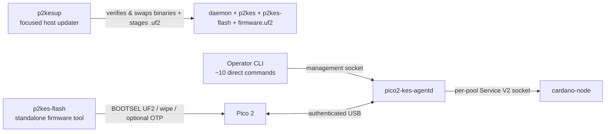

# Feature Specification: Simplify CLI, Daemon Lifecycle, and Software Updater

**Feature Branch**: `003-simplify-cli-updater`
**Created**: 2026-11-20
**Status**: Draft
**Input**: Redesign `pico2-kes-agent` around its core purpose—keeping Cardano stake-pool KES keys on a Pico 2 across power loss and serving them to `cardano-node`—by gutting the oversized `p2kesup` manager/TUI/host-hardening engine into a focused `ghcup`/`rustup`-style software updater, separating physical BOOTSEL firmware flashing into a standalone tool, collapsing the operator CLI from 18 ceremony-heavy subcommands down to ~10 direct commands (and 9-flag backup restore down to 4 inputs), fixing live daemon runtime bugs (dynamic pool polling, graceful shutdown, journal replay on reads, bounded journal growth, idle socket polling), and establishing a single canonical release-verification trust chain.

## Architecture & Redesign Summary

The existing wrapper/manager layer (`p2kesup` + bootstrap + firmware wrapper) grew larger than the core product itself because `p2kesup` combined six unrelated jobs—software updater, firmware/OTP flasher, host OS hardening manager, commissioning orchestrator, interactive terminal dashboard, and backup-host auditor—largely to hide a ceremony-heavy CLI. This redesign separates those concerns cleanly:

### Before vs. After Scope

| Layer | Current State | Redesigned State |
| --- | --- | --- |
| **Updater (`p2kesup`)** | 6 roles in one binary: release updater, mixed-component switcher, firmware/OTP orchestrator, `/etc/fstab` & `cardano-node` drop-in mutator, 14-screen terminal UI, backup-host `/proc` scanner | Focused `ghcup`/`rustup`-style updater (`install`, `update`, `uninstall`, `--version`): verifies signed release once, atomically swaps host executables, stages matching `firmware.uf2`, and prints the standalone firmware command if firmware changed |
| **Firmware flashing** | Intertwined with host upgrades via multi-step plans, systemd masking, and resume workflows | Separate, explicit standalone tool invoked by the operator during a planned maintenance window; daemon detects protocol mismatch on USB connect and prints remediation instructions |
| **Host hardening & config** | Privileged host-mutation engine editing swap, sleep targets, systemd units, and `cardano-node` drop-ins | Static, documented reference files (`pico2-kes-agentd.service`, udev rules, optional node memory-hardening drop-in, example config) applied by the operator with standard Linux tools |
| **Operator CLI** | 18 subcommands, 8 overlapping read commands with 2 pagination schemes, mandatory `--expected-revision`, `--receipt`, and `--incarnation` on writes, 9-flag `restore`, internal peer-PID flags | ~10 human-usable commands (mapped below); no terminal dashboard needed because the CLI itself is clear and direct |
| **Backup host** | Dedicated backup-host TUI mode with root `/proc` inspection | Offline `backup keygen` and `backup restore` commands on the isolated machine |

### Simplified CLI Command Mapping

| Target Command | Replaces |
| --- | --- |
| `status [POOL_ID] [--json]` | `status`, `host observe`, `device info`, `device security`, `device inventory`, `pool list`, `pool status`, `pool observe` |
| `commission [--serial HEX] [--out FILE]` | `device commission --usb-serial --expected-revision --receipt --out` |
| `pool add --cold-vkey FILE --network NAME` | `pool enroll --cold-vkey --network --expected-revision --receipt` |
| `pool rm POOL_ID [--yes]` | `pool delete --pool --incarnation --expected-revision --receipt --yes` |
| `key rotate POOL_ID --vkey-out FILE --backup-out FILE` | `key generate` + `key verification-key` + `key export` (3 commands → 1; standalone `key export` retained for re-export) |
| `key install-cert POOL_ID CERT_FILE` | `certificate install --pool --incarnation --generation --certificate --expected-revision --receipt` |
| `key discard POOL_ID [--yes]` | `key discard --pool --incarnation --generation --expected-revision --receipt --yes` |
| `reconcile` | `operation reconcile --receipt FILE` (daemon auto-reconciles from its own journal; no receipt file required) |
| `backup keygen --out FILE --public-out FILE` | `recipient create --out --public-out` |
| `backup set-recipient PUB_FILE` | `recipient set --public-key --expected-revision --receipt` |
| `backup restore --artifact FILE --key FILE --device-identity FILE --out FILE` | 9-flag `restore` (reads signed bindings from artifact and displays them for verification; optional assertion flags supported for scripts) |

## Clarifications

### Session 2026-11-20

- Q: Where should `p2kesup` install the host executables and staged firmware image? → A: System-wide (`/usr/local/bin` and `/usr/local/share/pico2-kes-agent`), run with `sudo` for install, update, and uninstall.
- Q: After `p2kesup update` atomically replaces the host binaries, how should it handle a running `pico2-kes-agentd` service? → A: Never restart automatically; swap files only and print the exact `systemctl restart` command for the operator to run when ready.
- Q: What executable name should operators type for the simplified CLI? → A: Rename the operator CLI binary to `p2kes` and remove `pico2-kes-agent-cli` (accompanied by a constitutional amendment).
- Q: How should the standalone firmware tool (flashing, board wipe, optional OTP lock) be delivered to operators? → A: Deliver as a native Rust standalone executable (`p2kes-flash`) sharing the canonical release/signature verifier with `p2kesup`, eliminating Python from the operator runtime (with hardware re-qualification of OTP/wipe paths).
- Q: After `p2kes backup restore` verifies the artifact's signature against `--device-identity` and displays the bound pool, incarnation, generation, and verification key, should it require an interactive confirmation before writing the plaintext KES key file? → A: Decrypt and write immediately once `--device-identity` signature verification passes, displaying the verified bindings in stdout (optional assertion flags still fail closed on mismatch).

## User Scenarios & Testing *(mandatory)*

### User Story 1 - Everyday KES Lifecycle Through a Simple Operator CLI (Priority: P1)

A stake pool operator manages their Pico 2 KES device directly from the command line without needing an interactive terminal dashboard or a separate wrapper tool. The operator can inspect overall device and pool health in one command, commission a blank device, enroll and remove pools, rotate a pool's KES key (producing both the public verification key and encrypted backup artifact in a single step), install a cold-signed operational certificate, and discard an unneeded staged key.

The operator never has to manually create or track per-command receipt files, pass pagination cursors for a bounded set of pools, or copy-paste redundant internal identifiers when only one active incarnation or staged generation exists for a pool.

**Why this priority**: The operator CLI is the primary human interface to the core product. Making the CLI clean, direct, and self-explanatory eliminates the root cause that led to the oversized terminal dashboard and wrapper layers.

**Independent Test**: Can be fully tested against a running service with an attached or simulated device by running the full lifecycle—commission, set backup recipient, add pool, rotate key, install certificate, inspect status, discard staged key, remove pool—using only the simplified command set and verifying each resulting state.

**Acceptance Scenarios**:

1. **Given** a running service with a commissioned device and 0 to 64 enrolled pools, **When** the operator runs the unified status command (optionally scoped to a single pool), **Then** the tool displays device identity, health, security posture, and all matching pool states in one response without pagination, supporting both human-readable and machine-readable output.
2. **Given** a running service with a configured backup recipient and an enrolled pool with no staged generation, **When** the operator runs the single key-rotation command for that pool with output paths for the verification key and encrypted backup, **Then** the device generates the new staged key, commits its encrypted backup, exports both files, and marks the generation eligible for automatic activation once certified—all in one operator action.
3. **Given** a pool with an active incarnation and a staged generation, **When** the operator installs a matching operational certificate or discards the staged generation by specifying only the pool identifier, **Then** the command resolves the pool's current incarnation and staged generation automatically and applies the change safely.
4. **Given** a mutation is interrupted mid-flight (such as a USB disconnect) leaving an uncertain outcome, **When** the operator checks status or runs reconciliation after reconnection, **Then** the service distinguishes the uncertain pending operation from a rejection, blocks conflicting new mutations until resolved, and reports the original operation's actual committed or rejected outcome without requiring a user-managed receipt file.
5. **Given** an operator deletes a pool or discards a staged generation interactively, **When** the command runs without an explicit confirmation flag, **Then** it prompts for confirmation describing the permanent effect before mutating device state.

---

### User Story 2 - Reliable Live Daemon Operations Across Pool Changes and Restarts (Priority: P1)

A stake pool operator enrolls a new pool or deletes an existing pool while the background service is running, and later restarts or stops the service during routine maintenance. Newly enrolled pools begin receiving active KES keys immediately without restarting the service, deleted pools stop being queried immediately, read-only status queries remain fast regardless of operation history length, and stopping the service lets in-flight management operations finish cleanly instead of aborting mid-write.

**Why this priority**: Correctness and operational reliability of the core background service are non-negotiable; runtime pool changes that silently fail to serve keys or shutdowns that interrupt USB writes directly endanger block production.

**Independent Test**: Can be tested independently by starting the service with zero configured pools, enrolling a pool at runtime, verifying a connected node receives the active key without restarting the service, deleting the pool and confirming polling stops, and issuing a shutdown signal while a management operation is active to confirm clean completion.

**Acceptance Scenarios**:

1. **Given** the service started with zero pools (or a subset of pools), **When** a new pool is enrolled and certified at runtime, **Then** the service begins polling the device for that pool and delivering its active KES key to connected node clients without requiring a service restart.
2. **Given** an enrolled pool is actively being polled, **When** that pool is deleted at runtime, **Then** the service closes its pool socket and stops polling that pool on the device immediately.
3. **Given** a management mutation is in progress when the service receives a stop signal, **When** the service shuts down, **Then** it stops accepting new requests, allows the in-flight management operation to complete within a bounded drain period, and exits cleanly.
4. **Given** a long-lived host with thousands of completed historical operations, **When** an operator runs read-only status or export commands, **Then** the service answers without replaying the entire operation history or rebuilding socket endpoints, and history storage is bounded through safe compaction or rotation so mutations are never permanently locked out.

---

### User Story 3 - Focused Software Updater Separate from Firmware Flashing (Priority: P2)

A stake pool operator uses a lightweight updater (`p2kesup`) to install, update, or remove the authenticated host software release—similar in scope to standard toolchain updaters. The updater verifies the signed release once using a single canonical verification path, installs or atomically replaces the host executables, and places the matching verified firmware image in a known local directory.

The updater does not launch an interactive terminal dashboard, does not edit unrelated host system configuration (such as swap tables, sleep targets, or node service units), does not maintain multi-component mixed-version installations, and does not attempt to drive physical microcontroller flashing inside a host software upgrade transaction.

**Why this priority**: Separating host software updates from physical firmware flashing and OS administration removes the primary source of architectural bloat, duplicated verification logic, and fragile multi-step recovery state machines.

**Independent Test**: Can be tested independently on a clean host by running `install`, verifying the installed binaries and staged firmware file, running `update` to a newer signed release, verifying atomic binary replacement and clear notification when firmware changed, and running `uninstall` to remove the managed software cleanly.

**Acceptance Scenarios**:

1. **Given** a supported Linux host without the software installed, **When** the operator runs the bootstrap or updater install command for a signed release, **Then** the updater verifies the release signature and integrity once, installs the host executables and matching firmware image, and prints the paths to reference deployment files.
2. **Given** an existing installation where a newer signed release is available, **When** the operator runs the update command, **Then** the updater verifies and atomically replaces the complete release tuple of host executables and updates the staged firmware image on disk.
3. **Given** an update includes a firmware version different from the previously staged firmware, **When** the host update completes, **Then** the updater clearly notifies the operator that new firmware is available and prints the exact standalone firmware-update command to run when ready.
4. **Given** the bootstrap script detects missing host prerequisites, **When** it asks the operator to approve installing them, **Then** it displays the exact proposed package changes to the operator before requesting confirmation.
5. **Given** an operator wants to remove the installed software, **When** they run the uninstall command, **Then** the managed executables and release artifacts are removed cleanly without touching unrelated host services or the operator's external backups.

---

### User Story 4 - Explicit, Standalone Firmware Installation and Update (Priority: P2)

An operator installs initial firmware onto a new Pico 2, updates firmware on an existing device during a planned maintenance window, or optionally applies hardware secure-boot lock using a dedicated, standalone firmware tool. Because flashing a Pico 2 requires physically holding the BOOTSEL button, firmware operations are explicit physical actions initiated by the operator rather than hidden steps inside a host software updater.

When the background service connects to a Pico 2 whose firmware protocol version is incompatible with the host software, the service refuses unsafe operations and clearly tells the operator which firmware version is present, which version is required, and how to update it.

**Why this priority**: Decoupling physical hardware flashing from host software updates eliminates service-masking deadlocks, resume-plan state machines, and accidental maintenance windows during routine host updates.

**Independent Test**: Can be tested independently by verifying a signed firmware image against a board, flashing a device via the standalone tool, and connecting a device with an older protocol version to confirm the service reports the mismatch and remediation command clearly.

**Acceptance Scenarios**:

1. **Given** a signed firmware image staged by the updater (or provided locally), **When** the operator runs the standalone firmware tool to verify and flash a Pico 2 in BOOTSEL mode, **Then** the tool verifies the firmware signature, confirms board compatibility, writes the image, and confirms the result without modifying host service configurations.
2. **Given** a commissioned Pico 2 is connected to a newly updated host service whose required protocol version does not match the device firmware, **When** the service probes the device, **Then** the service reports the exact version mismatch in status and logs and prints the standalone firmware update command without corrupting device state.
3. **Given** an operator chooses to apply optional hardware secure-boot lock or wipe an unlocked board, **When** they invoke the explicit standalone firmware tool command, **Then** the tool requires explicit attended confirmation describing irreversible effects and preserves all existing safety checks.

---

### User Story 5 - Streamlined Offline Backup Key Creation and Recovery (Priority: P3)

On an isolated backup host with no background service or Pico 2 attached, an operator creates a backup recipient keypair and later restores a KES signing key from an encrypted backup artifact. During restoration, the operator provides only the encrypted artifact, the recipient private key, the trusted public device identity record, and the output path. The tool verifies the artifact's origin signature against the trusted device identity, displays the authenticated pool, incarnation, generation, and verification key bound inside the artifact for confirmation, and writes the restored KES signing key to an owner-restricted file.

**Why this priority**: Disaster recovery happens under stress. Replacing nine error-prone hexadecimal command-line flags with verified artifact inspection preserves full cryptographic binding while making emergency recovery fast and reliable.

**Independent Test**: Can be tested completely offline without a daemon or hardware device by creating a recipient keypair, decrypting a test backup artifact using only the artifact, recipient private key, and trusted device identity file, and verifying the restored signing key matches the expected verification key and conventional format.

**Acceptance Scenarios**:

1. **Given** an isolated backup host with no service running, **When** the operator runs the backup key-generation command, **Then** it creates a passphrase-protected private recipient file and a separate public recipient file suitable for transfer to the primary host.
2. **Given** an encrypted backup artifact, the matching recipient private key, and the trusted public device identity file, **When** the operator runs the restore command, **Then** the tool validates the artifact's signature against the trusted device identity, displays the authenticated device, pool, incarnation, generation, and verification key, and writes the verified KES signing key to a new owner-restricted file without clobbering existing files.
3. **Given** a forged or tampered backup artifact whose signature does not match the trusted device identity, **When** the operator runs the restore command, **Then** restoration fails closed before decryption and writes no output file.
4. **Given** a scripted restore caller that wants to assert specific expected pool or generation identifiers, **When** those optional assertion flags are provided and disagree with the artifact, **Then** restoration fails closed without writing output.

---

### Edge Cases

- **Concurrent CLI mutations**: Two operator commands attempt to mutate device state at the same time. The daemon serializes mutations, rejects a stale optional `--expected-revision` if supplied, and never interleaves two USB writes.
- **Ambiguous pool state during implicit resolution**: If a pool has no staged generation when `install-cert` or `discard` is called, or already has a staged generation when `rotate` is called, the command fails explicitly with a clear message instead of overwriting or guessing.
- **Interrupted mutation followed by immediate retry**: If a USB disconnect occurs mid-mutation, the daemon retains the pending operation in its journal, blocks new mutations until reconciliation completes, and returns the original operation's reconciled outcome rather than issuing a duplicate mutation.
- **Partial backup/export failure during combined key rotation**: If key generation succeeds on the device but writing the local verification key or encrypted backup file fails (e.g., disk full or existing file at `--out`), the generated staged key and its encrypted artifact remain retrievable via a standalone export command without regenerating a new key.
- **Daemon running with 64 pools at idle**: Idle resource consumption remains low without spawning a busy-polling thread per pool.
- **Interrupted host binary update**: Replacing host binaries uses atomic staging and rename so a crash mid-download or mid-copy never leaves half-written executables in place.
- **Migrating from the previous `p2kesup` installation**: Operators with an existing installation have a clear, documented migration path to the simplified updater and CLI without losing their commissioned Pico 2 state, pool enrollments, or existing `/etc/pico2-kes-agent/config.json`.

## Requirements *(mandatory)*

### Functional Requirements

#### Core CLI Simplification
- **FR-001**: The operator CLI MUST consolidate all read-only device, security, inventory, and pool inspection operations into a single unified status command that supports optional scoping to one pool and both human-readable and machine-readable JSON output, without requiring pagination cursors for the supported 64-pool maximum.
- **FR-002**: The operator CLI MUST provide a concise set of core lifecycle commands covering: status, device commissioning, pool add/remove, key rotation (generate + export verification key and encrypted backup), standalone key/backup re-export, certificate installation, staged key discard, operation reconciliation, and offline backup keygen/recipient-set/restore.
- **FR-003**: For interactive operator use, mutation commands MUST NOT require the user to manually supply a state revision number or a local receipt file path; the CLI MUST still accept an optional expected-revision guard for automated scripts.
- **FR-004**: Commands targeting an enrolled pool (`pool remove`, `key rotate`, `key export`, `certificate install`, `key discard`) MUST resolve the pool's current active incarnation and (where applicable) current staged generation automatically when unambiguous, while still verifying explicit pool and generation identities on the device protocol to prevent substitution.
- **FR-005**: The key-rotation command MUST generate a new staged generation, retrieve its verification key and encrypted backup artifact, and write both to operator-specified non-clobbering paths in a single command; if local file output fails after device generation, the operator MUST be able to re-export the verification key and artifact without regenerating.
- **FR-006**: Destructive commands (pool removal and staged key discard) MUST require explicit confirmation (interactive prompt or explicit confirmation flag) stating the irreversible device-side effect.
- **FR-007**: The CLI MUST remove internal-only peer-process authentication flags that existed solely for the legacy terminal manager.

#### Daemon Runtime Correctness & Efficiency
- **FR-008**: The background service MUST dynamically update its active polling set whenever pools are enrolled or deleted at runtime, including when the service starts with zero configured pools, without requiring a service restart.
- **FR-009**: The background service MUST handle shutdown signals cleanly by stopping new request intake, allowing in-flight management operations to complete within a bounded timeout, and avoiding daemon termination on transient per-connection errors.
- **FR-010**: Read-only management requests MUST NOT replay the full operation journal or reconcile socket endpoints; endpoint reconciliation MUST run only when pool membership changes.
- **FR-011**: The service MUST manage its durable operation journal with bounded growth (compaction or rotation that preserves active pool bindings and any pending operation) so long-lived installations cannot permanently hit a hard storage ceiling.
- **FR-012**: While idle with up to 64 configured pools, the background service MUST avoid periodic per-pool busy-polling so idle CPU wakeups remain minimal.
- **FR-013**: When a connected device's firmware protocol version is incompatible with the service, the service MUST fail closed for unsafe operations and report the observed version, required version, and standalone firmware update instruction.

#### Updater & Firmware Separation
- **FR-014**: The updater (`p2kesup`) MUST be scoped exclusively to installing, updating, and uninstalling authenticated host software releases into system-wide paths (`/usr/local/bin` for executables and `/usr/local/share/pico2-kes-agent` for the staged signed firmware image and reference deployment files, invoked with `sudo`) and reporting installed versions.
- **FR-015**: Release signature and integrity verification MUST be implemented once as a single canonical trust chain with one source of truth for pinned signing authorities, eliminating duplicated verification logic across bootstrap, updater, and firmware tools.
- **FR-016**: The updater MUST install and update complete release tuples atomically and MUST NOT support partial mixed-version component installations.
- **FR-017**: The updater MUST NOT include an interactive terminal UI dashboard, MUST NOT start/stop/restart systemd services (after updating, it prints the exact `systemctl restart` command for the operator), MUST NOT mutate unrelated host OS configuration (swap, `/etc/fstab`, sleep targets, or `cardano-node` systemd units), and MUST NOT execute physical microcontroller firmware flashing as part of a host software update.
- **FR-018**: The bootstrap installer MUST display any proposed system package changes to the operator before asking for confirmation to install prerequisites.
- **FR-019**: Reference deployment artifacts (systemd service unit, udev rules, optional node memory-hardening drop-in, and example configuration file) MUST be shipped as static, documented files rather than generated by a privileged host-mutation engine.
- **FR-020**: Firmware verification, BOOTSEL flashing, optional board wipe, and optional hardware OTP secure-boot provisioning MUST be delivered as a native standalone executable (`p2kes-flash`) independent of the host software updater, sharing the single canonical release/signature verifier, removing Python as an operator host runtime dependency, and preserving (with hardware re-qualification) all existing hardware and cryptographic safety checks.

#### Offline Backup & Recovery
- **FR-021**: Offline backup restoration MUST operate without a running service or connected device, requiring only the encrypted backup artifact, the recipient private key, the trusted public device identity record, and the output path.
- **FR-022**: Before decrypting and writing a restored KES key, the restore command MUST verify the artifact's origin signature against the trusted device identity, fail closed if any optional caller-supplied assertion flag disagrees, and upon passing verification decrypt, write the owner-restricted file immediately, and display the authenticated device, pool, incarnation, generation, and verification key in output.

#### Compatibility, Removal, and Migration
- **FR-023**: Obsolete legacy manager code (interactive terminal dashboard, privileged multi-action host-mutation engine, mixed-component update paths, and unused UI dependencies) MUST be removed rather than retained behind compatibility shims.
- **FR-024**: All existing core security invariants—USB identity pinning, on-device key generation, forward-only KES evolution, 64-pool capacity, recipient-encrypted backup format, and KES Service V2 node-socket compatibility—MUST remain intact without breaking existing commissioned devices or backups.
- **FR-025**: The release MUST document a clear migration path from the legacy `p2kesup` installation and `pico2-kes-agent-cli` syntax to `p2kes` and the simplified updater without requiring device re-commissioning or pool re-enrollment, and include the accompanying constitutional amendment for the CLI rename.

### Key Entities

- **Release Tuple**: A single versioned, cryptographically signed distribution bundle containing the matching host executables (`pico2-kes-agentd`, `p2kes`, `p2kesup`, `p2kes-flash`), the signed Pico 2 firmware image, and static reference deployment files.
- **Pool Binding**: The association between an enrolled stake pool identifier, its current active incarnation, its configured Cardano network, and its dedicated KES Service V2 Unix socket.
- **Operation Journal**: The daemon's durable, checksummed record of pending and committed device mutations, used to reconstruct live pool bindings and automatically reconcile interrupted operations without user-managed receipt files.
- **Backup Artifact**: An immutable, device-signed, recipient-encrypted period-zero KES state package containing self-describing authenticated metadata (device, pool, incarnation, generation, verification key) verified against a trusted public device identity record.

## Success Criteria *(mandatory)*

### Measurable Outcomes

- **SC-001**: An operator can perform a complete pool KES rotation (generate key, export verification key and encrypted backup, install certificate) in **2 CLI commands** instead of 4+ commands with manual revision and receipt flags.
- **SC-002**: An operator can inspect complete device and pool status (up to 64 pools) in **1 command** (down from 8 separate read commands), with zero pagination steps.
- **SC-003**: An operator can restore an offline backup artifact by supplying **4 required inputs** (artifact, recipient key, trusted device identity, output path) instead of 9 required flags, with 100% cryptographic origin and binding verification preserved.
- **SC-004**: Enrolling a new pool on a running service delivers an active KES key to a connected node **without restarting the service**, in under 10 seconds after certification.
- **SC-005**: Read-only status response time remains constant (under 100 ms locally) regardless of whether the operation journal has 10 or 10,000 completed entries, and idle daemon wakeups across 64 pools drop from >1,000 wakeups/second to near-zero (<5 wakeups/second when no clients connect).
- **SC-006**: The host management and updater footprint is reduced by at least **85%** (removing the terminal UI, 24-action host-mutation engine, and duplicated upgrade/verification paths), leaving a single canonical release-verification trust chain.
- **SC-007**: All existing core invariants—64-pool capacity, power-loss recovery, KES Service V2 node compatibility, and byte-exact offline backup recovery—continue to pass 100% of applicable verification gates with zero regressions.

## Assumptions

- **CLI Binary Name**: The operator CLI is renamed to `p2kes` (formerly `pico2-kes-agent-cli`) with no compatibility shim; the required constitutional amendment will be ratified before implementation acceptance.
- **Target Operator Profile**: Operators running Cardano stake pool block producers on Debian/Ubuntu Linux are comfortable using standard Linux tools (`systemctl`, editing a small JSON configuration file, managing swap/hibernation) when given clear static unit files and documentation.
- **Single-Tuple Releases**: Every published release ships one tested, compatible tuple of daemon, CLI, updater, and firmware; mixing components from different releases is explicitly out of scope.
- **Existing Hardware & Protocol Compatibility**: Existing commissioned Pico 2 devices, on-device flash storage format, USB protocol v1, KES Service V2 node socket protocol, and encrypted backup artifact format remain unchanged by this redesign; only the host-side CLI, daemon runtime behavior, updater, and deployment model are simplified.
- **Scope Boundary**: Adding new cryptographic algorithms, changing on-device flash storage layout, adding remote/network management, or introducing an HSM/remote-signing model are explicitly out of scope.
